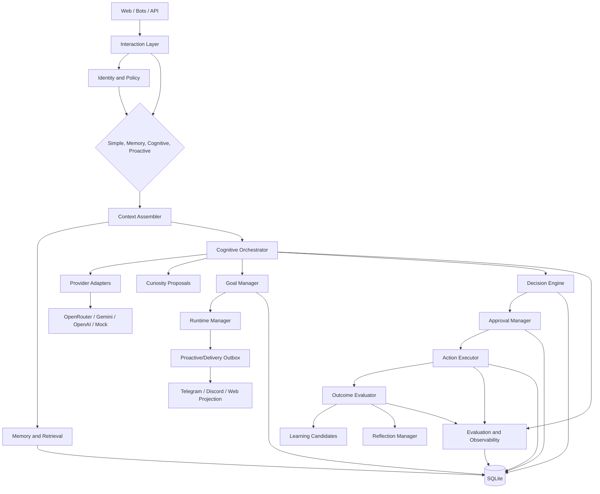
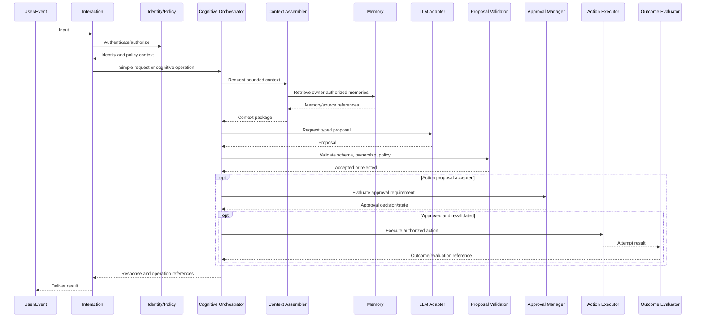

# Lucy Personal AI — Phase 1 / Step 6: Final Technical Specification

**Revision date:** 2026-11-23 (Cycle 19)
**Mode:** Final design consolidation; no implementation authorization
**Authority:** Owner-accepted Phases 0 and Steps 1–5; current code determines implementation; this specification determines proposed Phase 2 blueprint only after owner acceptance.
**Current status:** PHASE 1 STEP 6 — REVISION DRAFTED — PENDING INDEPENDENT REVIEW

## 1. Authority, Status, and Evidence Rules

### 1.1 Authority order

1. Explicit owner decisions/approvals.
2. Latest accepted design and amendments within their stated scope.
3. Earlier accepted design where later amendment does not replace it.
4. Current source for implementation behavior.
5. Current tests/results for tested behavior only.
6. Historical reports and context for historical claims.
7. Agent inference is not authority.

Conflicts must be stated, not silently resolved. “FINAL” in a filename alone does not establish authority.

### 1.2 Evidence labels

- **IMPLEMENTED:** code exists.
- **CURRENTLY VERIFIED:** current source or fresh test output supports claim.
- **HISTORICAL REPORT / TEST RESULT:** prior evidence, not a current run.
- **OWNER ACCEPTED:** explicit owner status provided.
- **INDEPENDENTLY REVIEWED:** reviewer status provided.
- **PROPOSED:** target design, not implemented.
- **DEFERRED:** intentionally postponed.
- **UNKNOWN / REQUIRES VERIFICATION:** evidence missing.
- **NOT STARTED:** no implementation performed.

One capability can be implemented, verified, and owner-accepted independently or not.

### 1.3 Normative Scope and Governance Applicability

Within this document, sections, algorithms, and tables designated as **normative** define the intended internal technical requirements and decision logic of the proposed Step 6 blueprint. This internal normative designation ensures that the design is self-consistent and mathematically auditable.

However, normative language within this proposed blueprint MUST NOT be misconstrued as owner acceptance or implementation authorization:
1. **Scope within Proposed Blueprint:** Normative statements (such as `MUST`, `REQUIRED`, `CANONICAL`) are binding for the internal consistency of this proposed specification only.
2. **Owner Acceptance Boundary:** A normative rule inside this proposed specification does NOT independently signify that:
   - The project owner has accepted proposed decisions D-12 through D-15 (including the D-14 privacy-deletion proposal);
   - Any proposed architectural change or schema has been approved;
   - Implementation has been authorized;
   - Current codebase already implements this behavior; or
   - Any automated or manual test has passed.
   Owner-accepted architecture remains strictly bounded by Phase 0, Phase 1 Steps 1–5 (Step 5 R6 approved 2026-11-16), and decisions D-01 through D-11.
3. **Prerequisites for Implementation:** Moving any proposed design into implementation strictly requires four distinct governance gates:
   - (a) Independent technical review of Step 6 with zero unresolved P1 findings;
   - (b) Explicit owner acceptance of Step 6;
   - (c) Explicit owner disposition (ACCEPT / REJECT / DEFER) of proposed decisions D-12 through D-15; and
   - (d) Separate, explicit owner authorization to commence Phase 2.
   Phase 2 implementation remains strictly **NOT STARTED — NO IMPLEMENTATION AUTHORIZATION**.

## 2. Project and Accepted Constraints

Lucy is a personal AI intended to develop as a Hybrid Cognitive System. Target cognition is implementable software behavior, not a claim of consciousness.

### LLM authority

LLM interprets, reasons, and proposes hypotheses, alternatives, questions, goals, decisions, reflections, evaluation suggestions, and memory/action proposals.

### Backend authority

Backend owns identity, policy, context, memory, authoritative state, validation, permissions, approval, task/action lifecycle, execution, outcomes, retry/recovery, privacy, and evaluation integrity.

**LLM proposes; backend validates and owns state.** No direct privileged action or authoritative mutation from raw LLM output.

### Technical constraints

- Windows 10; Intel i5-3470; 12 GB RAM; no discrete GPU.
- Node.js, Express, ESM, React, Vite, SQLite, `better-sqlite3`, legacy JSON compatibility.
- OpenRouter, Gemini, OpenAI, Mock.
- External inference; lightweight local backend; bounded concurrency/context/API costs.
- SQLite stays primary. No Redis, PostgreSQL, Kafka, vector database, or microservices without concrete evidence and owner approval.
- Modular monolith, incremental extensions, preserve Phase 0.

## 3. Acceptance and Implementation Status

| Work | Status |
|---|---|
| Phase 0 — Task 01B | OWNER ACCEPTED |
| Phase 1 — Step 1 | OWNER ACCEPTED |
| Phase 1 — Step 2 R1–R4 | OWNER ACCEPTED |
| Phase 1 — Step 3 | OWNER ACCEPTED |
| Phase 1 — Step 4 R1–R4.4 | OWNER ACCEPTED |
| Phase 1 — Step 5 R6 | OWNER ACCEPTED (2026-11-16) |
| Phase 1 — Step 6 | PHASE 1 STEP 6 — REVISION DRAFTED — PENDING INDEPENDENT REVIEW |
| Phase 2 — Implementation | NOT STARTED — NO IMPLEMENTATION AUTHORIZATION |

Phase 0 R14E historical result: 96 passed, 0 failed, `NODE_EXIT_CODE=0`. This was not re-run for Step 6.

## 4. Current Architecture and Evidence Baseline

### 4.1 Current components

Current paths inspected or identified in prior audits; this documentation-only revision did not re-audit source behavior:

- `backend/src/app.js`: Express middleware and route composition; initializes HTTP handler tracking.
- `backend/src/server.js`: startup, HTTP closure, handler waiting, scheduler/service drain, conditional SQLite close.
- `backend/src/services/ai/aiService.js`: provider choice, prompt construction, memory processing, response call.
- `backend/src/services/memory/memoryService.js`: core/user/temporary memory, extraction and validation.
- `backend/src/services/memory/chatHistoryService.js`: actual chat history path (not under `services/ai/`).
- `backend/src/services/ai/proactiveThoughtService.js`: proactive eligibility/generation/scheduler/dispatch coordination.
- `backend/src/services/ai/proactiveOutbox.js`: durable proactive state and channel dispatch.
- `backend/src/storage/sqliteStorage.js`: `documents` table, WAL, busy timeout, document transactions.
- `backend/src/storage/jsonStorage.js`: legacy JSON compatibility backed by SQLite.
- `backend/src/middlewares/auth.middleware.js`, `role.middleware.js`: authentication and role authorization.
- `backend/src/services/reminder/reminderService.js`: persisted reminders and timer-based dispatch.

Current source has no established Cognitive Orchestrator, general goal lifecycle, human approval workflow for cognitive actions, structured cognitive trace store, general outcome evaluator, or reflection/learning engine. Target modules below remain PROPOSED.

### 4.2 Current chat behavior

`chat.controller.js` loads recent chat history, updates proactive activity, calls `aiService.generateReply()`, then appends the assistant reply. `aiService` processes memory actions, reloads core/user memory, builds the system prompt, calls provider, and returns cleaned text. This is implemented AI orchestration, not a structured multi-stage reasoning record.

### 4.3 Current memory behavior

SQLite `documents(key,value,updated_at)` holds JSON values. `memoryService` supports core, user, temporary memory, extraction, updates/deletes and sensitive-marker filtering. `chatHistoryService` stores bounded recent conversations. No normalized memory tables, semantic ranking, general provenance/verification/version history, or conflict-resolution engine are implemented.

### 4.4 Current proactive and reminder behavior

Proactive outbox is durable, channel-specific, deduplicated, leased, and retried with bounded attempts. It remains delivery infrastructure. Current proactive history insertion happens before channel acceptance. In-app notifications use process memory and are not restart-durable.

`reminderService.js` removes due reminders before asynchronous dispatch. A later dispatch failure may lose the reminder. This is a limitation reported by prior static audit, not independently re-verified during Review Cycle 5; durable reminder handoff is PROPOSED, not implemented.

External Telegram/Discord provider acceptance does not prove user read and does not guarantee exactly-once delivery.

### 4.5 Historical test evidence

R14E reported 96 tests passed, 0 failed, exit code 0. It is HISTORICAL TEST RESULT, not a fresh Step 6 test run.

`backend/test/r10ConcurrencyVerification.test.js` and `docs/lucy-development/PROACTIVE_RELIABILITY_R10_VERIFICATION.md` describe physical-file SQLite and forked-process tests. They were not rerun here.

### 4.6 Historical source and Git snapshot (historical baseline, unverified at Cycle 19)

- Inspected Git HEAD: `98063c4e31217b13971478c5a151282b7ff61bca` (`Harden proactive reliability and shutdown lifecycle`).
- Initial and final repository status: `?? docs/architecture/`; architecture documents are untracked in Git. `git diff` therefore does not represent their content changes.
- Tracked source diff at inspection: none. This identifies repository state only; it does not independently verify current source behavior.
- Source claims in Sections 4.1–4.5 remain based on prior source audits and historical reports unless explicitly stated otherwise. No full source audit or test run was performed for Cycle 19. Exact date/cycle of the initial source snapshot remains historical context.

## 5. Target System Architecture

### 5.1 Module responsibility matrix

| Module/boundary | Responsibility | Inputs → Outputs | Authoritative state | Current status | Permission/failure boundary |
|---|---|---|---|---|---|
| Interaction Layer | HTTP/UI/bot input and response transport | Request/event → normalized envelope/response | None | IMPLEMENTED partially (`app.js`, controllers, bots) | Authenticate/validate; return safe errors |
| Identity & Policy | Resolve caller, owner, role, policy | Credentials/context → identity/policy | Auth identity/config | IMPLEMENTED for route roles | Authorization is not per-action human approval |
| Memory subsystem | Validate, retrieve, persist memory | Candidate/query → record/reference | SQLite-backed documents today; normalized model PROPOSED | IMPLEMENTED baseline; target EXTEND | Owner scope, provenance, sensitivity, conflict checks |
| Context Assembler | Build bounded context | Input + memory/history/goal refs → context package | No durable authority | PROPOSED | Access-filter every source; budget context |
| Cognitive Orchestrator | Coordinate cognitive operation | Input/context → typed proposals and result refs | Operation state (future) | PROPOSED | LLM output remains non-authoritative |
| LLM adapters | Normalize provider calls/results | Typed request → provider result/error | None | IMPLEMENTED provider classes, EXTEND contract | Timeouts, budgets, output parsing; no direct tools |
| Curiosity Engine | Propose questions from knowledge gaps | Context/gaps → curiosity proposal | Curiosity state (future) | NOT IMPLEMENTED | Relevance/frequency/privacy validation |
| Goal Manager | Goal lifecycle and progress | Proposals/events → goal state | Goal records (future) | NOT IMPLEMENTED; reminders are not goals | Owner scope, transition validation |
| Decision Engine | Compare options, evidence, risks, expected outcomes | Context/proposals → decision record | Decision record (future) | NOT IMPLEMENTED | Cannot execute action |
| Approval Manager | Record explicit human decisions | Approval request → approved/rejected/expired | Approval record (future) | NOT IMPLEMENTED | Role authorization alone is insufficient |
| Action Executor | Execute validated side effects | Authorized action → attempt/result | Action/attempt records (future) | Integrations exist; common boundary NOT IMPLEMENTED | Revalidate permission, idempotency, limits |
| Outcome Evaluator | Compare expected and observed outcomes | Decision/action refs + results → outcome | Outcome record (future) | NOT IMPLEMENTED | Unknown stays unknown; no false success |
| Learning Manager | Create evidence-aware learning candidates | Outcomes/corrections → candidates | Candidate records (future) | NOT IMPLEMENTED | No automatic core identity/policy edits |
| Reflection Manager | Evaluate prior behavior/outcomes | Trace/outcome/evaluation refs → reflection proposal | Reflection history (future) | NOT IMPLEMENTED | Evidence-based; not self-themed chat |
| Runtime Manager | Schedule, queue, resume, cancel, recover operations | Events/deadlines → operation state | Operation/task state (future) | Partial runtime exists in reminders/proactive | Bounded concurrency, lease/recovery, kill switch |
| Proactive Outbox | Durable channel delivery | Logical message/target → dispatch attempts | Existing proactive SQLite tables | IMPLEMENTED for proactive delivery | Not universal task/goal engine |
| Evaluation & Observability | Structured traces, quality/regression metadata | Stage events/results → evaluation metadata | Future evaluation history | Logs/tests exist; cognitive evaluator NOT IMPLEMENTED | Minimize/redact; no private chain-of-thought |
| Persistence | SQLite transactions and compatibility | Domain operations → durable records | SQLite | IMPLEMENTED documents/outbox; normalized memory PROPOSED | Short transactions; FK checks; backups deferred |

### 5.2 Overall architecture diagram



### 5.3 Minimal Module Communication Contracts

Proposed conceptual metadata contracts establishing minimum communication boundaries between cognitive modules before Phase 2. These define architectural shape without requiring premature code or concrete interface implementations.

#### 5.3.1 Reasoning Proposal

LLM-proposed payload: `proposal_type`, `schema_version`, `payload`, proposed evidence references, uncertainty metadata, model-output metadata, correlation hint. Backend-generated envelope: `proposal_id`, `operation_id`, authenticated owner scope, schema/evidence validation results, authoritative creation time, persistence result, lifecycle.
```text
LLM payload: proposal_type, schema_version, payload, proposed_evidence_references, uncertainty_metadata, model_output_metadata, correlation_hint
Backend envelope: proposal_id, operation_id, owner_scope, validation_results, created_at, persistence_result, lifecycle
```

#### 5.3.2 Memory Mutation Proposal

LLM-proposed payload: target memory reference, proposed change, provenance/evidence references, rationale summary. Backend-generated envelope: `candidate_id`, authenticated owner scope, target/evidence existence and ownership validation, sensitivity/conflict result, approval requirement, created time, persistence result.
```text
LLM payload: target_memory_reference, proposed_change, provenance_references, proposed_evidence_references, rationale_summary
Backend envelope: candidate_id, owner_scope, target/evidence_validation, sensitivity_conflict_result, approval_requirement, created_at, persistence_result
```

#### 5.3.3 Decision Proposal

LLM/module-proposed payload: alternatives, evidence references, risk hints, expected outcome, uncertainty metadata. Backend-generated envelope: `decision_id`, `operation_id`, authenticated owner scope, evidence/policy validation, authoritative risk classification, creation time, persistence and lifecycle.
```text
LLM payload: proposed_alternatives, proposed_evidence_references, proposed_risk_hints, expected_outcome, uncertainty_metadata
Backend envelope: decision_id, operation_id, owner_scope, evidence_policy_validation, authoritative_risk, created_at, persistence_result, lifecycle
```

#### 5.3.4 Action Proposal

LLM-proposed payload: action type, proposed target/resource scope, requested parameters, idempotency hint, risk hint. Backend-generated envelope: `action_id`, `operation_id`, authenticated owner scope, normalized resource, permission result, authoritative risk classification, approval requirement/status, attempt/claim references, creation time, persistence and lifecycle.
```text
LLM payload: action_type, proposed_target_scope, requested_parameters, idempotency_hint, risk_hint
Backend envelope: action_id, operation_id, owner_scope, normalized_resource, permission_result, authoritative_risk, approval_requirement/status, attempt_claim_reference, created_at, persistence_result, lifecycle
```

#### 5.3.5 Approval Request

Proposal-originated request may describe requested action and rationale only. Backend-generated envelope: `approval_id`, `operation_id`, `action_id`, authenticated owner scope, policy-derived requirement and scope, expiry, status, decision timestamp, and explicit human decision record. LLM cannot set approval status or requirement.
```text
LLM payload: requested_action_reference_hint, rationale_summary
Backend envelope: approval_id, operation_id, action_id, owner_scope, policy_requirement, approved_scope, expires_at, approval_status, human_decision_at
```

#### 5.3.6 Outcome Record

Observed-result claims/evidence may originate from provider or module but remain untrusted until validated. Backend-generated envelope: `outcome_id`, decision/action references, validated expected/observed result, evidence validation, result status, evaluation time, owner scope, persistence result.
```text
Untrusted observation: observed_result_claim, proposed_evidence_references
Backend envelope: outcome_id, decision_id, action_id, validated_expected_observed_result, evidence_validation, result_status, evaluated_at, owner_scope, persistence_result
```

#### 5.3.7 Learning Candidate

LLM/module-proposed payload: proposed update, evidence/outcome references, uncertainty/confidence hints. Backend-generated envelope: `candidate_id`, authenticated owner scope, evidence/outcome validation, validation status, approval requirement, creation time, persistence result and lifecycle.
```text
LLM payload: proposed_update, proposed_evidence_references, proposed_outcome_references, uncertainty_confidence_hints
Backend envelope: candidate_id, owner_scope, evidence_outcome_validation, validation_status, approval_requirement, created_at, persistence_result, lifecycle
```

#### 5.3.8 Field-level module authority matrix

| Field / Field category | Authoritative entity | Authority and validation rules |
|---|---|---|
| Proposal payload | LLM / module proposal | Untrusted proposal body; must pass strict schema validation |
| Alternatives and hypotheses | LLM proposal, backend validated | Proposed candidate options; backend validates structural sanity and policy constraints |
| Evidence references | Proposed references, backend verified | Proposed by LLM; backend strictly validates existence, tamper integrity, and owner scope |
| Owner ID / owner scope | Backend only | Derived strictly from authenticated session/caller context; LLM claims of owner scope are ignored |
| Permission result | Backend only | Evaluated strictly by backend policy engine based on caller identity and target resource |
| Validation result | Backend only | Deterministic schema and business rule validation performed strictly by backend validators |
| Approval requirement | Backend policy engine only | Computed authoritatively by backend risk policies; LLM cannot alter or bypass approval rules |
| Approval status | Approval Manager only | Recorded exclusively by Approval Manager from explicit human decision (`approved`, `rejected`, `expired`) |
| Risk classification | Backend authoritative classification | Backend sets authoritative risk level; LLM risk hints/scores are purely advisory metadata |
| Operation / action lifecycle | Backend only | Operational state transitions (`queued`, `running`, `completed`, `failed`) owned exclusively by backend |
| Created / decision timestamps | Backend UTC wall clock | Persisted authoritative timestamps use UTC wall-clock time. Monotonic clock is for in-process elapsed duration/timeout only; LLM timestamps are ignored. |
| Learning validation status | Backend only | Learning Manager and human review determine whether candidate updates are accepted |
| Authoritative persistence result | Backend only | Database transactions and repository boundaries establish whether any record is committed |

#### 5.3.9 Proposal Envelope and Backend Decision Metadata

Each artifact separates untrusted proposal content from authoritative backend metadata. Backend allocates authoritative `proposal_id`, `candidate_id`, `decision_id`, `action_id`, `approval_id`, `outcome_id`, and `operation_id`. LLM-provided IDs or ownership are correlation hints only and never identities or authorization.

**Proposal Envelope (LLM/module may propose):**

```text
proposal_payload
proposal_type
proposed_alternatives
proposed_risk_hints
proposed_evidence_references
uncertainty_metadata
model_output_metadata
correlation_hint
```

**Backend Decision Metadata (backend creates/decides):**

```text
backend_proposal_id
operation_id
authenticated_owner_scope
schema_validation_result
evidence_validation_result
authoritative_risk_classification
permission_result
approval_requirement
approval_status
authoritative_created_at
persistence_result
claim_or_execution_reference
```

| Contract | Proposal-originated fields | Backend-enriched metadata | Backend authority |
|---|---|---|---|
| Reasoning Proposal | proposal type/payload, alternatives/hypotheses, risk hints, evidence refs, uncertainty, model metadata, correlation hint | schema/evidence validation, operation linkage, created time | proposal ID, owner, persistence, lifecycle |
| Memory Mutation Proposal | target reference, proposed change, provenance/evidence refs, rationale summary | ownership and source verification, conflict/sensitivity validation | candidate ID, validation, approval requirement, memory write |
| Decision Proposal | alternatives, evidence refs, risks as hints, expected outcome, uncertainty | evidence scope/existence validation, policy checks | decision ID, authoritative risk class, lifecycle/persistence |
| Action Proposal | action type, target/parameters, idempotency hint, risk hint, correlation hint | permission/resource validation, idempotency assessment | action ID, owner, approval requirement/status, execution and attempt state |
| Approval Request | requested action/scope and reason | authenticated owner and policy evaluation | approval ID, scope, requirement, status from explicit human decision, timestamps |
| Outcome Record | observed-result claims and evidence refs | provider/reconciliation evidence validation, expected-vs-observed evaluation | outcome ID, result status, evaluation time, persistence |
| Learning Candidate | proposed update, evidence/outcome refs, uncertainty/confidence hints | owner/evidence validation, quality and safety validation | candidate ID, validation status, approval requirement, persistence |

Conceptual example (shape only; placeholder values are not production IDs/statuses):

```json
{
   "proposal": {
      "proposal_type": "action",
      "proposal_payload": { "action_type": "...", "requested_parameters": {} },
      "proposed_evidence_references": [],
      "proposed_risk_hints": ["..."],
      "correlation_hint": "model-local-reference"
   },
   "backend": {
      "proposal_id": "backend-generated-id",
      "operation_id": "backend-generated-id",
      "authenticated_owner_scope": "session-derived",
      "schema_validation_result": "backend-result",
      "evidence_validation_result": "backend-result",
      "authoritative_risk_classification": "backend-policy-result",
      "permission_result": "backend-policy-result",
      "approval_requirement": "backend-policy-result",
      "approval_status": "backend-managed",
      "authoritative_created_at": "backend-clock",
      "persistence_result": "backend-transaction-result"
   }
}
```

Raw proposal fields are untrusted. Backend alone validates evidence existence and owner scope, sets ownership, permissions, risk classification, approval requirements/status, authoritative timestamps and lifecycle, and decides persistence/execution. Proposals become no durable authoritative state until backend validates and persists them through authorized repository boundaries. No private chain-of-thought is included.

#### 5.3.10 Trust boundary and privacy invariants

1. **Untrusted input:** Raw LLM output is strictly untrusted data.
2. **Authoritative backend ownership:** Backend authoritative code alone establishes `owner_id` / owner scope, validates permissions and caller roles, computes approval requirements, enforces schemas and execution limits, controls operation and action lifecycles, and decides whether any proposal may be persisted or executed.
3. **No self-granted authority:** Never trust `owner_id`, approval status, role permissions, or authoritative state markers simply because they appear in LLM text output. Specifically:
   - LLM may provide advisory risk hints, but cannot assign authoritative risk classifications.
   - LLM cannot specify or modify its own approval requirements to circumvent policy.
   - LLM cannot claim or self-certify that an approval has been granted.
   - Any owner scope returned in LLM output is treated as untrusted metadata and overridden by session identity.
   - All proposed evidence references must be validated by backend to verify existence and confirm they reside within the authenticated owner's scope.
   - All authoritative timestamps are stamped by backend system time.
   - Proposals never become durable authoritative state merely because the LLM generated them.
4. **Privacy minimization:** Minimal module contracts omit private chain-of-thought (CoT) traces by default; only structured references, validation summaries, and minimized error/uncertainty descriptors are propagated. Concrete schema implementations remain deferred to respective Phase 2 work packages.

**Global timestamp authority:** Persisted authoritative timestamps and deadlines use backend UTC wall-clock time with explicit semantics. Monotonic clocks measure in-process elapsed durations/timeouts only; monotonic values are never persisted as cross-restart deadlines or compared as UTC. LLM-generated timestamps are untrusted metadata, never authority. Any contract exposing a time must identify source and meaning; provider dispatch fields follow Section 8.1.

## 6. Final Cognitive Pipeline

These paths are distinct. Not every request creates durable operation state.

### 6.1 Simple conversation

```text
Input
→ Identity/Policy
→ Bounded Context
→ Basic Memory Retrieval
→ LLM Response
→ Delivery
```

No mandatory hypothesis generation, uncertainty evaluation, decision engine, action executor, or durable cognitive operation. Use minimum provider calls and context budget.

### 6.2 Cognitive operation

```text
Input/Event
→ Identity/Policy
→ Context
→ Memory Retrieval
→ Reasoning Proposal
→ Uncertainty/Knowledge-Gap Metadata where needed
→ Proposal Validation
→ Decision
→ Approval if required
→ Authorized Action if required
→ Outcome
→ Reflection/Learning Candidate
```

LLM output is typed proposal. Backend validates every state mutation and action. Failure/rejection terminates or pauses operation with explicit reason.

### 6.3 Memory mutation

```text
LLM Memory Suggestion
→ Candidate
→ Ownership/Sensitive-Data/Provenance/Conflict Validation
→ Confirmation if required
→ Authorized Persistence
```

No direct LLM write to authoritative memory. Current SQLite document memory remains unchanged until separately designed/implemented migration.

### 6.4 Proactive operation

```text
Schedule/Event
→ Eligibility and Suppression
→ Thought Generation
→ Content/Policy Validation
→ Delivery Target Decisions
→ Durable Outbox Enqueue
→ Channel Dispatch
→ Attempt Result
→ Reconciliation if Ambiguous
→ Proactive State Update
```

Proactive text generation is not curiosity or general autonomous cognition. LLM never sends messages directly.

### 6.5 Cognitive sequence diagram



## 7. Cognitive Operation and Runtime

### 7.1 Operation lifecycle

```text
created
queued
running
awaiting_approval
completed
failed
cancelled
expired
```

Approval lifecycle remains separate:

```text
not_required
pending
approved
rejected
expired
cancelled
```

Invariant: operation `awaiting_approval` has active approval `pending`. Rejection ends operation as `cancelled`, reason `approval_rejected`; expiry ends it as `expired`, reason `approval_expired`. Proposal rejection is not action failure. Resume revalidates identity, permission, proposal, resource state, and approval validity.

### 7.2 Runtime responsibilities

Runtime Manager owns event/schedule triggers, queueing, bounded concurrency, deadlines, cancellation, leases, retry, restart recovery, kill switch, and drain. Cognitive Orchestrator owns cognitive work. Goal Manager owns goal lifecycle. Proactive Outbox owns channel dispatch only.

Use event/schedule-driven activity, no continuous LLM polling. Use resource-scoped serialization: owner state only where shared state conflicts; same memory/goal/action serialize or use optimistic concurrency; independent owners and read-only context can run concurrently. Bound provider concurrency and per-operation tokens/cost.

Keep SQLite transactions short. External calls occur outside transactions. Retry only safe/idempotent work, within budget and deadline, after permission revalidation.

### 7.3 Recovery

On restart: reload durable operations/dispatches, run the Section 8.1 recovery protocol, fence expired claims by advancing claim generation before any takeover, revalidate authorization/approval, resume only safe work, reconcile attempts with an external-call-start marker, avoid duplicate IDs, and record recovery metadata separately from terminal attempt evidence. A running attempt or expired lease is not proof of failure. Stale-worker completion is late evidence only; it cannot mutate authoritative state and must pass through reconciliation. Local fencing does not prevent an already-issued external side effect.

## 8. Messaging, Reminder, Action, and Learning Semantics

### 8.1 Logical message, dispatch model, and safe retry evaluation

**Timestamp names:** `authorization_decided_at` is UTC wall time captured after SQLite write serialization for lease/deadline decision. Successful commit establishes marker durability; no exact commit timestamp is claimed. `permit_observed_at` is optional UTC diagnostic time when worker observes commit. `provider_transmission_started_at` is adapter-observed request transmission start where available. `provider_response_observed_at` is adapter/backend observation time for response evidence. These are conceptual fields; physical schema is deferred. Generic `started_at` MUST NOT ambiguously represent more than one event.

#### Canonical four-layer outcome model (normative)

These four layers are distinct, immutable where stated, and evaluated in order; none substitutes for another.

| Layer | Meaning | Canonical values / mutability |
|---|---|---|
| **1. Attempt Result** | Result of one backend attempt under one backend invocation permit and its single initial adapter invocation. Preparation without a committed marker is not an invocation attempt. | `accepted`, `confirmed_failure`, `unknown`; terminal evidence immutable. A prepared/unmarked candidate has no attempt result. |
| **2. Attempt Evidence** | Provenance-bearing facts supporting a result: preparation, authorization marker, request/response, rejection, timeout, transport error, late response, reconciliation, provider IDs, verified deduplication evidence. | Append-only evidence records linked to attempt ID, generation, provider operation/replay-group ID, source, observed time, and authority level (`local_protocol`, `transport_observation`, `provider_authenticated`, `provider_contract_verified`, `reconciliation`). New evidence does not mutate prior evidence. |
| **3. Effective External Outcome** | Backend factual conclusion across all relevant started attempts/groups about provider-side effects. | `not_started`, `accepted`, `confirmed_failure`, `unknown`; rebuildable from complete evidence. |
| **4. Effective Target Delivery State** | Target-facing result, including eligibility, external outcome, live/retry operations, deadline and cancellation. This is sole input to message aggregation. | `pending`, `accepted`, `failed`, `unknown`, `suppressed`, `cancelled`, `not_deliverable`. Derived/rebuildable, never inferred from latest attempt alone. |

Definitions:
- **Proposition-Specific Evidence Evaluation:** Evaluated according to the specific factual question under review; no flat, unconditional total ranking replaces validation of provenance, exact request identity, and scope:
  1. *Was an invocation permit committed?* Proven only by authoritative SQLite transaction/marker commit and claim-generation/fencing history. Absence of marker proves no permit was granted; it does not prove non-execution.
  2. *Did backend invoke the adapter?* Proven only by trustworthy adapter invocation record tied to the exact attempt/permit.
  3. *Was a request handed to transport?* Proven only by transport handoff evidence. Pre-handoff errors prove the request did not reach transport on that path.
  4. *Could request bytes have been transmitted?* Proven by transport instrumentation, socket activity, or post-handoff error-stage evidence.
  5. *Did provider accept the operation?* Proven only by trusted provider acceptance identifying that exact operation and covering all potential submissions.
  6. *Did provider conclusively not execute the operation?* Proven only by trusted provider non-execution evidence covering that exact operation and all observable/hidden submissions.
  7. *Can an old worker still initiate a future invocation?* Proven by Pre-Marker Authorization Path and Committed Permit Exercise Path predicates.
  8. *Can the operation safely be replayed?* Proven by complete history, permit-path closure, verified provider idempotency covering all possible overlap, and all retry guards.
  *Critical Invariant:* The absence of a committed marker MUST NEVER override contradictory transport or provider evidence indicating that an external request may have been submitted. Absence of a marker is not proof of non-execution.
- **Protocol-Integrity Anomaly Framework & Deterministic Retry Gate:** An evidence/integrity classification (NOT a new dispatch lifecycle, target delivery, or aggregate state) triggered by trustworthy evidence of: (1) adapter invocation without a committed marker; (2) transport handoff without a committed marker; (3) actual transport submission/transmission without a committed marker; (4) network activity indicating a possible request without a committed marker; or (5) provider response or reconciliation evidence identifying an operation without a committed marker. The framework strictly separates three independent concepts:
  1. *Historical Anomaly Fact:* An immutable audit finding recording the observed protocol breach, missing marker, affected target, and raw contradictory evidence. This finding is preserved append-only during the applicable audit/retention period under explicitly approved owner policy (where unprovided, retention policy remains `NOT SPECIFIED — REQUIRES OWNER POLICY DECISION`), and is NEVER erased merely because the external outcome is subsequently resolved. This preservation does not assert infinite retention or bypass accepted R4.4 append-only memory invariants, nor does it authorize D-14 implicitly.
  2. *External-Effect Resolution:* A derived evidence conclusion determining whether every possible request/submission associated with the anomaly has been conclusively accounted for. Defaults to `unknown` (fails closed). Resolves to `accepted` only if trusted provider acceptance identifies the operation and covers all possible submissions across all paths; resolves to `confirmed_failure` only if trusted provider non-execution conclusively covers all possible submissions across all paths. A single provider response that does not account for all potential submissions/retries leaves the outcome `unknown`.
  3. *Protocol-Integrity Disposition:* An operational investigation and containment determination recording whether the cause, affected path, scope, and containment of the protocol violation have been established. Resolving the external effect does NOT automatically imply protocol containment.
  *Operational Containment Standard (Criteria & Authority):*
  - A protocol-integrity anomaly is classified as `contained` only when durable evidence satisfies all eight operational criteria: (1) anomaly identity (affected operation, target, attempt, permit, and claim generation) is unambiguous; (2) contradictory evidence, raw transport artifacts, and provenance records are durably preserved; (3) root cause is identified AND an effective mitigation has been implemented and its effectiveness verified; OR the affected execution path is reliably isolated, disabled, or fenced, with objective evidence that it cannot continue to create an uncontrolled integrity breach; (4) every relevant old claim and permit holder is accounted for: holder identity and generation are known, holder status is established as active, paused, terminated, fenced, or otherwise constrained, remaining invocation capability is explicitly evaluated, and no unaccounted holder can create a different or uncontrolled operation; (5) possible replay or overlap is evaluated under Replay Overlap Safety rules; (6) specific containment measures and objective evidence of their effectiveness are recorded; (7) remaining operational uncertainty and residual risk are documented; and (8) containment disposition is recorded with an authorized backend decision source and timestamp.
  - *Branch B Containment Interaction:* In Branch B (idempotent replay), old permit holders are not required to be terminated, but all relevant holders must be identified and accounted for. If a permit remains `POSSIBLY_EXERCISABLE`, all possible concurrent or late requests from that holder must be proven to map to the exact same logical operation under the verified provider deduplication contract (same key, exact payload, tenant/recipient/scope, and full overlap window). The applicable owner-approved policy must explicitly permit that containment approach, and no old holder may be capable of executing an unrelated or differently scoped operation under the same authorization. If these conditions cannot be established, containment is not established and Branch B must be denied.
  - *Authority Boundary:* Backend owns and enforces Protocol-Integrity Disposition under explicit owner-approved policy. An LLM may summarize evidence or propose dispositions, but CANNOT certify containment. Workers and provider adapters cannot self-declare containment. Provider acceptance confirms request acceptance, but does NOT establish protocol-integrity containment (the underlying execution path breach remains uncontained until independently isolated/mitigated). Provider non-execution confirms non-execution of covered requests, but does NOT establish protocol-integrity containment. If the governing policy, authority, or required evidence is absent or ambiguous, the system MUST fail closed (disposition remains `uncontained` / `pending_investigation`, and retry is prohibited).
  *Deterministic Anomaly Retry Gate:*
  - If a historical anomaly exists and possible submissions remain unaccounted for: external outcome remains `unknown`; retry is strictly prohibited.
  - If external outcome is resolved as `accepted`: no duplicate logical invocation for the accepted operation.
  - If external outcome is resolved as `confirmed_failure`, but required protocol-integrity investigation/containment remains incomplete (`disposition != contained`): retry is prohibited. In the absence of an explicit owner-approved policy permitting retry on an uncontained integrity breach, the system fails closed (retry prohibited pending owner decision).
  - If external outcome is resolved (`confirmed_failure` covering all submissions) AND required integrity containment is established (`disposition = contained` under owner policy) AND all standard retry guards pass (deadline active, budget remaining, cancellation absent, permission valid): retry may be authorized under existing policy.
  - The historical existence of an anomaly record in audit history alone does NOT block an otherwise authorized operation if both external-effect uncertainty is resolved AND the required protocol-integrity disposition is established.
- **`not_started` (External-Effect Outcome — Target-Level Evaluation):** A target-level historical conclusion, never inferred from a single operation group's absence of activity. Evaluation proceeds in two layers:
  - *Layer 1 — Operation Group Normalization:* Each operation group is independently evaluated using its own permit history, adapter invocation, transport handoff, actual transmission, network activity, provider evidence, contradictory evidence, and protocol anomaly records. A group with no external activity contributes evidence toward `not_started` for that group, but does NOT by itself establish target-level `not_started`.
  - *Layer 2 — Target-Level `not_started` Evaluation:* `not_started` is permitted at the target level only when ALL nine conditions are satisfied across ALL operation groups and execution paths: (1) no relevant backend invocation permit was ever successfully committed for any operation of this target; (2) complete and reliable durable protocol history exists for all relevant operations and execution paths; (3) NO adapter invocation occurred; (4) NO transport handoff occurred; (5) NO actual transport transmission/submission occurred; (6) NO network activity indicates a possible provider request; (7) NO provider response or reconciliation evidence indicates a possible request; (8) no applicable protocol-integrity anomaly affects this determination; and (9) evidence does not conflict. When history is incomplete or evidence conflicts, the result MUST remain `unknown`.
  - A committed marker followed by worker process termination, a permit becoming `RESOLVED`, or provider idempotency does NOT establish `not_started`. It is an external-effect conclusion, not proof that all local authorization paths are closed or that another worker may begin a replacement attempt.
- **Deterministic Authorization-Path Safety Predicate:** A rebuildable, derived safety predicate (not a mutable lifecycle column) evaluated across two distinct operational dimensions:
  1. *Pre-Marker Authorization Path (Answers: Can an existing old worker/claim generation still successfully commit an invocation permit?):*
     - `CLOSED`: No existing old claim generation can commit the marker. This includes: (a) a never-claimed dispatch with no prior worker authorization path; (b) a dispatch in `queued` or `retry_wait` with no active old claim; and (c) a prior claim generation proven fenced by a confirmed committed SQLite generation increment. A `CLOSED` pre-marker path allows fresh initial or replacement claim creation under ordinary claim policy; it does NOT mean a fresh claim is prohibited.
     - `OPEN`: An existing active old claim generation (e.g. Worker G holding an active lease) can still successfully commit the marker. Replacement claim/permit is strictly prohibited.
     - `UNCERTAIN`: Durable evidence, lease status, transaction outcome, or fencing status is incomplete or ambiguous (e.g. lease expired but G not yet fenced, or fencing transaction commit result unknown). Fails closed: no replacement permit.
  2. *Committed Permit Exercise Path (Answers: Can the holder of an already-committed permit still initiate the one authorized adapter invocation?):*
     - `NONE`: No relevant invocation permit was ever committed for this dispatch.
     - `POSSIBLY_EXERCISABLE`: At least one committed permit holder may still initiate the authorized adapter invocation, or evidence is insufficient to prove it cannot (e.g. worker active, paused/resumed, lease expired but worker termination unproven, crash before confirmed socket creation). Local SQLite fencing cannot revoke a committed permit.
     - `RESOLVED`: Every relevant committed permit has been proven unable to initiate a future adapter invocation (through verified process termination, or an enforced single-use adapter boundary). *Critical:* `RESOLVED` refers strictly to permit-exercise capability; it does NOT mean provider-side external effect is resolved (an in-flight call after process termination leaves external effect `unknown` until trusted evidence resolves it).
  *Multi-Permit Rule:* When multiple attempts/permits exist, `POSSIBLY_EXERCISABLE` applies if ANY relevant committed permit remains potentially exercisable; newer permits cannot conceal older exercisable permits.
- **Operation-Group-Scoped Replay Overlap Safety Predicate:** A derived safety predicate evaluating whether a replacement attempt can safely be transmitted under verified provider idempotency for a specific Operation Group (`operation_group_id`). Evaluated strictly per operation group; authorization for one group NEVER grants replay authority for any other group.
  - Requires: (1) same `target_id`, `operation_group_id`, logical operation identity, and stable idempotency key; (2) same exact payload or verified canonical payload identity (payload hash); (3) same tenant, recipient, channel, and provider scope; (4) provider contract explicitly guarantees deduplication covering concurrent requests, delayed requests, paused/resumed workers, old claims, late arrivals, and all potential overlap windows; (5) no possibility that a different operation or payload could execute under the same key; and (6) all possible requests from old permit holders are proven to map to the exact same logical operation. If any guarantee is missing, unverified, or ambiguous, Replay Overlap Safety is `false` (fails closed).
  - *Critical Semantic Invariant:* Replay Overlap Safety does NOT modify or falsify factual permit exercise state (a permit that is `POSSIBLY_EXERCISABLE` remains `POSSIBLY_EXERCISABLE`; it is never rewritten to `RESOLVED` by idempotency). Nor does it resolve external-effect uncertainty (the external outcome for that group remains `unknown` until resolving provider evidence arrives). It proves only that re-transmitting that exact logical operation is duplicate-safe.
- **Five Separated Operational Outputs:** The target normalization and retry evaluation procedures evaluate and emit five distinct, uncollapsed conceptual outputs:
  1. *Effective External Outcome:* Factual conclusion regarding provider-side execution (`not_started`, `accepted`, `confirmed_failure`, `unknown`). An unresolved protocol breach or pending integrity investigation does NOT force this to `unknown` if all external submissions across all paths are conclusively accounted for.
  2. *Effective Target Delivery State:* Target-facing delivery projection (`pending`, `accepted`, `failed`, `unknown`, `suppressed`, `cancelled`, `not_deliverable`). For Branch B idempotent replay, this state REMAINS `unknown`; it is NEVER converted to `pending` merely because replay is duplicate-safe.
  3. *Protocol-Integrity Disposition:* Operational status of the protocol breach investigation (`none_required`, `pending_investigation`, `uncontained`, `contained`). An external outcome of `accepted` or `confirmed_failure` does NOT prove containment.
  4. *Replay Overlap Safety:* Derived predicate (`true` / `false`) evaluating whether a duplicate request is guaranteed safe against all possible overlap windows under verified provider deduplication.
  5. *Replay Authorization Decision:* Operational scheduling decision (`PROHIBITED`, `ALLOWED_BRANCH_A`, `ALLOWED_BRANCH_B`, `DENIED`). Replay authorization is evaluated independently and is NOT hidden inside target lifecycle state.
- **Canonical Re-Authorization Guard (Operation-Group-Scoped):** Replay authorization is evaluated and emitted strictly per operation group (`replay_authorization(target_id, operation_group_id)`), never as an unconstrained target-wide blanket. A replacement invocation permit for an operation group can be authorized only under one of two mutually exclusive safe branches:
  - *Branch A (Standard non-execution path per operation group):* Pre-Marker Path is `CLOSED`; Committed Permit Exercise Path across all relevant attempts for this group is `NONE` or `RESOLVED`; External-Effect Resolution for this group is `confirmed_failure` covering all possible submissions across all paths; Protocol-Integrity Disposition is `contained` (or no anomaly exists); and all 17 safe retry requirements pass under `branch_a_retry_authorized(target, group)`. Replay authorization is `ALLOWED_BRANCH_A(group.id)`. (Target delivery state becomes `pending` if safe work is queued or in `retry_wait`, or `failed` if terminal).
  - *Branch B (Idempotent replay path per operation group):* Pre-Marker Path is `CLOSED`; Replay Overlap Safety is conclusively established for this exact operation group (`replay_overlap_safety(target_id, group_id) == true`); Protocol-Integrity Disposition is `contained` (or no anomaly exists); and all applicable standard guards pass (`branch_b_replay_authorized(target, group)`). Replay authorization is `ALLOWED_BRANCH_B(group.id)`. In this branch, previous permits remain factually `POSSIBLY_EXERCISABLE`, external effect for this group remains `unknown`, and Effective Target Delivery State REMAINS `unknown` (NEVER `pending`); replay is duplicate-safe, not proof of prior non-execution. Replay authorization for this group strictly does NOT authorize replay for any other operation group on the target.
  If neither Branch A nor Branch B is fully satisfied for an operation group, re-authorization for that group is strictly `DENIED` (or `PROHIBITED` if the group is accepted).
- **After start-marker commit:** Worker termination or crash alone cannot return that operation to `not_started`; absent trusted provider outcome, the external effect remains `unknown`.
- **`accepted` (External Outcome):** Requires trusted acceptance covering all possible submissions and every other relevant operation group resolved.
- **`confirmed_failure` (External Outcome):** Requires every relevant started operation conclusively non-accepted covering all possible submissions, with no unresolved group/effect or conflicting trusted evidence.
- **`unknown` (External Outcome):** Means at least one operation group/effect remains unresolved, even if it is the only group, or trusted evidence conflicts, or an unaccounted submission exists under a protocol-integrity anomaly.
- **`pending` (Target Delivery State):** Means eligible authorized work is safely progressing or waiting in recovery hold without violating concurrency/fencing guards, no unresolved possible external effect exists (all relevant operations are either `not_started` without anomaly or resolved `confirmed_failure` covering all submissions), no uncontained protocol-integrity condition blocks execution under the applicable policy, and all authorization and retry guards pass. `pending` is a target delivery state, NOT an authorization grant; it does not authorize a second worker or a duplicate invocation.
- **`accepted` (Target Delivery State):** Requires effective external `accepted` and no unresolved group.
- **`failed` (Target Delivery State):** Terminal eligible-target failure after no safe work remains and external outcome is `confirmed_failure`, or deadline expired with no unresolved permit/effect/anomaly.
- **`unknown` (Target Delivery State):** Means a committed invocation permit has no resolved outcome, any operation group remains unresolved, trusted evidence conflicts, or an unresolved possible external effect exists under a protocol-integrity anomaly; it cannot be converted to pending by dispatch labels, worker pause, or cancellation.
- **`suppressed` and `not_configured`:** Immutable pre-dispatch eligibility dispositions; they cannot conceal/erase an existing dispatch, permit, acceptance, or evidence. Later policy suppression records a separate policy event and leaves delivery state determined by history.
- **`cancelled`:** Requires cancellation to win before any permit and no earlier unresolved possible effect.
- **`not_deliverable`:** Applies only when no eligible dispatch was ever created and no external operation exists; it cannot override prior delivery history.

#### Canonical Effective Target Delivery State algorithm (normative)

This is the sole target-state precedence definition. A committed marker grants a permit; unresolved permit/effect evidence outranks dispatch lifecycle, retry state, new suppression, and cancellation. Attempt-level uncertainty is retained independently; a group outcome may resolve an attempt's uncertainty only at group level under verified provider deduplication, never by rewriting its attempt result.

Evaluate in strict order; stop at the first matching rule:

1. Load complete eligibility, immutable initial disposition, subsequent policy events, dispatch and claim history, all prepared attempts, marker commit outcomes, adapter invocation records, transport submission evidence, attempt results, replay groups, reconciliation evidence, cancellation events, deadline, claim fencing status, and retry authorization.
2. Check for protocol-integrity anomalies: if trustworthy evidence of adapter invocation, transport handoff, actual transport submission/transmission, network activity indicating a possible request, or provider response/reconciliation evidence exists without a corresponding committed start marker in durable SQLite history, flag a protocol-integrity anomaly and preserve the raw contradictory evidence.
3. Normalize every attempt and operation group using the Section 8.1 replay algorithm. Preserve each attempt's terminal result. Compute Effective External Outcome across all groups under canonical evidence precedence.
4. If any operation group is unresolved (including a single/only group), any trusted evidence conflict remains unresolved, any committed invocation permit may still be exercised without resolved effect status, or an unresolved possible external effect exists under a protocol-integrity anomaly, set target `unknown`. This precedes cancellation, suppression, `retry_wait`, `sending`, and other operational labels.
5. If Effective External Outcome is `accepted` and all relevant groups are resolved, set target `accepted`. Cancellation after acceptance is metadata only. (If an anomaly accompanied trusted acceptance, the historical anomaly fact and disposition are retained in audit metadata while target resolves `accepted`).
6. **Pre-marker UNCERTAIN recovery hold (Case A & B):** If external outcome is `not_started` or `confirmed_failure`, `permit_exercise_path == NONE`, and `pre_marker_path == UNCERTAIN` (e.g. lease expired, waiting for serialized recovery fencing; or fencing commit ambiguous): set target `pending`. This recovery hold authorizes NO new work, operates safely regardless of eligibility changes, takes precedence over cancellation and deadline expiry, and prevents a replacement worker or premature terminal failure until serialized fencing confirms the path `CLOSED`. (If marker commit itself was ambiguous [Case C], `permit_exercise_path` is `POSSIBLY_EXERCISABLE` and Step 4 forces `unknown`, never a pre-marker hold).
7. **Cancellation linearization:** If cancellation committed before every permit and no earlier possible external effect or anomaly remains unresolved (and pre-marker path is `CLOSED`): if outcome is `confirmed_failure`, set `failed`; otherwise set `cancelled`. Cancellation cannot erase prior attempts, anomalies, or effects.
8. **Pre-dispatch immutable dispositions:** If original disposition was pre-dispatch `suppressed` and no dispatch/permit/effect/anomaly exists, set `suppressed`. If original disposition was `not_configured` and no eligible dispatch/permit/effect/anomaly exists, set `not_deliverable`. Later suppression/configuration changes cannot override existing dispatch/effect/anomaly history; continue with external outcome and operational work.
9. **Safe active work and eligible Branch A retry:** If external outcome is `not_started` or `confirmed_failure`, no committed unresolved permit exists, no unaccounted external submission remains under a protocol anomaly, protocol-integrity disposition is contained where required by policy (or no anomaly), deadline is active, and eligible authorized work is progressing safely under an active claim, or is queued, prepared, `sending` before marker, or in `retry_wait` with all retry guards valid under Branch A (proven non-execution via `branch_a_retry_authorized`), set target `pending`. (Branch B duplicate-safe replay does NOT set target state to `pending`; under Branch B, target delivery state remains `unknown` while replay authorization is independently evaluated and granted). Pre-marker `pending` acknowledges safe active progress by the current claim holder; it does not authorize a replacement worker or a concurrent permit.
10. **Deadline expiration and terminal failure:** If deadline has expired, no unresolved permit/effect/anomaly exists, and pre-marker path is `CLOSED`: set `failed` (with reason `delivery_deadline_expired` if no invocation occurred). If external outcome is `confirmed_failure` and no safe retry/work remains, set `failed`.
11. **Ineligible target non-deliverable:** Set `not_deliverable` for no eligible target only if no external operation/dispatch exists and `not_started` has been established with all claim paths `CLOSED` and no anomaly. Otherwise fail closed to `unknown` for incomplete or inconsistent evidence.

Equivalent reference pseudocode (the ordered rules above are normative):

```text
// Helper functions for safe retry and idempotent replay authorization
function branch_a_retry_authorized(target, group):
   // Verifies all 17 Safe Retry Requirements strictly for this operation group.
   // Returns ALLOWED_BRANCH_A only when every guard passes; any failure returns DENIED or PROHIBITED.
   // Three distinct budgets are maintained: provider-attempt budget, transport retransmission budget,
   // and operational recovery budget. They MUST NOT be collapsed into one generic retry counter.
   return (
      pre_marker_path == CLOSED AND                                       // 1. Pre-marker path closed
      group.permit_exercise_path in (NONE, RESOLVED) AND                  // 2. All relevant permits resolved
      group.external_effect == confirmed_failure AND                      // 3. Confirmed failure covers all submissions
      (no_anomaly_exists OR group.integrity_disposition == contained_under_owner_policy) AND  // 4. Integrity contained
      group.provider_response_trustworthy == true AND                     // 5. Provider evidence trustworthy
      group.failure_category_is_retryable == true AND                     // 6. Retryable failure category
      group.permanent_rejection_resolved == true AND                      // 7. Permanent rejection cause corrected
      group.retry_after_delay_satisfied == true AND                       // 8. Retry-After respected as minimum
      group.backoff_and_jitter_schedule_satisfied == true AND             // 9. Backoff/jitter satisfied
      target.delivery_deadline_at > authorization_decided_at AND          // 10. Deadline active
      target.dispatch_not_cancelled == true AND                           // 11. Not cancelled
      target.permissions_and_configuration_valid == true AND              // 12. Permissions/config valid
      target.provider_attempt_count < target.max_provider_attempts AND    // 13. Provider-attempt budget
      target.transport_reservation_budget_remaining == true AND           // 14. Transport retransmission budget
      target.operational_recovery_budget_remaining == true AND            // 15. Operational recovery budget
      all_concurrency_fencing_guards_pass == true AND                     // 16. Fencing/concurrency/idempotency guards
      no_contradictory_evidence_and_no_unresolved_group_blocks_retry == true  // 17. No contradictory evidence; no unresolved group prohibits retry
   )

function branch_b_replay_authorized(target, group):
   // Verifies operation-group-scoped idempotent replay requirements:
   return (
      pre_marker_path == CLOSED AND
      group.replay_overlap_safety == true AND  // exact same logical operation, key, payload, scope, and provider dedupe covers all overlap windows
      (no_anomaly_exists OR group.integrity_disposition == contained_under_owner_policy) AND
      target.delivery_deadline_at > authorization_decided_at AND
      target.dispatch_not_cancelled == true AND
      target.permissions_and_configuration_valid == true AND
      target.provider_attempt_count < target.max_provider_attempts AND
      target.operational_recovery_budget_remaining == true
   )

function evaluate_target_and_reauthorization(target):
   normalize all attempt evidence and operation groups

   // --- Output 1: Effective External Outcome ---
   // Evaluated from complete evidence across all operation groups under proposition-specific evaluation:
   // - Resolves to accepted if all possible submissions are conclusively accepted
   // - Resolves to confirmed_failure if all possible submissions are conclusively non-accepted
   // - Resolves to not_started if no permit was ever committed, history is complete, and no external activity occurred
   // - Otherwise resolves to unknown (if any submission unaccounted for, evidence conflicts, or history incomplete)

   // --- Output 2: Effective Target Delivery State ---
   // Evaluate in strict priority order; stop at first match:

   // 1. External effect uncertainty or committed permit with unresolved effect
   if effective_external_outcome == unknown OR any committed permit unresolved:
      target_state = unknown
   // 2. Conclusive external acceptance wins
   else if effective_external_outcome == accepted:
      target_state = accepted  // Note: if anomaly exists, anomaly fact and disposition retained in audit
   // 3. Pre-marker recovery hold for confirmed marker-absent situations (Case A & B)
   // Precedes cancellation and deadline to prevent premature action while old worker is unfenced
   // Does NOT require eligible as a prerequisite; applies safely regardless of eligibility/cancellation
   else if permit_exercise_path == NONE AND pre_marker_path == UNCERTAIN:
      target_state = pending  // Recovery hold: authorizes NO new work; waits for serialized fencing to reach CLOSED
   // 4. Cancellation before any permit
   else if cancellation_won_before_all_permits:
      target_state = (effective_external_outcome == confirmed_failure) ? failed : cancelled
   // 5. Pre-dispatch immutable dispositions
   else if original_disposition == suppressed AND no dispatch/permit/effect/anomaly:
      target_state = suppressed
   else if original_disposition == not_configured AND no eligible dispatch/permit/effect/anomaly:
      target_state = not_deliverable
   // 6. Safe active progress or eligible Branch A retry before deadline
   else if eligible AND deadline_active AND integrity_gate_passed:
      if safe_work_queued_claimed_prepared_or_pre_marker_sending:
         target_state = pending
      else if effective_external_outcome == confirmed_failure AND any_group_branch_a_authorized:
         target_state = pending
      else:
         target_state = failed
   // 7. Deadline expiration (after pre-marker path is confirmed CLOSED)
   else if deadline_expired AND no unresolved permit/effect/anomaly AND pre_marker_path == CLOSED:
      target_state = failed  // delivery_deadline_expired if no invocation occurred
   // 8. Confirmed failure with no safe retry/work remaining
   else if effective_external_outcome == confirmed_failure:
      target_state = failed
   // 9. Ineligible target with proven non-execution
   else if no eligible target ever existed AND no external operation exists AND not_started_proven_without_anomaly AND pre_marker_path == CLOSED:
      target_state = not_deliverable
   else:
      target_state = unknown

   // --- Outputs 3, 4, 5: Protocol-Integrity, Replay Overlap Safety, and Replay Authorization (per Operation Group) ---
   // Evaluated independently per operation group (never target-wide):
   for each group in target.operation_groups:
      group.replay_overlap_safety = evaluate_replay_overlap_safety(target.id, group.id)

      if group.status == accepted:
         group.replay_authorization = PROHIBITED  // operation accepted; no duplicate logical invocation allowed
      else if branch_a_retry_authorized(target, group):
         group.replay_authorization = ALLOWED_BRANCH_A  // standard non-execution retry; target_state is pending
      else if branch_b_replay_authorized(target, group):
         group.replay_authorization = ALLOWED_BRANCH_B  // duplicate-safe replay for exact same logical operation; target_state REMAINS unknown; permit remains POSSIBLY_EXERCISABLE; external effect remains unknown
      else:
         group.replay_authorization = DENIED  // fails closed

   return {
      effective_external_outcome,
      effective_target_delivery_state: target_state,
      protocol_integrity_disposition,
      operation_group_evaluations: [
         for each group: {
            group_id: group.id,
            replay_overlap_safety: group.replay_overlap_safety,
            replay_authorization_decision: group.replay_authorization
         }
      ]
   }
```

#### Normative Algorithm to Pseudocode Equivalence Mapping

| Normative Algorithm Step | Pseudocode Condition / Output | Relevant State Table / Test Scenario |
|---|---|---|
| Step 1 (Load durable history) | Initialization & inputs to evaluation function | Complete dispatch and attempt history |
| Step 2 (Check anomaly evidence) | Anomaly flag, audit preservation, trigger evaluation | Table D.1, Table D.2 |
| Step 3 (Replay-group normalization) | Output 1 (`effective_external_outcome`) | Scenario 1–4, 18–20 |
| Step 4 (Unresolved effect / anomaly) | Condition 1 -> `target_state = unknown` | Scenario 3, 5, 8, 9, 14 |
| Step 5 (Conclusive acceptance) | Condition 2 -> `target_state = accepted` | Scenario 1, Scenario 10 |
| Step 6 (Pre-marker recovery hold) | Condition 3 -> `target_state = pending` (no `eligible` prerequisite) | Scenario 12, Scenario 13 |
| Step 7 (Cancellation linearization) | Condition 4 -> `target_state = cancelled` / `failed` | Scenario 15, Scenario 16 |
| Step 8 (Pre-dispatch dispositions) | Condition 5 -> `target_state = suppressed` / `not_deliverable` | Table row 1, 2 |
| Step 9 (Active work & Branch A retry) | Condition 6 -> `target_state = pending` (`branch_a_retry_authorized`) | Scenario 4, Scenario 6 |
| Step 10 (Deadline expiry & terminal failure) | Condition 7, 8 -> `target_state = failed` | Scenario 17 |
| Step 11 (Ineligible non-deliverable) | Condition 9 -> `target_state = not_deliverable` | Table row 2 |
| Fallback | Default else -> `target_state = unknown` | Unclassified history |
| Re-Authorization Guard (Branch A) | `group.replay_authorization = ALLOWED_BRANCH_A` | Scenario 6 |
| Re-Authorization Guard (Branch B) | `group.replay_authorization = ALLOWED_BRANCH_B` | Scenario 7, Scenario 9 |
| Re-Authorization Guard (Denied) | `group.replay_authorization = DENIED` / `PROHIBITED` | Scenario 1, 2, 8, 11 |

| Complete target history / current facts | Effective External Outcome | Authorization-path / claim state | Operational dispatch / reconciliation | Effective Target Delivery State |
|---|---|---|---|---|
| Original pre-dispatch disposition `suppressed`; no dispatch/effect; no anomaly | `not_started` | Pre-marker `CLOSED` (never claimed); permit `NONE` | none | `suppressed` |
| Original `not_configured` or empty target set; no dispatch/effect; no anomaly | `not_started` | Pre-marker `CLOSED` (never claimed); permit `NONE` | none | `not_deliverable` |
| Eligible dispatch newly queued; no claim ever issued; deadline active | `not_started` | Pre-marker `CLOSED` (never claimed; initial claim allowed under claim policy); permit `NONE` | `queued` | `pending` |
| Eligible dispatch claimed/prepared; worker active; marker absent; deadline active | `not_started` | Pre-marker `OPEN` (Worker G active); permit `NONE` | `sending` before marker | `pending` (worker G progressing; no replacement) |
| Marker CAS fails or rolls back; worker remains active under claim; deadline active | `not_started` | Pre-marker `OPEN` (Worker G active); permit `NONE` | `sending` before marker | `pending` (worker G may retry CAS or yield) |
| Marker CAS fails or rolls back; worker fenced by generation advance; safe work requeued | `not_started` | Pre-marker `CLOSED` (fenced by G+1); permit `NONE` | `queued` / `retry_wait` | `pending` (fresh claim permitted under G+1) |
| Confirmed marker-absent pre-marker path in recovery hold; lease expired or fencing ambiguous; deadline active | `not_started` or `confirmed_failure` | Pre-marker `UNCERTAIN`; permit `NONE` | recovery hold (authorizes NO new work; waiting for serialized fencing) | `pending` (recovery hold until serialized fencing closes path) |
| Confirmed marker-absent pre-marker path in recovery hold; lease expired or fencing ambiguous; deadline expired | `not_started` or `confirmed_failure` | Pre-marker `UNCERTAIN`; permit `NONE` | recovery hold (authorizes NO new work; waiting for serialized fencing) | `pending` (recovery hold until serialized fencing closes path, then `failed`) |
| Cancellation requested before marker; pre-marker path `UNCERTAIN` (recovery hold) | `not_started` or `confirmed_failure` | Pre-marker `UNCERTAIN`; permit `NONE` | recovery hold (waits for serialized fencing to close path) | `pending` (recovery hold until serialized fencing closes path, then `cancelled`) |
| Worker G fenced before marker; generation advanced to G+1; safe work requeued | `not_started` | Pre-marker G `CLOSED`; permit `NONE`; G+1 eligible | `queued` / `retry_wait` | `pending` (replacement claim permitted after fencing) |
| No marker found; adapter invocation observed; transport status unknown | `unknown` (Protocol Anomaly) | Anomaly flagged; permit `NONE`; adapter invoked; effect uncertain | anomaly pending investigation | `unknown` (fails closed; automatic retry prohibited) |
| No marker found; actual transport submission observed; result unknown | `unknown` (Protocol Anomaly) | Anomaly flagged; permit `NONE` but effect possible; submission unaccounted | anomaly pending investigation | `unknown` (fails closed; automatic retry prohibited) |
| No marker found; trusted provider acceptance covers all submissions | `accepted` (Protocol Anomaly) | Anomaly flagged; permit `NONE`; acceptance covers all requests | terminal accepted; anomaly retained | `accepted` (metadata retains anomaly fact and disposition) |
| No marker found; trusted provider non-execution covers all submissions; integrity contained | `confirmed_failure` (Protocol Anomaly) | Anomaly flagged; permit `NONE`; non-execution proven; integrity contained | anomaly resolved; retry guards apply | `pending` if safe retry guards pass; otherwise `failed` |
| No marker found; trusted provider non-execution covers all submissions; integrity uncontained | `confirmed_failure` (Protocol Anomaly) | Anomaly flagged; permit `NONE`; non-execution proven; integrity uncontained | retry prohibited under policy | `failed` (fails closed to prevent retry without containment) |
| Attempt 1 unknown; Replay Overlap Safety established for exact same logical operation and key under Branch B; integrity contained; standard guards pass | `unknown` | Pre-marker `CLOSED`; permit `POSSIBLY_EXERCISABLE`; Replay Overlap Safety true | reconciliation pending / Branch B replay authorized | `unknown` (Replay Authorization: `ALLOWED_BRANCH_B`) |
| Attempt 1 `confirmed_failure`; retry queued, not claimed; no unresolved effect | `confirmed_failure` | Prior attempt permit `RESOLVED`; new pre-marker `CLOSED` (unclaimed retry) | `queued` | `pending` |
| Attempt 1 `confirmed_failure`; retry in `retry_wait`, not claimed; no unresolved effect | `confirmed_failure` | Prior attempt permit `RESOLVED`; new pre-marker `CLOSED` (unclaimed in retry_wait); permit `NONE` | `retry_wait` | `pending` |
| Attempt 1 `confirmed_failure`; retry claimed/prepared, valid claim, marker absent; deadline active | `confirmed_failure` | Prior attempt permit `RESOLVED`; Pre-marker `OPEN` (Worker G active); permit `NONE` | `sending` before marker | `pending` (Worker G progressing; no replacement) |
| Any relevant marker committed; result absent/unknown, including retry marker | `unknown` | Permit `POSSIBLY_EXERCISABLE`; external effect possible | `sending`, `retry_wait`, `failed`, or reconciliation pending | `unknown` |
| Attempt 1 unknown; later independent attempt confirmed failure | `unknown` | Attempt 1 permit `POSSIBLY_EXERCISABLE`; unresolved | any | `unknown` |
| Marker committed; worker later terminated; call in flight or unobserved | `unknown` | Pre-marker `CLOSED`; permit `RESOLVED` (process terminated); external effect `unknown` | reconciliation pending | `unknown` (termination does not prove provider non-execution) |
| Only Group A exists; Attempt 1 unknown; no trusted resolution; possible effect remains | `unknown` | Unresolved external effect | any | `unknown` |
| Same verified group has attempt unknown and trusted acceptance; no conflict or other unresolved group | `accepted` | Group resolved by provider deduplication | resolved | `accepted` |
| Trusted acceptance but conflicting trusted non-acceptance in same group | `unknown` until authoritative reconciliation resolves conflict | Conflicting evidence | any | `unknown` |
| Group A accepted; independent Group B unknown | `unknown` | Group B effect possible | any | `unknown` |
| All relevant operation groups conclusively non-accepted; retry queued or in `retry_wait` (unclaimed); deadline active | `confirmed_failure` | Prior permits `RESOLVED`; new pre-marker `CLOSED` (ready for fresh claim); permit `NONE` | `queued` or `retry_wait` | `pending` |
| All relevant operation groups conclusively non-accepted; retry claimed/prepared by Worker G; deadline active | `confirmed_failure` | Prior permits `RESOLVED`; Pre-marker `OPEN` (Worker G active); permit `NONE` | `sending` before marker | `pending` (Worker G progressing; no replacement) |
| All groups conclusively failed; no retry remains | `confirmed_failure` | All paths closed; terminal | terminal failure | `failed` |
| Deadline expired; no permit/effect unresolved; eligible work has no valid retry | `not_started` or `confirmed_failure` | Closed; no work permitted | terminal/no work | `failed` (`delivery_deadline_expired` if `not_started`) |
| Cancellation wins before marker; no earlier unresolved effect; no prior confirmed failure | `not_started` | All paths closed/cancelled; permit `NONE` | `cancelled` | `cancelled` |
| Cancellation after marker, outcome unresolved | `unknown` | External effect possible; permit `POSSIBLY_EXERCISABLE` | cancellation requested; reconciliation pending | `unknown` |
| Cancellation after marker, worker terminated, outcome unresolved | `unknown` | External effect possible; permit `RESOLVED` (terminated); effect `unknown` | cancellation requested; reconciliation pending | `unknown` |
| Cancellation after accepted operation | `accepted` | Terminal accepted | terminal accepted; request metadata only | `accepted` |
| Cancellation after all groups confirmed failed and no retry allowed | `confirmed_failure` | Terminal failed | cancelled/terminal; request metadata retained | `failed` |
| Later policy suppression after dispatch/permit exists | determined from full history, never reset by suppression | Determined by claim/permit history | unchanged or policy cancellation requested | derived by these rules; never `suppressed` solely due to later suppression |

This precedence is non-extensible by dispatch-state shortcuts. Specifically `sending`/`retry_wait` with marker absent and valid safe work is `pending`; either state with relevant committed marker and unresolved result is `unknown`.

#### Canonical replay-group normalization (normative)

Group attempts only when verified provider-specific evidence establishes one logical external operation: stable provider-supported idempotency identity plus contract covering key scope, exact payload, tenant/target scope, validity/retention interval, and late/concurrent requests; or another documented provider operation identity with equivalent guarantee. Same message ID, target ID, backend attempt ID, or application retry intent alone never establishes a group. Otherwise each authorized invocation is an independent possible side effect. Normalize every group independently; an unresolved group alone is sufficient to make overall Effective External Outcome `unknown`, including when it is the only group.

Attempt result is immutable and attempt-scoped: e.g., Attempt 1 timeout remains `unknown`; Attempt 2 trusted acceptance remains `accepted`. The operation-group outcome is a different derived value. Under verified provider deduplication, Attempt 2 acceptance may resolve the single operation represented by Attempt 1 even though Attempt 1 remains historically `unknown`; this is valid only if provider contract proves both requests map to one operation and acceptance identifies that operation. An attempt's `unknown` is not itself conflicting trusted evidence. Trusted evidence that the operation was not accepted and trusted acceptance are conflicting evidence; group remains `unknown` until authoritative reconciliation resolves the conflict.

For each target, backend MUST execute this single complete-history normalization, with no early return:

1. Load every prepared candidate, committed start-marker authorization, attempt result, evidence item, adapter invocation record, actual transport submission record, late response, provider operation identifier, reconciliation record, cancellation and dispatch transition.
2. Validate provenance, identity, authority level, and integrity; untrusted/local absence is not provider non-execution proof. Keep prepared/unmarked candidates separate from authorized invocations.
3. Check for protocol-integrity anomalies: if adapter invocation, transport handoff, actual transport submission, network activity, or provider response evidence exists without a corresponding committed start marker in durable SQLite history, flag a protocol-integrity anomaly and preserve the raw contradictory evidence.
4. Establish only verified provider operation/replay groups; treat all other authorized invocations as independent groups.
5. Resolve each group without rewriting attempts under proposition-specific evidence evaluation:
   - (a) If a protocol-integrity anomaly exists:
     - (i) If trusted provider acceptance identifies the operation and covers all potential submissions (including hidden SDK retries), resolve group `accepted`; the historical anomaly fact and protocol-integrity investigation disposition are retained in audit metadata.
     - (ii) If trusted provider evidence conclusively proves non-execution covering every possible submission across all paths, resolve group `confirmed_failure`; the historical anomaly fact is preserved, and retry remains subject to protocol containment and all re-authorization guards.
     - (iii) If one provider response resolves one request but other submissions/retries remain unaccounted for, or if provider evidence is incomplete/conflicting, resolve group `unknown`. An unresolved anomaly MUST NOT be resolved to `not_started`.
   - (b) Conflicting trusted acceptance and trusted non-acceptance -> group `unknown` until authoritative reconciliation;
   - (c) Trusted acceptance that identifies the group operation and covers all submissions, with no conflicting trusted evidence, resolves the group `accepted` even if an individual attempt in that verified group remains historically `unknown`;
   - (d) Every authorized transmission conclusively non-accepted covering all possible submissions -> `confirmed_failure`;
   - (e) No relevant backend invocation permit was EVER successfully committed for any operation of this target, complete and reliable durable protocol history exists across all execution paths, NO adapter invocation occurred, NO transport handoff occurred, NO actual transmission/submission occurred, NO network activity indicates a possible provider request, NO provider response or reconciliation evidence exists, and no protocol anomaly affects the determination -> `not_started`; otherwise group `unknown`.
6. Examine **all** groups with strict overall precedence: (1) if at least one group is `unknown` (including any group where possible external submissions under an anomaly remain unaccounted for), overall Effective External Outcome is `unknown`; (2) unresolved trusted evidence conflict in any group also yields `unknown`; (3) if every group is resolved and at least one is `accepted`, overall outcome is `accepted`; (4) if none is accepted and all relevant started groups are conclusively non-accepted, outcome is `confirmed_failure`; (5) `not_started` only if no invocation permit was ever successfully committed for any relevant operation, history is complete and reliable, no adapter invocation, transport handoff, actual transmission, network activity, or provider evidence exists, and no anomaly is present. A committed marker can never be reclassified `not_started` solely because worker terminated or request appears not to have reached network. Never early-return on acceptance.
7. Evaluate authorization-path safety and retry separately using the derived predicates:
   - (a) `not_started` proves only the absence of committed permits/external effects, not that another worker may safely obtain a new permit;
   - (b) Pre-Marker Authorization Path must be proven `CLOSED` (by advancing `claim_generation` and invalidating old fencing tokens in a committed SQLite transaction, or by proving the dispatch was never claimed). An unclaimed dispatch has pre-marker path `CLOSED`, allowing initial claim creation under ordinary claim policy;
   - (c) Committed Permit Exercise Path across all relevant attempts must be evaluated independently: `NONE`, `POSSIBLY_EXERCISABLE`, `RESOLVED`. Advancing generation in SQLite revokes database write authority but cannot revoke a committed permit;
   - (d) Re-authorization follows the two-branch Canonical Re-Authorization Guard:
     - *Branch A (Non-execution):* Pre-Marker Path is `CLOSED`; Committed Permit Exercise Path is `NONE` or `RESOLVED`; External-Effect Resolution is `confirmed_failure` covering all potential submissions across all paths; and Protocol-Integrity Disposition is `contained` (or no anomaly);
     - *Branch B (Idempotent replay):* Pre-Marker Path is `CLOSED`; Replay Overlap Safety is established for the exact same logical operation and provider idempotency key (deduplication contract explicitly covers all concurrent, delayed, paused/resumed, and late-arriving requests through all overlap windows); Protocol-Integrity Disposition is `contained` (or no anomaly). In Branch B, old permits remain factually `POSSIBLY_EXERCISABLE` and external outcome remains `unknown`; replay is duplicate-safe, not proof of prior non-execution;
   - (e) For retry after failure, retry is allowed only after trusted non-execution covering every relevant prior submission (or verified deduplication under Branch B); also recheck deadline, cancellation, permissions, budget and backoff. Retry does not resolve an unknown outcome.
8. Normalize Effective Target Delivery State from the table above, considering safe pending work and eligibility. Store late evidence against original attempt; stale workers never write authoritative state. Reconciliation accepts evidence and triggers deterministic recomputation only.

| History | Effective external outcome | Authorization-path / recovery safety | Effective target delivery state | Reason |
|---|---|---|---|---|
| Only Group A exists; its possible effect remains unresolved | `unknown` | Permit `POSSIBLY_EXERCISABLE`; possible in-flight call | `unknown` | One unresolved group is sufficient |
| Group A accepted; independent Group B unknown | `unknown` | Group B permit `POSSIBLY_EXERCISABLE` | `unknown` | Independent possible side effect remains unresolved |
| Same verified group: Attempt 1 result remains `unknown`; Attempt 2 result `accepted`; dedupe contract proves one operation; no conflict/other unresolved group | `accepted` | Single operation resolved by provider deduplication | `accepted` | Attempt 1 history unchanged; group acceptance resolves operation-level uncertainty |
| Attempt accepted in Group A; Attempt unknown in independent Group B | `unknown` | Group B effect unresolved | `unknown` | Acceptance cannot hide independent effect |
| Attempt 1 unknown; Replay Overlap Safety established for exact same logical operation and key under Branch B; integrity contained; standard guards pass | `unknown` | Pre-marker `CLOSED`; permit `POSSIBLY_EXERCISABLE` | `unknown` (Replay Authorization: `ALLOWED_BRANCH_B`) | Duplicate-safe replay authorized under Branch B; target state and prior attempt remain `unknown` until resolving evidence arrives |
| All authorized attempts conclusively failed; retry queued or in `retry_wait` (unclaimed); deadline active | `confirmed_failure` | Prior attempts `RESOLVED`; Pre-marker `CLOSED` (ready for fresh claim); permit `NONE` | `pending` | Failure is external conclusion; target reflects operational retry ready for fresh claim |
| All authorized attempts conclusively failed; retry claimed/prepared by Worker G; deadline active | `confirmed_failure` | Prior attempts `RESOLVED`; Pre-marker `OPEN` (Worker G active); permit `NONE` | `pending` | Failure is external conclusion; Worker G progressing under active claim |
| All authorized attempts conclusively failed; no retry remains | `confirmed_failure` | Prior attempts `RESOLVED`; Pre-marker `CLOSED`; permit `NONE` | `failed` | Terminal failure; all groups non-accepted |
| No marker ever committed; dispatch newly queued; no adapter/transport/provider evidence | `not_started` | Pre-marker `CLOSED` (never claimed; initial claim allowed under policy); permit `NONE` | `pending` | Factual external outcome is `not_started`; safe initial work queued |
| No marker ever committed; dispatch claimed/prepared by Worker G; no adapter/transport/provider evidence | `not_started` | Pre-marker `OPEN` (Worker G active); permit `NONE` | `pending` | Factual external outcome is `not_started`; Worker G actively progressing |
| No marker ever committed; Worker G lease expired; G not yet fenced | `not_started` | Pre-marker `UNCERTAIN`; permit `NONE`; Worker G not proven dead | `pending` (under hold / takeover protocol) | No replacement permit until generation advanced to G+1 and G fenced |
| No marker ever committed; Worker G fenced by advancing to G+1; requeued | `not_started` | Pre-marker G `CLOSED`; permit `NONE`; G+1 eligible to claim | `pending` | Replacement worker may now safely proceed |
| No marker found; actual transport submission observed; result unknown | `unknown` (Protocol Anomaly) | Anomaly unresolved; permit `NONE` | `unknown` | Absence of marker does not override transport evidence |
| No marker found; trusted provider acceptance for same operation | `accepted` (Protocol Anomaly) | Anomaly flagged; permit `NONE`; acceptance validated | `accepted` | Acceptance resolves operation; anomaly preserved in audit |
| No marker found; trusted provider conclusive non-execution proven | `confirmed_failure` (Protocol Anomaly) | Anomaly flagged; permit `NONE`; non-execution proven | `pending` or `failed` by retry guards | Non-execution proven; anomaly preserved; retry requires guards |
| Marker committed; worker later terminated; no trusted provider result | `unknown` | Pre-marker `CLOSED`; permit `RESOLVED` (process terminated); external effect `unknown` | `unknown` | Termination resolves permit exercise (cannot resume), but does not prove whether request reached provider |
| Late trusted acceptance from stale worker | Recompute all groups; may become `accepted` only if no other unresolved group | Stale token rejected for direct mutation; evidence accepted | Corresponding normalized state | Evidence only; reconciliation commits projection, stale worker cannot overwrite |

**Worked cases:** Same-group acceptance resolves group outcome only when provider contract proves identity/deduplication and no conflicting trusted evidence or other unresolved group exists; the earlier attempt remains `unknown`. Conflicting trusted evidence in that same group remains group `unknown` until reconciled. Independent unknown group always makes overall outcome unknown. All groups conclusively non-accepted yields `confirmed_failure`. `not_started` confirms no permit committed. Authorization-path fencing governs takeover and replacement attempts. Late acceptance adds evidence and triggers this algorithm; stale worker cannot mutate authoritative state or authorize retry.

#### Deadline authorization decision semantics (normative)

SQLite start-marker protocol:

```text
BEGIN IMMEDIATE
Acquire SQLite write serialization
Capture authorization_decided_at (UTC wall clock)
Validate dispatch, generation, fencing token, lease, deadline, cancellation, and all authorization guards
Perform conditional start-marker CAS using authorization_decided_at
COMMIT
Only after successful commit may worker use invocation permit
```

**`authorization_decided_at`** is a single UTC wall-clock timestamp captured after SQLite write serialization and used for all lease/deadline checks; require `delivery_deadline_at > authorization_decided_at`. **Marker durability** is established only by successful transaction commit; it is an outcome, not a timestamp, and no exact commit timestamp is inferred. A successful pre-deadline decision may commit after deadline; the permit is usable only after positively confirmed commit. Rollback or failed CAS means no permit. Unknown commit result means worker MUST NOT invoke; recovery inspects durable marker and fences claim. **`permit_observed_at`** is optional process-local diagnostic UTC timestamp after worker observes successful commit, not commit time. **`provider_transmission_started_at`** is adapter-observed transmission start where available. **`provider_response_observed_at`** is time trusted response evidence is observed. No generic `started_at` may conflate these events. Physical transmission may occur after deadline due to scheduling; no hard physical deadline absent provider-side expiry.

Deadlines persist as absolute UTC wall-clock timestamps. Monotonic time is for in-process elapsed durations/timeouts only, never cross-restart deadlines. Clock rollback may delay expiry; forward jumps may expire work early. Record clock source/decision timestamp; local UTC is not provider-authoritative. No expired authorization decision is permitted.

| Boundary | Required result |
|---|---|
| Initial marker authorization decision | `authorization_decided_at < delivery_deadline_at`; use Section 8.1 serialized CAS semantics. |
| Initial marker decision before deadline; commit completes after | Permit is valid only after positive commit confirmation. |
| Initial invocation use | One adapter invocation only after successful commit; may be late after process pause. |
| Retransmission scheduling | Must occur before immutable deadline and pass policy/budget/key/idempotency guards. |
| Retransmission reservation | Durable atomic slot allocation before handoff; valid only while all guards pass. |
| Transport handoff | Fresh final guard check; no handoff at or after deadline or after observed cancellation. |
| Transmission/arrival after handoff | May occur after deadline; no local hard-stop guarantee. |
| CAS decision just before deadline; commit just after | Commit grants permit because decision was eligible while serialized; worker may invoke only after commit. This is explicit authorization-decision semantics, not transmission guarantee. |
| Deadline expires while waiting for write serialization | Capture `authorization_decided_at` only after acquisition; CAS rejects; no permit. |
| Clock moves backward | UTC deadline can expire later in real elapsed time; detect/report discontinuity where measurable; never substitute persisted monotonic time. |
| Clock jumps forward | Work may expire early; fail closed, record decision timestamp, no permit after observed expiry. |
| Rollback after successful CAS statement before commit | No durable authorization; no permit/call. |
| Stale claim generation/token | CAS affects zero rows; no permit/call. |
| Cancellation commits before marker CAS | CAS fails; cancelled, no permit. |
| Marker CAS commits before cancellation | Permit remains; cancellation metadata cannot claim non-execution; normalize via attempt evidence/reconciliation. |
| Worker pauses after successful commit, resumes after deadline | Permit remains usable; it is already authorized. No new authorization/retransmission scheduling after observed expiry; initial physical transmission may occur late and no hard cutoff is claimed. |

The canonical claim, attempt-start, fencing, and recovery protocol below is the sole normative protocol for provider dispatches. Sections 7.3, 8.4, and 8.5 MUST reference it rather than defining alternate behavior.

An immutable message-level `delivery_deadline_at` is inherited by its targets and dispatches. It is an **initial-invocation authorization decision deadline**: marker CAS MUST require `delivery_deadline_at > authorization_decided_at`, where timestamp semantics and commit behavior are defined above. A successful pre-deadline decision may commit later and still grant a permit, usable only after positive commit confirmation. Initial physical transmission may occur after deadline due to scheduling; no hard physical deadline exists absent provider-side enforcement.

Retransmission has separate local scheduling/reservation and transport-handoff gates. Scheduling/reservation may occur only before deadline. Immediately before handing a reserved retransmission to adapter/transport, backend MUST recheck current UTC deadline, cancellation, claim/generation and parent-permit association, policy/permission, remaining budget, provider key validity, and verified coverage for every possible late arrival. If deadline or any guard fails before handoff, do not hand off, even if retransmission was previously scheduled/reserved. Once handed off, physical transmission/arrival may occur later and local code cannot claim it stopped absent verified transport/provider enforcement. Late responses remain evidence for reconciliation.

Keep six entities strictly separate:

1. **Logical outbound message:** Authoritative semantic intent and payload created by system.
2. **Delivery target:** Configured recipient/channel binding with policy (`required` vs `optional`).
3. **Channel dispatch:** Durable queue item representing dispatch intent to a specific target.
4. **Delivery attempt:** Execution record of an actual network call (mutable while running; permanently immutable once terminal).
5. **Delivery reconciliation:** Ambiguity-resolution workflow evaluating unconfirmed outcomes.
6. **Eligibility disposition:** Filter outcome (`eligible`, `suppressed`, `not_configured`).

Target identity uses stable non-null `target_id`; provider `target_key` is optional metadata. Required/optional policy is captured per message target at creation and never mutates retroactively. Ineligible targets create no dispatch.

#### Dispatch lifecycle

```text
queued, sending, retry_wait, accepted, failed, unknown, cancelled
```

#### Attempt result

```text
accepted, confirmed_failure, unknown
```

#### Delivery reconciliation

```text
not_required, pending, resolved_accepted, resolved_failed, unresolved
```

Action reconciliation remains separate from delivery reconciliation:

```text
not_required, pending, resolved_succeeded, resolved_failed, unresolved
```

#### Distinguishing failure categories and safe-to-retry boundaries

Retry budget alone is never sufficient evidence that an external side effect is safe to retry. The system strictly distinguishes four failure categories:

1. **Provider rejection:** Provider contract indicates request rejected before acceptance. Rejection may be permanent (e.g., malformed request or permission/configuration failure) or transient. HTTP 400, 403, 429, and other status codes are examples only; status code alone does not prove retryability or zero external effect. An invocation attempt may have `confirmed_failure` only when trusted evidence establishes its operation was not accepted; retryable rejection does not make target terminal while safe work remains.
2. **Confirmed non-execution:** Adequate transport/provider evidence confirms request was not received or acted upon (e.g., connection refused before request transmission, when adapter evidence supports that conclusion). This supports attempt result `confirmed_failure` only for the identified operation; safe retry remains subject to all guards below.
3. **Delivery failure after acceptance:** External provider accepted message but later failed internal dispatch (e.g., bot blocked by recipient, channel deleted, permission revoked). This is a terminal failure; blind resending is strictly prohibited.
4. **Unknown external effect:** Ambiguous network drop, socket hang-up, HTTP 5xx, or timeout where provider may have processed payload. Strictly not safe to retry without reconciliation evidence or verified provider idempotency.

Provider adapters return normalized evidence, not retry authority. Minimum adapter classification metadata:

```text
provider_response_classification
request_transmission_may_have_started
provider_acceptance_confirmed
non_execution_confirmed
external_effect_unknown
retryability_classification
evidence_reference
retry_after_or_backoff_metadata
```

Adapter classification must follow the specific provider contract; examples such as HTTP 400 (often request correction), 429 (possibly rate-limited), 403 (possibly permission/configuration), and 5xx (not proof of non-execution) are not universal rules. Backend alone decides retry eligibility and cannot delegate that decision to adapter.

#### Safe retry decision protocol and mandatory requirements

A dispatch is strictly prohibited from entering `retry_wait` unless all eight requirements are satisfied:

1. **Trusted non-execution or duplicate-safe evidence:** Either local durable protocol proves no invocation permit was granted or could still be exercised (no committed marker and old claim fenced), provider-specific evidence proves non-execution, or verified provider idempotency makes replay safe.
2. **Separate replay safety from outcome certainty:** If external effect is unresolved, Effective External Outcome and target remain `unknown`. A new backend attempt may proceed only if guard 1 and verified provider idempotency prove replay duplicate-safe, including any late invocation by an old permit holder; retry never resolves uncertainty by itself.
3. **Idempotency verification:** Where non-execution is not proven, provider idempotency MUST guarantee duplicate requests do not create separate effects for same key, exact payload, scope, and full possible arrival interval. Scheduling before key expiry is insufficient if a pause/delay can cause arrival after expiry; absent a proven bound/provider guarantee, retransmission is forbidden and outcome remains `unknown`.
4. **Consistent idempotency keys:** Action/message idempotency key is passed consistently where provider supports it; absence must be covered by proven non-execution.
5. **Remaining provider-attempt budget:** `provider_attempt_count < max_provider_attempts`. Claims, preparation records, and lease takeovers do not increment provider attempt count. A committed start marker increments it exactly once.
6. **Active authoritative deadline:** Backend creates one immutable `delivery_deadline_at` per logical message; all targets and dispatches inherit same deadline. New backend attempt authorization requires `delivery_deadline_at > authorization_decided_at`; each transport retransmission schedule requires current backend UTC wall time `< delivery_deadline_at`. Creating retries never extends or recomputes it. On expiry, schedule no new backend authorization/retransmission. A target with no unresolved permit/effect and no valid retry becomes `failed` with reason `delivery_deadline_expired`; a target with possible external effect remains `unknown` pending reconciliation. No new lifecycle state is added.
7. **Valid permissions and configuration:** Channel configuration, recipient identity, and bot permissions remain valid. Retry also requires no cancellation or terminal state that forbids replay.
8. **Bounded backoff policy:** Retry interval follows bounded exponential backoff with jitter, preventing infinite loops.

Reconciliation record is not the only valid non-execution evidence: local proof that no start-marker CAS committed and protocol forbade invocation can establish non-execution once the old claim is fenced. Provider evidence may independently establish non-execution or an outcome according to the verified provider contract. Permanent rejection cannot retry until its cause is corrected and backend policy permits. Provider acceptance followed by downstream failure is not zero-effect evidence. Unknown remains `unknown`; retry budget alone never permits retry. Retry is distinct from reconciliation: reconciliation gathers evidence/resolves outcome; retry creates a new provider attempt only after the guard is satisfied. Delivery remains best-effort under provider semantics; this design claims neither exactly-once nor universal at-least-once delivery.

#### Canonical claim, attempt-start, and fencing protocol

This is the single canonical protocol for dispatch claims and provider invocation. Sections 7.3, 8.4, and 8.5 refer to it; they MUST NOT define alternate marker or fencing behavior.

**Fencing authority and invocation permit are distinct:**

- **Fencing authority** is the worker's revocable right to mutate authoritative local dispatch/attempt state. It is bound to active `claim_generation` and fencing token; every authoritative update checks both in its SQLite compare-and-set. Takeover advances generation, invalidating prior fencing authority.
- **Backend invocation permit** is durable permission for exactly one initial provider-adapter invocation for a specific `(dispatch_id, attempt_id, claim_generation)` after the start-marker CAS transaction commits and worker positively confirms commit. It is not database-write authority and is not proof the adapter/network/provider was reached or accepted the request. One adapter invocation may cause multiple transport submissions only under Section 8.2's separate finite reservation protocol; those are retransmissions under the same adapter invocation, not additional adapter invocations or backend permits.
- A committed marker makes the invocation permit **irrevocable locally**. SQLite can fence writes but cannot revoke a permit from a paused/resumed process or retract network bytes already sent. Permit is single-use by protocol/process control, but local SQLite cannot prove a resumed worker has not already invoked after a crash. Thus crash/takeover after marker with no trusted result remains `unknown`; it MUST NOT create another invocation merely because lease expired.
- Provider-side fencing, capability expiry, or idempotency could constrain late invocation only if verified for that provider and key scope/window. No Telegram/Discord capability is assumed here. Without verified provider enforcement, recovery waits for worker termination/evidence or leaves outcome `unknown`; automatic replay is forbidden unless safe replay semantics are verified.

#### Execution-boundary alternatives and recommendation (single normative comparison)

| Capability | Same-process asynchronous worker | Isolated worker/process | Provider-enforced token/idempotency |
|---|---|---|---|
| Prevent stale database writes | SQLite claim-generation CAS can reject stale writes | Same local CAS plus supervised worker identity | Provider enforcement is additional; local CAS still required |
| Stop a paused old invocation | No. Promise cancellation, `AbortController`, timeout, or shutdown signal does not prove provider did not receive request or prevent a paused continuation | Parent can request termination; verified process termination prevents that process resuming, but cannot retract request already sent | Can reject stale generation only if provider explicitly checks it before effect |
| Prove worker termination | No durable proof across pause/restart from lease alone | OS process handle/supervisor can confirm process termination; PID alone is insufficient due to reuse and supervision races | Not applicable to local process; provider result/query still required |
| Prevent duplicate provider operation | Only verified provider idempotency can dedupe a replay | Same; process isolation alone does not dedupe prior request | Possible only within documented key scope, payload identity, and validity window |
| Crash recovery | Marker after crash is `unknown`; hold/reconcile or verified idempotent replay | Terminated process can be fenced locally; prior marked call still may have reached provider | Provider query/dedupe can improve recovery if verified |
| Resource cost | Lowest; no additional process service | Additional process lifecycle, IPC, monitoring, and Windows supervision complexity | Provider capability is not under Lucy's control and may not exist |
| Suitability for Lucy | Default architecture; fail closed after marker if permit holder can resume | Optional hardening only if measured need justifies process management | Use only after provider-specific contract/API verification |

**Recommendation:** Retain same-process modular-monolith worker as default. Before marker, SQLite CAS and fencing prevent stale authorization. After marker, local fencing cannot revoke a permit held by a paused worker. Isolated process termination proves only that process cannot resume, not whether request reached provider. Provider-side idempotency/fencing remains `UNKNOWN / REQUIRES VERIFICATION` for Telegram/Discord. No automated takeover solely on lease expiry; fail closed when safety cannot be established.

Process termination evidence means that worker can no longer resume; it does **not** prove whether its earlier request reached or was processed by provider. Provider non-execution evidence is a separate classification.

**Invocation, adapter, and transport boundaries**

1. One successful start-marker commit grants one backend invocation permit for one parent attempt.
2. A worker may invoke provider adapter at most once using that permit. A second adapter invocation requires a distinct backend attempt/permit; it is never authorized by reusing the existing permit.
3. Within that single adapter invocation, HTTP client/SDK may submit initial transport request and only explicitly reserved retransmissions. Every additional submission consumes one durable transport reservation from the parent attempt's finite budget; it does not increment `provider_attempt_count`.
4. Adapter invocation, transport handoff, transport transmission, provider receipt, and provider acceptance are distinct events. Instrumentation may observe some but not all; unknown transmission counts remain unknown.
5. Hidden retries at any stack layer are prohibited unless they consume the same global reservation budget and emit parent-linked evidence. If that cannot be verified or enforced, automatic retry is disabled.

**Separate entities and accounting**

- **Dispatch:** Stable logical target work item.
- **Claim:** Temporary worker ownership, carrying `dispatch_id`, monotonically increasing `claim_generation`, unforgeable fencing token, worker identity, and lease expiry. Claim is not an invocation and does not consume provider-attempt budget.
- **Attempt preparation:** Durable candidate invocation record with stable `attempt_id`, `dispatch_id`, generation/token reference, and preparation metadata. It is not an authorized attempt, is not evidence provider was called, and does not consume `provider_attempt_count`.
- **Provider invocation authorization:** Successful committed marker CAS grants one backend invocation permit and increments `provider_attempt_count` once. It counts authorizations, not confirmed physical calls; a crash before transmission still consumes it.
- **Operational recovery budget:** Separate bounded claim/recovery counter and backoff limits worker churn. It MUST NOT be conflated with `provider_attempt_count`; exhaustion may set a non-lifecycle operational hold condition, not provider failure.
- **Reconciliation:** Evidence resolution only. It never creates a provider invocation and never mutates terminal attempt result.

**Execution-boundary conclusion:** Keep same-process modular-monolith worker as default and fail closed after a committed permit with unresolved external effect. SQLite fencing does not revoke that permit. Isolated process termination proves only that process cannot resume, not whether earlier request reached provider. Provider-side fencing/idempotency remains conditional on verified semantics. No automatic takeover solely on lease expiry.

#### Invocation permit decision table

| Boundary event | Fencing authority | Invocation permit | Provider/effective outcome | Authorization-path / re-authorization status | Permitted action |
|---|---|---|---|---|---|
| Unclaimed dispatch newly queued | None issued yet | None | `not_started` | Pre-marker `CLOSED` (never claimed; initial claim allowed under claim policy); permit `NONE` | Scheduler may issue initial claim under ordinary policy |
| Before marker CAS (no adapter/transport/provider evidence) | Current claim token only | None | `not_started` | Pre-marker `OPEN` (active worker G); permit `NONE` | CAS may grant one permit to active worker if all guards pass |
| Before marker CAS (adapter invocation observed) | Current claim token only | None (Protocol Anomaly) | `unknown` (Protocol Anomaly) | Anomaly flagged; permit `NONE`; adapter invoked | CAS prohibited; investigate anomaly; automatic retry forbidden |
| Before marker CAS (actual transport submission observed) | Current claim token only | None (Protocol Anomaly) | `unknown` (Protocol Anomaly) | Anomaly flagged; permit `NONE`; effect possible | CAS prohibited; investigate anomaly; automatic retry forbidden |
| Marker CAS fails/rolls back; worker remains active under claim | Token remains; no marker committed | None | `not_started` | Pre-marker `OPEN` (Worker G active); permit `NONE` | No provider call; worker G may retry CAS or yield |
| Marker CAS fails/rolls back; worker fenced by generation advance | Old token fenced | None | `not_started` | Pre-marker `CLOSED` (fenced by G+1); permit `NONE` | Fresh claim allowed under G+1 after guards pass |
| Marker commits, same worker active | Current generation can mutate state | Granted to one attempt ID; local storage cannot prove future single-use after pause/restart | `unknown` until result | Permit `POSSIBLY_EXERCISABLE`; holder active | Worker may invoke once by protocol |
| Lease takeover after marker | Old token fenced for DB writes | Old permit may still be held by paused worker; takeover cannot revoke it | `unknown` | Permit `POSSIBLY_EXERCISABLE`; old permit cannot be revoked | New worker sets non-lifecycle operational hold/reconciles; replay only if verified provider dedupe covers overlap |
| Old process termination verified after marker | Old process cannot resume | Permit holder gone, but request may already have been sent | Still `unknown` absent provider result | Pre-marker `CLOSED`; permit `RESOLVED` (cannot resume); external effect `unknown` (call in flight) | Reconcile; termination alone is not provider non-execution evidence |
| Provider acceptance validated | Fencing token controls persistence only | Consumed/closed by attempt result | Provider operation `accepted` | Permit `RESOLVED`; terminal result recorded | Preserve result; no blind resend |

**Protocol and linearization points**

1. **Claim transaction:** In one short SQLite write transaction, compare-and-set a dispatch from claimable `queued`/`retry_wait` to `sending`, increment `claim_generation`, create fencing token, bind worker/lease, and verify no cancellation or terminal state has won. Commit returns the claim to worker. Exactly one successful row update grants claim. Claim itself does not increment provider attempt count. A later generation fences stale database writes but cannot revoke an invocation permit already issued to an older process.
2. **Attempt preparation:** Under the current token, create stable `attempt_id` and preparation record. This is durable, but not provider-start evidence. If crash occurs here, takeover fences prior generation; prepared attempt remains abandoned/recovery metadata and consumes no provider attempt budget.
3. **Atomic deadline-and-start-marker CAS:** Begin `BEGIN IMMEDIATE`; acquire SQLite write serialization; capture `authorization_decided_at` once; validate expected `dispatch_id`/`attempt_id`, active claim generation/fencing token, `lease_expires_at > authorization_decided_at`, dispatch `sending`, prepared attempt, marker absent, cancellation absent, no terminal/invalidation state, `delivery_deadline_at > authorization_decided_at`, and all policy/retry/permission guards. Perform conditional marker CAS with this decision timestamp; set marker and generation, increment `provider_attempt_count` once. Require exactly one affected row. Zero rows or rollback means no permit. Commit establishes marker durability but not an exact commit timestamp. Unknown commit result means caller MUST NOT invoke; recovery inspects durable marker under write serialization and fences claim before deciding next state. Successful pre-deadline decision may commit after deadline; permit becomes usable only on positively confirmed commit.
4. **Provider invocation:** Only after worker positively confirms successful marker-CAS commit, invoke provider outside every SQLite transaction. Provider adapter returns normalized evidence; backend owns final classification. Marker commit grants an irrevocable local invocation permit, not proof the call occurred. Worker MUST invoke at most once per attempt ID by process protocol. Local SQLite cannot make this permit durable single-use against a paused/resumed or restarted process: if process may resume after takeover, local state cannot prove whether invocation already happened or will happen. Therefore no replacement attempt may be invoked after marker commit until either (a) old permit holder is proven terminated (making permit `RESOLVED`) and external effect status is known, or (b) verified provider-side idempotency/fencing covers the same key, payload, scope, retention interval, and possible overlap. If neither proof is available, set non-lifecycle operational hold condition while preserving dispatch `unknown`, Effective External Outcome `unknown`, and target `unknown`; availability is sacrificed to avoid unsafe duplicate. Deadline and optional transport retransmission policy are defined above.
5. **Result commit:** Worker writes attempt terminal result and dispatch operational state via a new short transaction guarded by the same active generation/token. Terminal result is immutable. If CAS fails because token stale, worker cannot update authoritative dispatch/attempt; store response as separate late evidence keyed to attempt and generation, then reconcile.
6. **Lease takeover/fencing:** Expiry alone does not prove non-execution or worker termination. A live paused worker whose lease expired might resume at any time. Therefore, recovery transaction increments `claim_generation` and issues a new fencing token before takeover, invalidating all old fencing authority for SQLite writes. Old worker cannot pass a not-yet-committed marker CAS or perform authoritative updates (it will affect zero rows and fail). This safely fences the pre-marker authorization path (`CLOSED`). However, if its marker already committed, its invocation permit was already issued locally and cannot be revoked by database fencing; takeover cannot stop a paused worker from later invoking externally (`POSSIBLY_EXERCISABLE`). New worker MUST NOT create a new provider invocation until old permit cannot still be exercised (trusted process termination/fencing at execution boundary) and effect status is known, or verified provider idempotency covers possible overlap. Local fencing cannot cancel an external call. If safety cannot be established, keep existing dispatch/effective outcome/target `unknown`; an operational hold condition blocks scheduling, not a new lifecycle state.
7. **Cancellation linearization:** Cancellation CAS and marker CAS serialize through SQLite write transaction. If cancellation commits first, it invalidates/marks dispatch cancelled; marker CAS affects zero rows and no invocation is allowed. If marker CAS commits first, cancellation cannot assert non-execution; it records cancellation request metadata and dispatch remains subject to provider result/reconciliation. After acceptance, accepted result remains; retraction requires verified provider-specific cancellation API and evidence.
   - Before marker commit, cancellation wins the serialized race and prevents initial permit; authorization path is closed.
   - After marker commit but before initial invocation, permit remains granted; cancellation cannot revoke it or prove non-execution. Worker SHOULD suppress an initial call not yet handed to adapter after observing cancellation, but target remains `unknown` until evidence proves no effect and no permit holder can resume. Worker MUST NOT schedule retransmissions after cancellation.
   - While initial request is in flight, no local cancellation claims external stop; retain `unknown` pending evidence.
   - Before retransmission scheduling, observed cancellation prohibits scheduling.
   - After scheduling but before transport handoff, cancel queued retransmission only if adapter boundary confirms it was not handed off; otherwise treat as uncertain and do not claim stopped.
   - After transport handoff or physical transmission, retransmission may be impossible to retract. Preserve evidence and reconcile.
   - After trusted acceptance, preserve `accepted`; only verified provider-side retraction can change downstream status and cannot erase accepted attempt history.
8. **Recovery and re-authorization decision:**
   - **Ambiguous marker/fencing commit recovery sequence (normative):** When a worker crashes or encounters an ambiguous commit result during marker CAS or fencing transactions:
     1. Recovery MUST NOT invoke the provider or issue a replacement permit based on ambiguity.
     2. Recovery executes `BEGIN IMMEDIATE` to obtain SQLite write serialization before inspecting or deciding marker absence. An ordinary read before write serialization is insufficient.
     3. Under this serialized boundary, recovery inspects the authoritative marker, attempt, dispatch, generation, and fencing records.
     4. If the marker is committed: the permit was granted; permit-exercise is `POSSIBLY_EXERCISABLE` unless holder process termination is verified (in which case permit-exercise becomes `RESOLVED`, while external effect remains `unknown`). Fencing the generation closes the pre-marker path but does not revoke the committed permit. Outcome defaults to `unknown`.
     5. If the marker is absent AND complete reliable history shows no adapter invocation, transport handoff, actual transmission, network activity, or provider evidence: recovery executes the fencing update (incrementing `claim_generation` and updating fencing token) within that serialized transaction.
     6. Only after confirmed commit of the fencing update is the pre-marker authorization path classified `CLOSED`. If the fencing transaction commit itself is ambiguous, recovery repeats serialized inspection; the path remains `UNCERTAIN` until confirmed.
     7. If the marker is absent BUT ANY adapter invocation, transport handoff, actual transmission, network activity indicating a possible request, or provider response/reconciliation evidence exists: flag a protocol-integrity anomaly; do NOT classify as `not_started`; external outcome is `unknown` unless trusted provider evidence conclusively covers all possible submissions across all paths; automatic retry is blocked until the anomaly's external effect and protocol-integrity disposition are resolved.
     8. Race and concurrency ordering analysis:
        - *Marker commits before recovery serializes:* Marker is durably detected; permit is granted; permit-exercise is `POSSIBLY_EXERCISABLE`; external effect defaults to `unknown`.
        - *Marker rolls back before recovery serializes:* Marker is absent; recovery can safely fence old generation if no external activity evidence exists.
        - *Recovery serializes first and fences before a late old marker CAS:* Recovery commits `claim_generation + 1`; when old worker subsequently attempts marker CAS under old generation, CAS affects zero rows and fails; no permit is granted.
        - *Fencing commit becomes ambiguous:* Recovery re-enters serialized `BEGIN IMMEDIATE` transaction to verify whether generation was incremented; path remains `UNCERTAIN` until verified.
        - *Provider evidence exists with marker absent:* Protocol-integrity anomaly flagged; external outcome resolved only if provider evidence covers all possible submissions across all paths, otherwise `unknown`; retry blocked until contained.
        - *Adapter invocation exists with transport status unknown:* Anomaly flagged; outcome `unknown` (fails closed); retry blocked.
        - *Transport handoff exists without reliable transmission observation:* Anomaly flagged; outcome `unknown` (fails closed); retry blocked.
        - *Multiple prior attempts and permits exist:* Multi-permit evaluation applies; all permits evaluated; `POSSIBLY_EXERCISABLE` if ANY permit remains potentially exercisable.
     9. Pre-Marker UNCERTAIN Recovery Hold cases & deadline/cancellation interaction:
        - *Case A (Confirmed marker-absent, unfenced old claim):* Marker absence is confirmed, but old pre-marker claim generation G has not been fenced (e.g. Worker G lease expired). Pre-Marker Path is `UNCERTAIN`; Permit Exercise Path is `NONE`; target is held in `pending` recovery hold (authorizes NO new work). No replacement claim, permit, or invocation is permitted. An existing worker may continue only if its original claim/lease remains demonstrably valid. Serialized recovery must execute fencing before a fresh claim is considered.
        - *Case B (Ambiguous fencing transaction commit):* Marker absence is confirmed, but commit confirmation for the fencing update is ambiguous. Target remains held in `pending` recovery hold; system does not assume generation was advanced. Serialized recovery re-inspects durable generation state before permitting a fresh claim under G+1.
        - *Case C (Ambiguous marker CAS commit or marker found):* The system MUST NOT assume Permit Exercise Path is `NONE` and MUST NOT classify the situation as a harmless pre-marker hold. Serialized recovery under `BEGIN IMMEDIATE` must inspect whether the marker was committed. If committed, permit was granted (`POSSIBLY_EXERCISABLE`), external effect defaults to `unknown`, and target becomes `unknown` (fails closed; never `pending` or `not_started`).
        - *Deadline interaction with recovery hold:* Deadline expiration does NOT itself fence an old worker or close a pre-marker authorization path. While a confirmed marker-absent pre-marker path remains `UNCERTAIN` (Cases A & B), `pending` represents a recovery hold even after the delivery deadline expires. This recovery hold authorizes NO new work; it prevents premature terminal failure while fencing is executing. Once serialized recovery confirms the old generation is fenced and Pre-Marker Path becomes `CLOSED`, the immutable deadline is reevaluated: if the deadline has expired and no permit/effect remains unresolved, the target transitions to `failed` (`delivery_deadline_expired`). This hold does NOT extend or recompute the deadline.
        - *Cancellation interaction with recovery hold:* A cancellation request alone does not prove the old authorization path is closed. Cancellation serializes against marker authorization and fencing. If cancellation committed before marker CAS, but pre-marker path is `UNCERTAIN` (Cases A & B), target remains held in `pending` recovery hold until serialized fencing confirms the path `CLOSED`, then transitions to `cancelled`. If a marker was committed, cancellation cannot claim non-execution; outcome remains `unknown` pending provider evidence/reconciliation.
     10. SQLite driver and transaction behavior: SQLite `better-sqlite3` execution semantics, lock escalation, and write serialization require WP4 verification; no unverified runtime behavior is assumed here.
     11. If history is incomplete, inconsistent, or untrustworthy, fail closed: re-authorization is denied.
   - **No marker committed + no adapter/transport/network/provider evidence + prior generation fenced:** Durable SQLite state proves protocol prohibited provider invocation; no provider attempt budget was consumed. Pre-marker path is `CLOSED`, committed permit is `NONE`. This is a safe candidate for re-authorization / retry under generation G+1, subject to deadline, policy, and bounded recovery budget. Lease expiry alone is not enough: advancing `claim_generation` and fencing the old token is mandatory before re-authorization.
   - **No marker committed + adapter/transport/network/provider evidence observed (Protocol Anomaly):** External outcome is `unknown` (or resolved via trusted provider evidence covering all submissions). Re-authorization is strictly prohibited while the anomaly is unresolved. Anomaly must be investigated, external effects fully accounted for, and protocol-integrity disposition established before any replacement attempt can be authorized.
   - **Marker committed + no trusted result:** Means possible invocation/external effect. Committed permit is `POSSIBLY_EXERCISABLE` (or `RESOLVED` if worker termination verified). Effective outcome remains `unknown`. Backend MUST NOT reissue or re-authorize a new permit merely because old lease expired, old worker is fenced, or worker is believed dead. Local SQLite fencing advances generation for database writes but cannot revoke the committed permit. Wait for trustworthy termination/effect evidence, reconcile, or replay only if provider idempotency is verified for same key, identical payload, scope, retention window, and any possible concurrent late invocation. Idempotent replay may be replay-safe while outcome certainty remains unknown; it does not establish acceptance. Terminal attempt result remains immutable. Late response is evidence only; backend reconciliation may revise effective dispatch projection, never historical attempt. If neither termination proof nor provider deduplication exists, keep target `unknown` and unscheduled under non-lifecycle operational hold; do not mislabel hold as lifecycle state.

**Crash/race windows:** (a) before claim: no claim/attempt; dispatch remains queued/retry_wait; (b) after claim before preparation: takeover fences generation; no provider attempt; (c) after preparation before marker: preparation is abandoned; no provider attempt budget consumed; (d) during marker transaction: rollback/no affected row means no permit; unknown commit result means worker MUST NOT invoke and recovery reads durable marker; (e) after marker commit before socket: provider attempt budget is consumed, outcome `unknown`; original worker retains possible invocation permit even if lease is taken over; no second attempt without provider duplicate-safety proof; (f) during call or after provider acceptance before local result commit: `unknown` until trusted late/provider evidence is reconciled; (g) stale late response: separate evidence, no authoritative overwrite.

#### Operational dispatch projection and reconciliation (normative mapping is Section 8.1)

Dispatch state is an operational projection of canonical attempt and reconciliation records. Terminal attempt result remains immutable. This subsection does not define another external-outcome precedence; Section 8.1 complete-history normalization controls. In particular dispatch `failed`/`retry_wait` does not by itself set target delivery `failed`/`pending`. `held`/`hold` describes only a non-lifecycle operational control condition that prevents unsafe scheduling; conceptual example: dispatch `unknown`, reconciliation `pending`, retry not permitted, reason `unresolved_external_effect`. It does not alter dispatch lifecycle, Effective External Outcome, or Effective Target Delivery State, and clears only on valid reconciliation or authorization evidence.

1. **Reconciliation record integrity:** Stores ambiguity verdict (`resolved_accepted`, `resolved_failed`, `unresolved`) and corroborating evidence, without replacing attempts.
2. **Reconciliation evidence mapping:**
   - `reconciliation.status = resolved_accepted` contributes trusted acceptance evidence to its verified operation group; recompute all groups and target state under Section 8.1.
   - `reconciliation.status = resolved_failed` contributes trusted non-acceptance evidence only for the operation it resolves; do not clear independent unresolved groups. Retry scheduling is separate operational state.
   - `reconciliation.status = unresolved` contributes no resolution; any possible effect remains external `unknown`.
3. **Lease expiry is not automatic failure:** Apply recovery decision in canonical protocol above. Live stale worker loses mutation authority; late result is evidence, not authoritative state.
4. **Allowed vs. rejected transitions:**
   - *Allowed:* operational `queued → sending`; `sending → retry_wait` only after retry guards; `sending → failed`, `unknown`, `accepted`, or `cancelled` only when matching canonical evidence and Section 8.1 rules permit; `retry_wait → sending` only after fresh authorization. A control condition such as `operational_hold_reason=unresolved_external_effect` is not a lifecycle state and does not change dispatch, external outcome, or target state; it blocks worker scheduling until valid reconciliation or authorization evidence clears it.
   - *Rejected:* any new provider invocation without guards in Section 8.1; treating `resolved_failed` for one group as resolution of others; authoritative update from stale token; mutating terminal attempt result.
5. **Semantic boundaries:** `suppressed` is an eligibility disposition, not a delivery outcome. Provider acceptance (`accepted`) confirms provider acceptance, not recipient reading. Exactly-once delivery is never claimed without explicit provider guarantees and verified semantics.

#### Provider operation versus downstream delivery outcome

`accepted` is the provider-operation outcome: provider acceptance is confirmed by trusted response or reconciliation evidence. It does not mean downstream delivery is confirmed and never means the user read/acknowledged the message.

Where a provider exposes trustworthy downstream status, record it as a separate conceptual projection:

```text
not_observed
pending
delivered
failed
unknown
```

These are proposed downstream delivery semantics, not additions to dispatch lifecycle. If the provider supplies no downstream evidence, retain `not_observed`; do not infer `delivered`. A downstream failure after provider acceptance is recorded separately and does not overwrite the provider-operation attempt result `accepted`. Logical message aggregation is explicitly a **provider-acceptance aggregate**, computed from effective provider-operation outcomes; any downstream delivery aggregate, if later required, is a separate projection and must not redefine this aggregate. Conflicting provider acceptance/non-execution evidence for one operation remains unresolved/`unknown` pending reconciliation.

### 8.2 Attempt history, target normalization, and aggregate message status

Aggregate message status is a derived, fully rebuildable rollup calculated **only** from Effective Target Delivery State values defined in Section 8.1. It MUST NOT consume raw attempt results, latest attempt, Effective External Outcome alone, or unnormalized dispatch status. It never overrides child truth. Operational dispatch, attempt result/evidence, external outcome, and target delivery state remain separate dimensions.

#### Effective target delivery state normalization (summary; normative mapping is Section 8.1)

Normalize each target exactly once before aggregation:

```text
Eligibility
   + complete attempt/evidence history
   + Effective External Outcome
   + operational retry/deadline/cancellation state
   ↓
Effective Target Delivery State (Section 8.1)
   ↓
Aggregate Message Status (Section 8.3.2)
```

| Complete target history/current fact | Effective Target Delivery State | Rule |
|---|---|---|
| Original pre-dispatch `suppressed`, no dispatch/effect | `suppressed` | No prior delivery history exists |
| Original `not_configured`/empty target set, no dispatch/effect | `not_deliverable` | Not a delivery attempt result |
| Eligible `queued`, valid retry, no unresolved effect/permit | `pending` | Retry work remains before deadline |
| Eligible `sending`, claim/preparation valid, marker absent | `pending` | Protocol prohibits provider call before marker commit |
| Eligible `sending` or `retry_wait`, relevant marker committed and unresolved | `unknown` | Permit outranks operational labels |
| Earlier attempt `confirmed_failure`; later retry remains safe/active | `pending` | Historical failure retained |
| Any independent group unresolved or trusted conflict unresolved | `unknown` | Cannot be concealed by acceptance/failure elsewhere |
| Only one operation group exists and remains unresolved | `unknown` | Unresolved group alone is sufficient |
| Same verified group has unknown attempt plus trusted acceptance; no conflicting evidence or other unresolved group | `accepted` | Attempt result remains unknown; group outcome resolves logical operation |
| All relevant groups resolved accepted | `accepted` | Provider acceptance, not downstream delivery |
| All relevant groups confirmed non-accepted; safe retry work remains | `pending` | External outcome may stay `confirmed_failure`; no unresolved permit/effect |
| All relevant groups confirmed non-accepted; no retry remains | `failed` | Terminal eligible-target failure |
| Deadline expired; no unresolved permit/effect or valid retry | `failed` | Reason `delivery_deadline_expired` if no invocation occurred |
| Cancellation wins before any permit; no prior unresolved effect | `cancelled` | If prior groups are confirmed failure and retry disallowed, retain `failed` |
| Cancellation after marker with unresolved result | `unknown` | Cancellation cannot revoke permit or prove non-execution |
| Marker committed; worker terminated; no trusted provider result | `unknown` | Termination does not establish non-execution |
| Cancellation after trusted acceptance | `accepted` | Acceptance preserved; cancellation metadata only |
| Later policy suppression/config change after dispatch exists | Derived from complete history; never reset to `suppressed`/`not_deliverable` | Disposition cannot erase dispatch/evidence |

#### Full attempt-history normalization examples (non-normative summary; algorithm is Section 8.1)

Do not apply a competing precedence here. The Section 8.1 complete-history algorithm is normative. These examples restate its expected outcomes:

1. Group A accepted + independent Group B unknown → Effective External Outcome `unknown`, Effective Target Delivery State `unknown`.
2. Attempt 1 unknown + Attempt 2 accepted in same verified deduplicated group, no other unresolved group → external `accepted`, target `accepted`.
3. Attempt 1 accepted in Group A + Attempt 2 unknown in Group B → `unknown` / `unknown`.
4. All authorized attempts conclusively failed and no unresolved effect → external `confirmed_failure`; target `pending` if safe retry active, otherwise `failed`.
5. No invocation authorization, all permits fenced, eligible work can retry → external `not_started`, target `pending`.
6. Late response adds evidence; deterministic recomputation only after reconciliation, with no stale overwrite.

Historical attempt results remain immutable. An unresolved independent marker remains `unknown` despite later failures or acceptance elsewhere. Acceptance resolves only verified operation group; a separate unresolved possible effect keeps the target `unknown`.

Reconciliation adds evidence; it does not erase terminal attempt evidence. `pending` and `unknown` are mutually exclusive target states: `pending` requires safe work remains and no unresolved external effect; possible started call without resolved result is `unknown`. A stale worker result is late evidence and cannot alter authoritative projection directly. Ineligible targets have no dispatch or attempt.

#### WP4 reconciliation and target-state acceptance matrix (normative test cases; algorithm in Section 8.1)

WP4 MUST test these outcomes by normalizing every operation group before target state; attempt results remain immutable and reconciliation only adds evidence.

| Reconciliation/evidence case | Group-level outcome(s) | Effective External Outcome | Retry authorization | Effective Target Delivery State | Attempt-history mutation | Further reconciliation |
|---|---|---|---|---|---|---|
| No dispatch; original disposition `suppressed`/`not_configured`; no permit/effect and all claims unable to authorize | None; `not_started` proven | `not_started` | None | `suppressed` / `not_deliverable` | None | No |
| Eligible queued/prepared/claimed/sending before marker; no unresolved prior group; deadline/policy valid | Prior groups `confirmed_failure` or none | `confirmed_failure` or `not_started` | MAY after all guards | `pending` | Preparation/evidence append only | No |
| Any one operation group unresolved, and it is only group | Group A `unknown` | `unknown` | Duplicate-safe replay MAY only if verified; uncertainty remains | `unknown` | No terminal result rewrite | SHOULD, where provider lookup exists |
| Group A accepted; independent Group B unresolved | A `accepted`; B `unknown` | `unknown` | No new independent retry unless its own prior effect resolved/safe | `unknown` | No mutation | MUST pursue B evidence where available |
| Case A: reconciliation confirms acceptance for relevant group; no independent unresolved group | Group `accepted` | `accepted` | No further invocation for accepted operation | `accepted` | Attempt results immutable; append reconciliation evidence | No, absent conflict |
| Case B: reconciliation confirms non-acceptance for every unresolved group; no other unknown; deadline active; safe retry remains | All started groups `confirmed_failure` | `confirmed_failure` | MAY; all budget/deadline/permission/idempotency guards rechecked | `pending` | Prior `unknown` attempt stays `unknown`; reconciliation evidence appended | No, unless later conflicting/late evidence arrives |
| Case C: reconciliation confirms non-acceptance for all groups; no safe retry remains | All started groups `confirmed_failure` | `confirmed_failure` | MUST NOT | `failed` | Immutable attempts retained | No, absent new evidence |
| Case D: provider lookup/inconclusive evidence | At least one group `unknown` | `unknown` | Duplicate-safe replay MAY only if verified; does not resolve uncertainty | `unknown` | No mutation | MUST/SHOULD per provider lookup availability |
| Case E: Group A resolves `confirmed_failure`, Group B remains `unknown` | A `confirmed_failure`; B `unknown` | `unknown` | Only group-specific duplicate-safe replay may be considered; no inference across groups | `unknown` | No mutation | MUST pursue B evidence where available |
| Case F: Attempt 1 `unknown`, Attempt 2 `accepted` in same verified group; contract proves one logical operation; no conflict/other unresolved group | Group `accepted` | `accepted` | No further invocation for operation | `accepted` | Attempt 1 stays `unknown`; Attempt 2 stays `accepted` | No, absent conflict |
| Trusted acceptance conflicts with trusted non-acceptance in same group | Group `unknown` pending authority resolution | `unknown` | No retry absent verified duplicate-safety across conflict | `unknown` | Preserve both evidence records | MUST reconcile |
| Replay is verified duplicate-safe but has no resolving evidence yet | Same group remains `unknown` | `unknown` | MAY within finite retry/deadline/provider-validity constraints | `unknown` | Append each observed transmission evidence | SHOULD reconcile |
| Stale-worker late acceptance arrives | Recompute every group; no shortcut | Outcome per full-history precedence | No retry authority from late response alone | Derived from normalized history | Stale worker cannot overwrite; reconcile/add evidence | MUST reconcile before authoritative projection |
| Marker committed; worker terminated; provider result absent | Group remains `unknown` | `unknown` | No retry unless verified dedupe covers every possible late effect | `unknown` | Preserve marker/attempt evidence | MUST reconcile/hold |
| Cancellation before marker CAS; no prior unresolved effect | No permit; prior groups resolved | `not_started` or prior `confirmed_failure` | MUST NOT after cancellation | `cancelled` unless prior `confirmed_failure` and retry ends, then `failed` | Cancellation event appended | No |
| Cancellation after marker or after retransmission handed to transport | Any unresolved group stays `unknown`; acceptance still wins when trusted | `unknown` or `accepted` by canonical precedence | MUST NOT schedule new retransmission after observing cancellation | `unknown` unless accepted/resolved | Cancellation metadata appended; never erase attempt/evidence | MUST if effect unresolved |
| Deadline expires with no unresolved permit/group and no safe retry | All groups `confirmed_failure` or strict `not_started` | Same | MUST NOT | `failed` for eligible target; `delivery_deadline_expired` if no invocation | No mutation | No |
| Required/optional aggregation after normalization | Child targets already normalized | Not an input to aggregate | N/A | Aggregate only through Section 8.3.2 | No child mutation | Rebuild after dispatch/reconciliation recovery |

The `resolved_failed` reconciliation verdict maps only the operation group it resolves. If that resolves every relevant unresolved group and no group remains unknown, outcome becomes `confirmed_failure`; target is `pending` when safe retry work remains, otherwise `failed`. A confirmed failure for one group never clears another group's uncertainty. Verified replay safety permits a replay attempt but does not change the group's `unknown` outcome absent trusted resolving evidence.

#### Attempt-history and target-state examples (WP4; non-normative summary)

| Situation | Prior attempt evidence | Deadline | Effective external outcome | Authorization-path / fencing state | Effective Target Delivery State | New retry/replay allowed? | Reconciliation |
|---|---|---|---|---|---|---|---|
| Never claimed | No invocation | Active | `not_started` | Pre-marker `CLOSED` (never claimed; initial claim allowed); permit `NONE` | `pending` | MAY after policy/budget checks | No |
| Claimed, no marker, worker active; no transport evidence | Invocation forbidden by protocol | Active | `not_started` | Pre-marker `OPEN` (Worker G); permit `NONE` | `pending` (Worker G active) | MUST NOT issue replacement permit | No |
| Claimed, no marker, claim fenced; no transport evidence | Invocation forbidden by protocol | Active | `not_started` | Pre-marker `CLOSED` (G fenced by G+1); permit `NONE` | `pending` | MAY after revalidation and new claim | No |
| No marker found, adapter invocation observed | Contradictory evidence | Active | `unknown` (Protocol Anomaly) | Anomaly flagged; permit `NONE`; adapter invoked | `unknown` | MUST NOT until anomaly resolved | Required; investigate anomaly |
| No marker found, actual transport submission observed | Contradictory evidence | Active | `unknown` (Protocol Anomaly) | Anomaly flagged; permit `NONE`; effect possible | `unknown` | MUST NOT until anomaly resolved | Required; investigate anomaly |
| No marker found, trusted provider acceptance covers all submissions | Provider acceptance validated | Any | `accepted` (Protocol Anomaly) | Anomaly flagged; permit `NONE`; accepted | `accepted` | MUST NOT create duplicate effect | Retain anomaly flag in audit |
| No marker found, conclusive provider non-execution covers all submissions | Provider non-execution validated | Active | `confirmed_failure` (Protocol Anomaly) | Anomaly flagged; permit `NONE`; non-execution | `pending` if safe retry guards pass | MAY only after all safe-retry guards | Retain anomaly in audit |
| Claimed, no marker | Invocation forbidden by protocol | Expired | `not_started` | Closed by deadline; permit `NONE` | `failed` (`delivery_deadline_expired`) | MUST NOT | No |
| Prepared attempt, no marker, old token fenced; no transport evidence | No provider call permitted | Active | Prior outcome unchanged; otherwise `not_started` | Pre-marker `CLOSED`; permit `NONE` | `pending` if retry valid; else prior normalized state | MAY after guards | No |
| Start-marker transaction rolled back; worker remains active under claim | No permit issued | Active | `not_started` | Pre-marker `OPEN` (Worker G active); permit `NONE` | `pending` (Worker G active) | Worker G may retry CAS or yield | No |
| Start-marker transaction rolled back; worker fenced by generation advance | No permit issued | Active | `not_started` | Pre-marker `CLOSED` (fenced by G+1); permit `NONE` | `pending` | MAY after new claim under G+1 and guards | No |
| Marker transaction commit result unknown | Durable marker may or may not exist; worker MUST NOT invoke | Any | Recover durable evidence under write serialization; marker → `unknown`, absent marker after fencing → `not_started` | `UNCERTAIN` until serialized inspection and fencing | `unknown` if marker; otherwise `pending` or `failed` by deadline | No until permit state established | Required if marker exists |
| Marker committed, crash before socket | Invocation permit issued; call may resume | Active | `unknown` | Permit `POSSIBLY_EXERCISABLE`; worker may resume | `unknown` | MUST NOT unless permit cannot be exercised and replay is provider-safe | MUST reconcile/hold |
| Marker committed, call may be in flight | Effect may occur | Active | `unknown` | Permit `POSSIBLY_EXERCISABLE`; in flight | `unknown` | Only verified duplicate-safe replay covering overlap | MUST reconcile when available |
| Marker committed, worker terminated, call in flight | Termination proves worker cannot resume; call may have been sent | Active | `unknown` | Permit `RESOLVED` (process terminated); external effect `unknown` | `unknown` | MUST NOT absent verified idempotency or provider non-execution | MUST reconcile/hold |
| Marker committed, no result | Effect may have occurred | Expired | `unknown` | Permit `POSSIBLY_EXERCISABLE` | `unknown` | MUST NOT start after deadline | MUST reconcile/hold |
| Trusted provider acceptance, no other unresolved group | Acceptance validated | Any | `accepted` | Permit `RESOLVED` | `accepted` | MUST NOT create another logical effect | No unless conflict exists |
| Accepted operation has downstream failure | Provider accepted; downstream fails | Any | `accepted` | Permit `RESOLVED` | `accepted` | MUST NOT blind resend | Provider-specific downstream reconciliation only |
| Attempt 1 confirmed failure; Attempt 2 queued/not claimed | No unresolved effect | Active | `confirmed_failure` | Attempt 1 permit `RESOLVED`; Attempt 2 pre-marker `CLOSED` | `pending` | MAY after guards | No |
| Attempt 1 confirmed failure; Attempt 2 claimed/prepared/sending before marker | No unresolved effect; protocol forbids invocation | Active | `confirmed_failure` | Attempt 1 permit `RESOLVED`; Attempt 2 held by Worker G (Pre-marker `OPEN`) | `pending` | MAY for Worker G only | No |
| Attempt 1 confirmed failure; Attempt 2 in `retry_wait` (unclaimed) | Attempt 1 failed; no unresolved effect | Active | `confirmed_failure` | Attempt 1 permit `RESOLVED`; Pre-marker `CLOSED`; permit `NONE` | `pending` | MAY after wait elapses and new claim guards pass | No |
| Attempt 1 confirmed failure; Attempt 2 in `retry_wait` (held by Worker G) | Attempt 1 failed; no unresolved effect | Active | `confirmed_failure` | Attempt 1 permit `RESOLVED`; Pre-marker `OPEN` (Worker G active); permit `NONE` | `pending` (Worker G active) | Worker G may execute after wait elapses | No |
| Attempt 1 confirmed failure; Attempt 2 marker committed, result absent | Permit granted; outcome unresolved | Active | `unknown` | Attempt 2 permit `POSSIBLY_EXERCISABLE` | `unknown` | Only verified deduplicated retransmission or safe reconciliation | MUST reconcile |
| Attempt 1 unknown; Attempt 2 confirmed failure outside verified group | Independent possible effect remains | Any | `unknown` | Attempt 1 permit `POSSIBLY_EXERCISABLE` | `unknown` | MUST NOT unless prior effect resolved or all possible effects replay-safe | MUST reconcile |
| Unknown attempt replayed in verified group | Same provider operation, key valid | Active | `unknown` until evidence resolves; then group may be `accepted` | Same logical operation | `unknown` until evidence; then `accepted` if no other unresolved group | MAY under all guards | SHOULD reconcile; preserve late results |
| Unknown attempt; key expired, scope/payload mismatch, semantics unverified | Replay safety unproven | Any | `unknown` | Pre-marker `CLOSED`/fenced; permit `POSSIBLY_EXERCISABLE`; external effect `unknown` | `unknown` | MUST NOT absent independent non-execution proof | MUST reconcile/hold |
| Trusted evidence conflicts | Conflicting operation results | Any | `unknown` | `unknown` | MUST NOT unless every possible effect replay-safe | MUST reconcile; retain all records |
| Late acceptance from stale worker | Response tied to old attempt/generation | Any | Re-normalize all groups after reconciliation | Based on full normalized history | No invocation authorization by itself | MUST reconcile |

`provider_attempt_count` counts each successfully committed start-marker CAS, including a crash before transmission. It measures backend invocation authorizations, not physical transmission count. Claims, preparation, lease takeover, and failed marker CAS do not increment it. A separate bounded operational recovery/claim budget controls worker churn; exhausting it may set an operational hold control condition, not a lifecycle/outcome state and not provider failure.

#### Transport retransmission accounting and handoff protocol (normative)

One backend invocation authorization does not imply one physical HTTP transmission. HTTP clients and provider SDKs MUST have automatic retries disabled unless provider-specific deduplication is verified for identical operation identity, exact payload, scope, key lifetime, concurrent requests, and every possible late arrival. WP4 MUST inspect/version-record client and SDK retry defaults and verify effective configuration; configuration alone is insufficient if middleware/interceptors can retry.

Conceptual per-attempt limits may be named `max_transport_retransmissions`, `transport_retransmission_count`, `transport_retransmission_backoff`, `transport_retry_after`, `transport_reservation_id`, `transport_reservation_status`, and `transport_retry_policy_version`; these are not physical schema commitments. `max_transport_retransmissions` MUST be finite/configured. Missing, invalid, or unbounded limit fails closed (zero retransmissions), never unlimited. The budget is global to one parent backend attempt across adapter, client, SDK, middleware, interceptor, and lower-level transport retries. It is distinct from `provider_attempt_count`, backend attempt records, observed transmission count, and claim/recovery budget.

**Stages:** `scheduled` means candidate only, no budget slot; `reserved/authorized` means one slot durably atomically allocated; `handed_off` means adapter/transport accepted the submission; `observed` means transmission/response/error evidence was collected. These stages have separate identities/evidence and need not coincide. A durable reservation is conservatively counted and remains consumed after crash, timeout, pause, or ambiguous handoff. Release only when durable evidence proves it was never handed off and the protocol can safely release; absent such proof, retain reservation. Exhaustion blocks further retransmissions but never turns an unresolved outcome into `confirmed_failure`.

**Atomic reservation protocol:** After a candidate is scheduled, worker validates parent attempt/permit, current generation, cancellation, policy/permission, deadline, provider idempotency identity/key validity/late-arrival coverage, backoff and `Retry-After`. In one SQLite serialized write transaction (`BEGIN IMMEDIATE`-style; driver semantics require WP4 verification), CAS `transport_retransmission_count < max_transport_retransmissions`, increment/reserve exactly one slot, and persist unique reservation ID linked to parent attempt, permit reference, claim generation, provider operation/replay group, exact payload identity, idempotency-key reference and retry-policy version. Require exactly one affected row and successful commit confirmation before reservation use. A concurrent loser reads current state and cannot reuse a reservation. Commit ambiguity means no handoff; recovery inspects durable reservation and conservatively counts it. Reservation alone is not transport handoff.

Before transport handoff, perform a fresh final check of immutable deadline (`now < delivery_deadline_at`), cancellation, current claim/generation and parent permit association, policy/permission, reservation ownership/status, remaining budget (including this reservation), provider idempotency key validity through all possible arrival windows, payload identity and backoff/`Retry-After`. If any check fails, do not hand off. A previously scheduled/reserved item MUST NOT be handed to transport after deadline. If already handed off, actual transmission/arrival may occur later; no local stop or hard physical deadline is claimed.

Transport retries use bounded exponential backoff with jitter: derive delay from configured finite base/cap and attempt ordinal, add bounded jitter. A valid provider `Retry-After` is a minimum wait, not a value to clip down to the local maximum. If provider wait is inside the automatic scheduling range, schedule no earlier than that wait. If it is below local minimum, raise to local minimum only when provider semantics allow; otherwise honor provider semantics. If valid wait exceeds local automatic maximum, defer or abandon automatic retry—never retry earlier by clipping. If provider wait exceeds remaining deadline, schedule nothing. Invalid/malformed/untrusted values are not retry authorization; fallback to safe configured policy only if provider contract permits, else do not automatically retry. Exact finite numeric bounds are WP4 parameters, not architectural constants. Recheck count/budget before scheduling; no immediate retry storm or unbounded loop.

Any permitted transport retransmission belongs to the same parent backend attempt, the same single adapter invocation, and its backend invocation permit. It MUST reuse the same provider operation/idempotency identity, exact payload, and scope, remain attributable to parent attempt and unique reservation, and be covered by verified provider idempotency. It MUST NOT create another backend attempt/adapter invocation or increment `provider_attempt_count`; it cannot bypass claim/fencing, cancellation, permission, provider-attempt budget, reconciliation, finite transport reservation budget, or deadline. Before scheduling and again at final transport handoff, recheck current backend UTC time (`now < delivery_deadline_at`), cancellation, current claim/generation/permit association, policy/permission, reservation and budget, payload identity, key validity/late-arrival coverage, and backoff. Monotonic time cannot authorize a cross-process/restart deadline.

Provider idempotency must cover stable operation identity, exact payload, tenant/recipient/target scope, key retention/validity, concurrent and late requests, and every retransmission's possible arrival including worker pause/resume and transport delay. Scheduling before expiry is insufficient if actual arrival may occur after provider key expiry. No maximum network delay may be assumed unless provider/transport contract guarantees it. If late-arrival deduplication cannot be proven through the entire possible arrival window, do not retransmit; preserve external/target `unknown` and reconcile where available. If deadline or key validity expires after scheduling but before transport handoff, cancel the queued retransmission if possible; otherwise do not hand it off and record uncertainty. Once handed to transport, it may transmit despite cancellation/deadline; no hard physical cutoff is claimed absent provider enforcement. Transport timeout is never proof of non-execution.

Adapter records each observable transmission/retry as append-only evidence linked to parent backend attempt ID, generation, provider, retry-policy/version, transmission ordinal when observable, request identity/digest, timestamps, response/error classification, and provenance. Evidence informs normalization but grants no retry authority. If actual transmission count is unobservable, record it as unknown; do not infer packet or transmission count.

| Counter/concept | Counts | Does not establish |
|---|---|---|
| `provider_attempt_count` | Successfully committed backend invocation authorizations (marker commits) | Physical network call or packet count |
| Backend attempt records | Durable attempt preparation/authorization history by lifecycle | That each record reached provider |
| `transport_retransmission_count` | Durable slots reserved for explicit retransmissions per parent backend attempt | New backend authorization, handoff, transmission, or provider receipt |
| Transport reservations | Unique durable slot IDs with states scheduled/reserved/handed_off/observed kept separately | Exact packets or guarantee that a handed-off request arrived |
| Known transport transmissions | Adapter-observed initial/retransmitted transmissions linked to parent attempt | Exact packets, unobserved sends, or provider receipt |
| Operational recovery budget | Claim/worker churn controls | Backend provider authorization or transport retry budget |
| Confirmed provider operations | Distinct verified provider operation identities accepted | Downstream delivery or user read |

Provider acceptance and replay groups are counted by verified provider operation identity, not application intent or transport retry count. These rules apply to all channel adapters and reminder outbox dispatch.

| Scenario | Required behavior |
|---|---|
| Initial marker authorization before deadline; commit after deadline | Permit becomes usable only after successful commit; pre-deadline decision remains valid. |
| First transmission occurs after permit; deadline expires | No new backend attempt authorization. |
| Timeout before deadline; provider deduplication verified for every possible arrival window; finite budget remains | Schedule/reserve before deadline only; before handoff recheck deadline, cancellation, generation, policy, key validity, and budget. |
| Timeout after deadline | No new transport retransmission scheduling. |
| Retransmission scheduled/reserved before deadline but worker resumes after deadline or key expiry | MUST NOT hand to transport; retain reservation conservatively and preserve `unknown` if effect unresolved. |
| Retransmission handed to transport before deadline/cancellation but transmission occurs afterward | Cannot guarantee stop; retain evidence and reconcile; no hard physical cutoff claim. |
| Provider deduplication or maximum late-arrival coverage unverified | No automatic retransmission after ambiguous result; retain `unknown` and reconcile. |
| Transport retransmission budget exhausted | MUST NOT retransmit; preserve current outcome (`unknown` if unresolved), reconcile. |
| Cancellation observed before schedule | MUST NOT schedule; preserve prior attempt/effect state. |
| Cancellation after schedule but before transport handoff | Cancel queued item if cancellation is reliable; otherwise do not hand off, do not claim stopped, retain uncertainty and no new schedule. |
| Valid `Retry-After` within configured permissible interval | MAY schedule no earlier than provider-requested wait, subject to all guards. |
| Valid `Retry-After` below configured minimum | May apply configured minimum only if provider semantics permit; otherwise honor provider wait and policy. |
| Valid `Retry-After` above local automatic maximum | MUST NOT shorten wait; defer or abandon automatic retry under explicit policy. |
| `Retry-After` extends beyond immutable delivery deadline | MUST NOT schedule; no retry window remains. |
| Invalid/malformed `Retry-After` | Not retry authorization; apply safe configured policy only if all other guards pass, otherwise no retry. |

### 8.3.1 Downstream delivery outcome projection

`accepted` in dispatch and logical-message aggregate means provider operation accepted request. It does not prove downstream delivery or user-read/acknowledgment.

Where provider supplies trustworthy downstream status, maintain a separate projection (not dispatch lifecycle):

```text
not_observed
pending
delivered
failed
unknown
```

If provider does not supply downstream evidence, keep `not_observed`; do not infer `delivered` or `read`. Downstream delivery failure after provider acceptance is recorded separately and MUST NOT overwrite provider-operation attempt result `accepted`. Conflicting provider acceptance/non-execution evidence remains unresolved/`unknown` pending reconciliation.

### 8.3.2 Canonical message aggregation (normative)

Inputs are exclusively normalized Effective Target Delivery State (`pending`, `accepted`, `failed`, `unknown`, `suppressed`, `cancelled`, `not_deliverable`) plus immutable required/optional designation. Never read raw attempt result, latest attempt, Effective External Outcome, or dispatch status directly. The output vocabulary is `pending`, `accepted`, `partially_failed`, `partially_delivered`, `unknown`, `failed`, `suppressed`, `cancelled`, `not_deliverable`. Aggregate labels are separate from child states; `pending` is not operational dispatch `active`.

Branch by required-target count. Evaluate required targets first. Empty-set checks precede any universal predicate.

**Required-target algorithm:**

```text
R = effective states of required targets
if |R| == 0: use optional-only algorithm
else if any R == unknown: unknown
else if any R == pending: pending
else if all R == accepted: accepted
else if any R == accepted and any R == failed: partially_failed
else if any R == accepted: partially_delivered
else if any R == failed: failed
else if all R == suppressed: suppressed
else if all R == cancelled: cancelled
else: not_deliverable
```

`pending` precedes terminal mixes: a confirmed failed target with active retry stays `pending` overall until work resolves. `unknown` outranks pending because an unresolved effect cannot be masked by other outstanding work. Accepted plus only non-deliverable/cancelled/suppressed states is `partially_delivered`; acceptance plus failure is `partially_failed`. Child states and failure metadata remain visible.

| Required normalized state multiset | Aggregate |
|---|---|
| Any `unknown` (with any other states) | `unknown` |
| No unknown; any `pending` (with any terminal states) | `pending` |
| All `accepted` | `accepted` |
| `accepted` + `failed`, no pending/unknown | `partially_failed` |
| `accepted` + any of `suppressed`, `cancelled`, `not_deliverable`, no failed/pending/unknown | `partially_delivered` |
| No accepted; any `failed`, no pending/unknown | `failed` |
| All `suppressed` | `suppressed` |
| All `cancelled` | `cancelled` |
| Other mix only among `suppressed`, `cancelled`, `not_deliverable` | `not_deliverable` |

**Optional-only algorithm** (when required count is zero):

```text
O = effective states of optional targets
if |O| == 0: not_deliverable
else if any O == accepted: accepted
else if any O == unknown: unknown
else if any O == pending: pending
else if any O == failed: failed
else if all O == suppressed: suppressed
else if all O == cancelled: cancelled
else: not_deliverable
```

Empty-set guard precedes all `all(...)`. Therefore `accepted + unknown` and `accepted + failed` are `accepted` in optional-only branch, while child metadata exposes ambiguity/failure. All failed → `failed`; all suppressed → `suppressed`; all cancelled → `cancelled`; mixed suppressed/cancelled/not-deliverable or zero targets → `not_deliverable`.

**Required + optional interaction:** optional states never alter required-branch result; preserve them in per-target metadata. Thus required all accepted + optional unknown → `accepted`; required accepted + pending → `pending`; required accepted + unknown → `unknown`; required accepted + failed terminal → `partially_failed`; required failed + optional accepted → `failed`.

| Required states | Optional states | Aggregate |
|---|---|---|
| accepted, accepted | unknown | `accepted` |
| accepted, pending | accepted | `pending` |
| accepted, unknown | failed | `unknown` |
| accepted, failed (terminal) | accepted | `partially_failed` |
| failed, failed | accepted | `failed` |
| all suppressed | any | `suppressed` |
| all cancelled | any | `cancelled` |
| all not-deliverable | any | `not_deliverable` |

Required acceptance cases: accepted + pending → `pending`; accepted + terminal failed → `partially_failed`; accepted + unknown → `unknown`; all required accepted + optional unknown → `accepted`. Retry-in-progress cannot yield terminal failure. Optional-only examples follow the algorithm above.

#### Aggregate invariants

1. **Derived state:** Aggregate status is never an authoritative persistent column that can drift from child records.
2. **Child truth preserved:** Aggregation never masks child attempt history or per-target terminal errors.
3. **Idempotence:** Rebuilding aggregate status from the database yields the identical result at all times.
4. **Crash safety:** Restart recovery recomputes aggregate status only after recovering dispatches and reconciliation records.

### 8.3 Authority and projection recovery

Logical message, delivery targets, and dispatches constitute the fixed delivery authority. User-facing chat history (`chatHistoryService`) and web notifications are projections keyed by stable message ID:

1. **Projection idempotence:** Projections are populated/updated idempotently and never duplicate on retry or restart.
2. **Projection isolation:** Projection failure cannot alter delivery truth.
3. **Cross-store transactions:** Cross-store atomicity is never claimed unless records participate in the same local SQLite transaction.
4. **Current limitation:** In current source, proactive history appends precede external channel acceptance, and in-app notifications are in-memory. Target architecture requires delivery-confirmed projection updates and restart reconstruction.

### 8.3.3 Privacy deletion and storage-sanitization proposal (D-14; pending owner acceptance)

**Authority:** D-14 remains `PROPOSED — PENDING OWNER ACCEPTANCE`. The following is a candidate scope for owner decision, not a normative accepted exception to R4.4, not implementation authorization, and not a claim that deletion is implemented. Owner must decide whether and how normal append-only memory design admits a privacy-deletion exception. Ordinary retention approval does not authorize append-only memory mutation. This proposal does not presume D-14's policy decision or create a new deletion policy before owner disposition.

Keep three assurance levels distinct:

1. **Logical deletion (candidate D-14 scope):** If owner accepts D-14, define which active logical records/projections are deleted or redacted, including normalized records/versions/evidence/relationships, documents projections, caches, traces, and retrieval indexes if selected. Report exactly which logical objects were processed and what operation completed on each. Logical deletion does not prove bytes are physically unrecoverable.
2. **SQLite storage sanitization — REQUIRES VERIFICATION:** SQLite `DELETE`, `UPDATE`, and `VACUUM` alone do not establish universal physical erasure. A future implementation design must examine active database pages, WAL, rollback journal when used, freelist, temporary files, indexes and virtual-table shadow structures (including FTS5 if enabled), cache copies, and actual SQLite build/driver/journal mode. `PRAGMA secure_delete` and other options are candidate mechanisms only; do not assume defaults, `FAST` behavior, or media coverage. Verify against chosen build and storage; no physical-erasure claim is made here.
3. **Backup and physical media — DEFERRED / NOT ESTABLISHED:** Backup retention, deletion replay/filtering after restore, cryptographic erasure, and media-level sanitization require owner policy and implementation verification. Restore workflow must not silently reintroduce logically deleted data if D-14 is accepted. No claim that every backup/media copy is destroyed or unrecoverable.

Current owner-accepted R4.4 continues to require append-only normal updates and the listed relational invariants. General retention schedule approval does not authorize mutating historical versions. D-14 proposes any exception and propagation rules; exact retention schedule, historical evidence deletion, cryptographic pruning, backup lifecycle, and physical media erasure remain deferred pending explicit owner decisions and verification.

### 8.4 Durable reminder handoff

*Prior review finding: durable reminder handoff (Cycles 3–9; separate from later aggregate finding P1-D).*

A reminder occurrence is an independent temporal entity, distinct from goals, cognitive operations, actions, or message dispatches.

Reminder attempts use the dispatch attempt-start marker and claim-generation fencing defined in Section 8.1; the reminder table does not duplicate provider attempt history or establish separate delivery authority.

Cancellation-versus-claim and cancellation-versus-marker linearization MUST use the Section 8.1 transactional compare-and-set protocol. No reminder-specific attempt-start or fencing protocol is defined.

#### Occurrence lifecycle

```text
scheduled
due
handoff_pending
handed_off
cancelled
handoff_failed
```

#### Occurrence identity

- **One-time reminder:** Occurrence ID equals stable `reminder_id`.
- **Recurring reminder:** Occurrence ID equals deterministic composite key: `{reminder_id}_{scheduled_epoch_iso}`.

#### Definition of handed_off

`handed_off` indicates that a durable delivery intent (logical message + target + outbox dispatch) has been successfully committed in the outbox storage. It **does not** imply provider transmission, provider acceptance, or recipient acknowledgement. After handoff, the proactive/delivery outbox owns all dispatch attempts, lease management, and retry policies.

#### Same-database atomic handoff protocol

To resolve the current source limitation where `reminderService.js` removes reminders before dispatch (risking reminder loss on failure):

1. **Due detection:** Scheduler identifies occurrences where `scheduled_time <= now()` and state is `scheduled` or `due`.
2. **Stable identity assignment:** Occurrence is verified with its deterministic occurrence ID.
3. **Atomic SQLite transaction:** In a single local SQLite transaction:
   - Verify occurrence is still `due` and not cancelled (`status = 'due' AND cancelled_at IS NULL`).
   - Transition occurrence state to `handoff_pending` as an in-transaction transient step.
   - Insert logical outbound message record.
   - Insert delivery target record(s).
   - Insert durable outbox dispatch record (`proactive_dispatches`).
   - Update occurrence state from `handoff_pending` to `handed_off` with `handoff_at = now()`.
4. **Transaction commit:** The SQLite transaction commits atomically. Only now is the delivery intent durable.
   - *Crash safety guarantee:* If the process crashes before commit or the transaction rolls back, the durable database state remains `due`. On restart, the scheduler cleanly re-picks the occurrence as `due`. There is zero unrecovered dangling `handoff_pending` state outside of the active transaction.
5. **Channel dispatch outside transaction:** Outbox worker claims the dispatch leased row and executes external provider call **strictly outside** any database transaction.
6. **Future cross-boundary handoff:** If reminder storage and outbox ever reside in separate persistence boundaries, cross-store atomicity is not claimed; a two-phase idempotent handoff protocol with restart reconciliation is required.

#### Duplicate invocation and local idempotency guarantee

1. **Deterministic keys:** Each occurrence generates a deterministic outbox message key.
2. **Database unique constraints:** A unique constraint on occurrence ID in outbox records rejects duplicate handoff attempts.
3. **Safe no-op:** A duplicate scheduler invocation attempting handoff on an already handed-off occurrence is a safe no-op.
4. **Scope of guarantee:** Local database invariants guarantee exactly one durable delivery intent per occurrence; they do not guarantee exactly-once external channel delivery across untrusted transport networks.

#### Expired leases and unknown external calls

An expired worker lease (`lease_expires_at < now()`) does **not** automatically indicate execution failure and must not blindly transition to `retry_wait`:

1. **No durable start marker:** If marker never committed and old claim is fenced, protocol proves no invocation permit; dispatch may be a safe retry candidate under Section 8.1 rules.
2. **Marker committed:** If `external_call_may_have_started` is present with unresolved result, dispatch/effective target outcome is `unknown` and reconciliation is required, even if crash may have occurred before socket creation.
3. **Provider idempotency verified:** If provider supports message idempotency and safe replay, operational dispatch may transition to `retry_wait` only after the eight safe-to-retry requirements. A committed unresolved permit keeps target state `unknown` while retry proceeds.
4. **Live stale worker:** Lease takeover advances claim generation; old worker loses authoritative update rights. Any late external result is recorded separately and reconciled.
5. **Lease duration operational parameter:** Lease duration is a bounded, configurable operational parameter, calibrated and tested during implementation; no specific value is an architectural invariant.

#### Cancellation race boundaries

1. **Cancellation before dispatch starts:** If cancelled while dispatch is `queued`, dispatch transitions to `cancelled` without external side effects.
2. **Cancellation while dispatch is sending:** If cancelled while network call is in-flight, backend cannot assume request stopped; dispatch outcome must be reconciled before final state resolution.
3. **Cancellation after provider acceptance:** If provider already accepted message, backend cannot retract it unless provider exposes a cancellation API; status remains `accepted`, never falsely changed to `cancelled`.
4. **Post-handoff cancellation semantics:** Cancelling a reminder after handoff is best-effort against unsent outbox dispatches, not a guarantee to retract transmitted messages.

#### Reminder handoff failure and recovery matrix

Before handoff commit there is no logical message, target, dispatch, or message aggregate. Such rows report occurrence/handoff state separately and aggregate as `N/A — NO DURABLE LOGICAL MESSAGE EXISTS`. After commit, aggregation consumes only Effective Target Delivery State per Section 8.3.2.

| Failure / race window | Durable state | Attempt/claim evidence and fencing | Recovery action | Retry safety | Expected logical-message aggregate |
|---|---|---|---|---|---|
| Crash before handoff transaction | Occurrence `due`; no logical message | No transaction/outbox row | Scheduler rechecks occurrence and starts transaction | Handoff retry safe; no message aggregate | N/A — NO DURABLE LOGICAL MESSAGE EXISTS |
| Crash during handoff transaction | SQLite rollback leaves occurrence `due`; no partial message/targets/dispatch | Transaction rollback; no attempt/claim | Scheduler retries atomic handoff | Safe; no provider call possible | N/A — NO DURABLE LOGICAL MESSAGE EXISTS |
| Transient transaction rollback | Occurrence `due`; no handoff intent | SQLite transient error; no outbox row | Bounded DB retry policy; otherwise leave due for later scheduler | Safe handoff retry | N/A — NO DURABLE LOGICAL MESSAGE EXISTS |
| Permanent schema/configuration failure | Handoff transaction rolled back; no message/dispatch | Constraint/configuration error recorded outside rolled-back transaction | Separate transaction records `handoff_failed` and reason | No retry until cause corrected/authorized | N/A — NO DURABLE LOGICAL MESSAGE EXISTS |
| Duplicate scheduler invocation | One committed occurrence/message identity, or transaction still serialized | Unique occurrence/message key plus transactional compare-and-set | Matching existing intent is safe no-op; mismatched payload is conflict, never silent overwrite | No second intent | Existing message aggregate unchanged; otherwise N/A |
| Crash after handoff commit, before claim | Occurrence `handed_off`; message/target/dispatch `queued` | No attempt claim or call-start marker | Worker loads queued dispatch | Safe to claim; message aggregate `pending` | `pending` |
| Worker claim/attempt creation; crash before call-start marker | Dispatch `sending` under generation G; attempt prepared; marker absent | Generation G/token and attempt ID durable; protocol forbids provider invocation before marker commit | New claim advances generation to G+1; stale G fenced; mark/recover prepared attempt separately; queue for new attempt after checks | Safe retry candidate because marker absent and protocol proves no call; advancing generation to G+1 safely fences stale G before new permit is issued | `pending` after valid requeue |
| Crash after marker, before socket creation | Dispatch claim/attempt durable; `external_call_may_have_started` committed | Marker present; socket may or may not exist; generation may expire | Fence old token; set effective outcome `unknown`; reconcile | Unsafe absent verified provider idempotency | `unknown` |
| Crash during network call | Dispatch may have reached provider; no terminal local result | Marker present; request/response evidence incomplete | Fence old token; reconcile provider evidence; stale response only late evidence | Unsafe absent verified provider idempotency | `unknown` |
| Provider accepted, crash before local persistence | Provider may have accepted; local attempt has marker but no terminal result | Provider response may arrive late; stable provider/message references if available | Late response becomes evidence; reconcile; accepted only on validated evidence | Unsafe blind resend | `unknown` until resolved, then `accepted` |
| Lease expires while old worker remains alive | Dispatch lease expired; new generation may be claimed | Old token stale; marker determines unknown-vs-no-call candidate | Fence old worker updates by advancing generation; reconcile if marker exists; late result stored separately | No retry if marker exists absent idempotency; if marker absent, re-authorization safe only after old generation is fenced | `unknown` if marker exists; `pending` during safe fenced no-marker recovery |
| Stale worker completion | Newer claim generation active or dispatch terminal | Completion bears stale generation | Persist late evidence separately; reconciliation evaluates it; no authoritative overwrite | Not itself retry authorization | Existing normalized aggregate unchanged until reconciliation |
| Cancellation wins before worker claim | Occurrence/dispatch `cancelled`; no call-start marker | Transactional CAS changes queued state before claim | Worker claim CAS fails; no provider call | No retry; intentionally cancelled | `cancelled` |
| Worker claim wins cancellation race, cancellation before marker | Dispatch claimed with generation/token; no marker | Cancellation CAS sees current claim; invalidate/fence claim and set cancelled atomically if marker absent | Worker marker CAS fails; provider invocation prohibited | No retry; cancellation won before call | `cancelled` |
| Cancellation after call-start marker | Cancellation request metadata; dispatch effect may be unknown | Marker present; current claim/token tracked | Do not claim provider stopped; reconcile call result | No blind retry | `unknown` until resolved |
| Cancellation after provider acceptance | Dispatch effective `accepted`; cancellation request audit only | Terminal accepted attempt/provider evidence | Preserve accepted; retract only via verified provider-specific cancellation API and evidence | No delivery retry | `accepted` |
| Restart reconciliation | Dispatch effective `unknown` | Marker/attempt history and reconciliation evidence retained; claims fenced | Query provider only if contract supports; record resolution; retry only after safe guards | Only with proven non-execution/idempotency and all retry guards | `accepted`, `failed`, `unknown`, or `pending` after safe retry |

#### Durable reminder invariants

1. **No reminder loss:** A due reminder occurrence is never removed or marked complete until its delivery intent is safely committed to durable outbox storage.
2. **Idempotent occurrence keys:** Exactly one outbox message exists per occurrence ID; duplicate handoffs are rejected by unique constraints.
3. **No network calls in transactions:** All external bot/API calls occur outside database transaction boundaries.
4. **Outbox ownership:** Outbox owns all delivery retries and channel tracking once handoff reaches `handed_off`.
5. **Valid cancellation:** Cancellation and dispatch races adhere to strict state transition validation.

### 8.5 Action and attempt lifecycle

Action lifecycle:

```text
prepared, authorized, running, succeeded, failed, unknown, cancelled
```

Attempts have stable action ID, unique attempt ID/number, and result history. Attempt is mutable only while running; terminal result is immutable. On restart, running attempt becomes recovery/reconciliation candidate, not presumed failure.

Unknown external side effects require trusted evidence before retry; reconciliation is one possible evidence path, not a prerequisite when local durable protocol proves invocation never started. Action execution MUST use Section 8.1's canonical claim/marker/fencing protocol when an external dispatch is involved. Reconciliation does not execute another action. Retry creates a new attempt only after non-execution or provider idempotency establishes replay safety; retry budget, deadline, and permissions are rechecked. Unknown non-idempotent action is not automatically retried.

### 8.6 Goals, decisions, learning

Goal Manager owns goal lifecycle; reminder is not a goal. Decision Engine owns alternatives/evidence/risk/expected outcome; decision proposal is not execution. Action Executor owns side effect. Outcome Evaluator compares expected/actual; successful execution is not necessarily successful decision. Learning Manager proposes evidence-aware updates; no automatic identity/policy mutation. Reflection evaluates prior behavior using traces/outcomes, not self-themed messages.

## 9. Memory & Database Design R4.4, Evaluation, and Safety

### 9.1 Memory & Database Design R4.4 Specification

The target memory subsystem transitions from unstructured key-value JSON documents to a normalized, owner-scoped relational model in SQLite. This consolidates accepted Step 4 R4.4 invariants while labeling unaccepted schema details as proposals; no schema or migration is implemented.

#### 9.1.1 Five core structures and conceptual responsibilities

1. **`memory_records` (Current-State Snapshot Projection and Active Pointer):** Stores memory identity, owner scope, and pointer (`current_version_id`) to the active canonical version. A denormalized read-optimized factual/text snapshot is `PROPOSED SCHEMA DETAIL — PENDING OWNER ACCEPTANCE`; it is not a second source of truth and, if accepted, is derived from and rebuilt from the pointed-to canonical version.
2. **`memory_versions` (Canonical Historical Record):** The sole canonical record of truth for memory content, factual attributes, and modifications over time. It is append-only during normal operations.
3. **`memory_sources` (Source Provenance):** Tracks the originating context, interaction, external document, or event that produced the memory.
4. **`memory_evidence` (Evidence-to-Version Mapping):** Associates specific evidentiary excerpts, message IDs, or validation artifacts with individual memory versions.
5. **`memory_relationships` (Memory Graph Relationships):** Captures semantic and causal links between distinct memory entities (e.g., contradicts, refines, derives_from).

#### 9.1.2 Owner-accepted relational invariants and proposed implementation details

**OWNER-ACCEPTED R4.4 INVARIANTS:** Five structures and responsibilities in 9.1.1; owner-scoped composite relationships; explicit `NOT NULL` on primary-key/foreign-key child columns; `memory_records.current_version_id NOT NULL`; the specified current-version deferred composite FK; canonical `memory_versions` and projected `memory_records`; atomic version/pointer updates; null-safe equality; stale-pointer rejection; append-only normal updates; separate lifecycle/verification/validity/retention/deletion attributes; and per-connection SQLite foreign-key activation/verification. The owner-accepted append-only invariant applies to normal memory updates; it does not by itself establish a privacy-deletion exception.

**PROPOSED D-14 — NOT OWNER-ACCEPTED:** An authorized privacy-deletion/minimization exception and its propagation scope. D-14 remains `PROPOSED — PENDING OWNER ACCEPTANCE`; no deletion exception, retention policy, or physical-erasure requirement is asserted as owner-approved here. Until explicit owner disposition, this section records candidate design considerations only; it does not grant implementation authority or choose privacy policy on the owner's behalf.

**PROPOSED IMPLEMENTATION DETAILS — NOT OWNER-ACCEPTED:** Exact SQL types, surrogate-vs-natural identifiers beyond required owner-scoped tuple semantics, identifier encoding, extra indexes, concrete delete actions, optional reverse FK, extra denormalized snapshot columns, repository method signatures, and any D-14 privacy-deletion exception/propagation beyond owner-accepted R4.4. No normalized schema or privacy-deletion implementation is authorized by this proposal.

The five structure responsibilities, owner-scoped key relationships, referenced tuple uniqueness, and referential integrity duties in the matrix are conceptual design requirements. Candidate PK form, exact FK declarations beyond the accepted current-version FK, column sets, and delete actions are not accepted SQL DDL.

Exact SQL types, surrogate-vs-natural identifiers, delete actions, and index names are implementation details, not accepted schema facts. The following conceptual candidate keys and ownership relationships preserve R4.4 invariants; concrete DDL remains WP1 design work.

| Table | Candidate primary key / referenced unique key | Owner scope and required `NOT NULL` columns | Parent-child relationships and required FK responsibilities | Proposed referential update/delete behavior |
|---|---|---|---|---|
| `memory_records` | Candidate PK `(owner_id, memory_id)`; referenced key `(owner_id, memory_id)` | Accepted owner-scoped identity and non-null current pointer; exact column DDL is proposed | Accepted current-version FK `(owner_id, memory_id, current_version_id)` → `memory_versions(owner_id, memory_id, version_id)` | No implicit history cascade. Any D-14 deletion action awaits owner disposition; exact SQL action proposed. |
| `memory_versions` | Required referenced key UNIQUE `(owner_id, memory_id, version_id)`; candidate PK may use same tuple | Exact column DDL proposed; all key components non-null required | Accepted pointer-FK target. Under recommended Alternative B, repository transaction enforces memory identity and prevents orphan versions. Reverse FK is not required by accepted R4.4. | Normal version rows append-only. Any D-14 exception and delete action remain proposed. |
| `memory_sources` | Candidate PK `(owner_id, source_id)` | Candidate schema `owner_id`, `source_id` NOT NULL | Owner-scoped source identity; source may be shared by multiple same-owner evidence records | Never delete shared source on one memory deletion; exact restrict/orphan cleanup action proposed subject to privacy policy. |
| `memory_evidence` | Candidate PK `(owner_id, evidence_id)` | Candidate FK components `owner_id`, `evidence_id`, `memory_id`, `version_id`, `source_id` NOT NULL | Candidate composite FKs to same-owner `memory_versions(owner_id, memory_id, version_id)` and `memory_sources(owner_id, source_id)` | Repository coordinates authorized deletion; no unapproved cascade. Exact DDL proposed. |
| `memory_relationships` | Candidate PK `(owner_id, relationship_id)` | Candidate schema `owner_id`, `relationship_id`, `source_memory_id`, `target_memory_id`, `relationship_type` NOT NULL | Two same-owner endpoint references to `memory_records(owner_id, memory_id)` | No implicit cascade; authorized deletion explicitly removes affected edges. Self-link policy/detail proposed; default recommendation rejects self-links. |

**Key constraints and deferred pointer:** SQLite referenced columns must be a declared PRIMARY KEY or compatible UNIQUE key. Therefore target design explicitly requires `UNIQUE(owner_id, memory_id, version_id)` (or that exact tuple as `memory_versions` PK); name differences do not imply uniqueness. The accepted current-version FK is:

```sql
FOREIGN KEY (owner_id, memory_id, current_version_id)
   REFERENCES memory_versions(owner_id, memory_id, version_id)
   DEFERRABLE INITIALLY DEFERRED
```

This accepted current-version relationship is one direction. SQLite checks its deferred constraint at transaction commit. `current_version_id NOT NULL` remains mandatory; if referenced version is absent, commit fails and full transaction rollback leaves no partial record. Alternative B requires repository transaction to validate same-owner parent identity and reject orphan versions; Alternative A's reverse FK and both-direction deferral remain `PROPOSED — PENDING OWNER ACCEPTANCE`. All composite key/FK components on child relationships remain explicitly `NOT NULL` to prevent SQLite's nullable-FK bypass.

**Owner and connection invariants:** Every relationship carries `owner_id` through parent and child keys, making cross-owner references fail composite FK validation. Every SQLite connection enables `PRAGMA foreign_keys = ON` and verifies active value (`1`) before domain queries. Memory Repository remains the single authoritative read/write/projection boundary.

#### Reverse identity relationship alternatives — proposed recommendation

| Alternative | Referential integrity | SQLite/lifecycle complexity | Migration and test implications |
|---|---|---|---|
| A — Bidirectional deferred FK | Database directly prevents orphan versions and mismatched memory identity | Creates a deferred cycle; initial insert/delete ordering and both deferred constraints require careful handling | More complex DDL and migrations; tests must cover commit/rollback in both directions and delete behavior |
| B — Accepted one-way current-version FK plus repository invariant | Database guarantees every record points to a unique same-owner version; repository transaction enforces that every inserted version belongs to an existing same-owner record and prevents orphan creation | Simpler SQLite graph; record/version creation ordering follows accepted pointer FK deferral; any D-14 deletion behavior remains separately pending | Easier migration and lifecycle testing; tests must prove repository invariant under concurrent writes and rollback |

**Technical recommendation:** Prefer Alternative B unless owner-accepted R4.4 material explicitly requires reverse FK. Accepted R4.4 requires the current pointer FK and one authoritative repository; it does not explicitly require reverse FK. Repository MUST create record/version in a transaction, verify same-owner identity, and reject orphan versions; tests MUST cover this invariant. This recommendation is `PROPOSED — PENDING OWNER ACCEPTANCE` only if a new schema-level reverse FK is desired. Retaining the accepted one-way FK plus repository invariant does not add a new owner decision. Privacy deletion/deletion cascades are not part of this accepted recommendation; they require explicit D-14 disposition and separately approved scope.

#### 9.1.3 Version, canonical authority, and projection consistency

1. **Single source of truth:** `memory_versions` is the immutable canonical record of truth. `memory_records` is a current-state projection. There is only one source of content truth; `memory_records` cannot diverge from the version designated by `current_version_id`.
2. **Snapshot contents and rebuildability:** Denormalized retrieval content in `memory_records` is a proposed schema detail pending owner acceptance. If retained, repository writes derive it from the exact `current_version_id`, verify null-safe field equality, and can rebuild it from that pointed-to canonical version. Projection reconstruction must not use `MAX(created_at)`.
3. **Deterministic version ordering:** Each memory's versions have deterministic, owner-scoped ordering via `version_id` sequence/order assigned by repository (or another explicitly accepted monotonic version ordinal); timestamps are metadata, not ordering authority. Exact key representation remains proposed schema detail.
4. **Transactional atomicity:** Creating a new `memory_versions` row and updating the `memory_records` snapshot pointer must occur in the exact same SQLite transaction.
5. **Null-safe equality (`IS`):** Snapshot comparison and update queries must use SQLite's null-safe equality operator (`IS` / `IS NOT`) for all nullable columns to prevent silent false negatives on `NULL` comparisons.
6. **Stale version pointer rejection:** Stale current-version updates are rejected using optimistic concurrency checks (matching expected previous `current_version_id`).
7. **Append-only normal operation:** Normal memory edits never mutate historical `memory_versions` rows; they insert a new version.
8. **D-14 proposal status:** A privacy-deletion/minimization exception to append-only normal updates remains proposed, not accepted. This accepted memory invariant list does not authorize deletion behavior.

Evidence/source integrity requirements: every `memory_evidence` row references exactly one same-owner canonical version and one same-owner source; its provenance can be traced through `(owner_id, memory_id, version_id)` and `(owner_id, source_id)`. A shared source remains while any valid reference exists. `memory_relationships` has two same-owner endpoint references; endpoint validity and owner equality are mandatory, with exact FK implementation subject to proposed schema detail. Self-link policy remains a proposed schema detail. Any endpoint unlink/removal as privacy deletion is contingent on explicit owner acceptance of D-14 and approved scope; no deletion cascade is accepted here.

#### 9.1.4 Lifecycle, verification, and epistemic dimensions

1. **Lifecycle states:**
   ```text
   active, disputed, deleted
   ```
2. **Verification states:**
   ```text
   unverified, user_confirmed, externally_verified
   ```
3. **Four distinct epistemic attributes:**
   - **Provenance:** Originating source, event, or author of the claim.
   - **Verification:** Inspection/attestation status (`unverified`, `user_confirmed`, `externally_verified`).
   - **Confidence:** Calibrated statistical or model probability score (strictly nullable unless backend has defensible measurement; never fabricated).
   - **Uncertainty:** Explicit identification of missing evidence, contradictory data, or knowledge boundaries.
   *Invariant:* These four attributes are orthogonal and must never be substituted for one another. User confirmation is human verification, not a calibrated mathematical confidence score. `externally_verified` indicates external attestation, not infallible objective truth.

#### 9.1.5 Validity, retention, and deletion invariants

1. **Separation of validity and retention:**
   - **Factual validity window:** `valid_from`, `valid_until` define the temporal period during which the asserted fact was true in reality.
   - **Retention and deletion timestamps:** `retention_expires_at`, `deletion_requested_at`, `deleted_at` define data management and compliance lifecycles.
   - These fields describe distinct metadata dimensions; exact retention policy by data class requires explicit owner approval.
2. **Deletion invariant:**
   ```text
   status = 'deleted' IF AND ONLY IF deleted_at IS NOT NULL
   ```
   - This invariant defines a logical lifecycle consistency condition only; it is not deletion authorization or evidence of physical erasure.
3. **Pending deletion:** Pending deletion is a transient, derived state indicated by `deletion_requested_at IS NOT NULL AND deleted_at IS NULL`; it records a request/pending state and is not authorization to execute deletion.
4. **Authority boundary:**
   - `deletion_requested_at`, `deleted_at`, or `status='deleted'` do not independently authorize logical deletion, propagation, mutation of accepted append-only history, SQLite storage sanitization, backup deletion/filtering, or physical-media erasure.
   - Any operation that changes, removes, rewrites, or invalidates canonical historical `memory_versions` records in a way that violates normal append-only R4.4 behavior strictly requires: (a) explicit owner acceptance of D-14 for the applicable scope; or (b) a separate explicit owner decision that directly and unambiguously amends the relevant accepted R4.4 invariant.
   - General owner-approved data-access or retention policies that do not violate accepted R4.4 invariants (e.g. archiving projections, setting retention metadata, or applying view-level filters) do NOT authorize an exception to normal append-only memory history. Approval of a general retention schedule, deletion timestamp, or privacy principle must never be interpreted as implicit acceptance of D-14 or an append-only exception. D-14 remains `PROPOSED — PENDING OWNER ACCEPTANCE`.
5. **Physical assurance:** Logical lifecycle state does not prove SQLite page/WAL/journal/freelist/temp-file sanitization or backup/media erasure. Such mechanisms remain `REQUIRES VERIFICATION` or `DEFERRED / NOT ESTABLISHED` as specified in Section 8.3.3.

#### 9.1.6 Five-stage migration strategy

To transition from legacy JSON document storage (`documents` table) to the normalized schema safely:

1. **Stage 1 (Normalized copy):** Define a consistent initial snapshot boundary. Copy legacy `documents` state into normalized tables while legacy storage remains the sole authority. Detect post-snapshot changes using reliable change capture only if verified in current storage; no such sequence is assumed available.
2. **Stage 2 (Catch-up and parity):** Catch up every legacy write after snapshot using a verified monotonic change sequence/high-water mark and replay through final high-water mark; alternatively, if reliable tracking is unavailable, quiesce/serialize legacy writes, perform final copy and parity over stable state, then maintain quiescence through cutover. Verify normalized data exactly matches the stable authoritative legacy state; a moving/unbounded copy is not parity evidence.
3. **Stage 3 (Normalized authority cutover):** At a defined write boundary, atomically route all mutations to the normalized repository. Before boundary legacy is sole authority; after boundary normalized repository is sole authority. Never allow independent concurrent writable authorities. Cutover requires verified parity and no unprocessed legacy changes.
4. **Stage 4 (Compatibility projection):** After cutover, normalized repository remains sole authority. Legacy `documents` compatibility projection is emitted from normalized writes; if same SQLite transaction/boundary applies, projection is atomic with authority write. If not, a durable projection/recovery protocol is required. It is not a second authority. Legacy readers may continue; legacy writes must be routed through repository, rejected, or quiesced—not independently accepted.
5. **Stage 5 (Deprecate compatibility layer):** After all consumers/readers are migrated and verified, retire compatibility projection and legacy document storage.

*Migration invariants:* SQLite remains primary. Legacy is authoritative before cutover; normalized repository is authoritative after cutover. Stage 1 needs an initial snapshot boundary plus catch-up or controlled quiescence. If current storage lacks reliable change sequence, that capability is unresolved until source inspection; controlled write quiescence is safer fallback. Cutover cannot occur with stale copy or in-flight unaccounted writes. Rollback selects one authority at a time, preserves both datasets and replays/validates writes; it must never enable two independent writers. Exact snapshot/change-capture mechanism, parity criteria, quiescence, and rollback checkpoint remain WP1 requirements, not implementation claims.

### 9.2 Evaluation and Observability

Domain K1–K8 is accepted. Structured metadata may include trace/operation IDs, memory/source references, proposal validation, decision/action/outcome references, errors, suppression reason, and evaluation state. Do not store private chain-of-thought by default.

Data minimization, redaction, owner access, and human review are general design principles; LLM self-evaluation is not independent ground truth. Retention and deletion propagation MUST follow an explicitly owner-approved policy for the applicable data class. An owner-approved retention policy for operational or evaluation data classes does not authorize an exception to normal append-only memory history; any mutation, deletion, or rewriting of canonical `memory_versions` records requires explicit owner acceptance of D-14 or a direct amendment to accepted R4.4 invariants. This statement does not independently authorize a D-14 exception, logical deletion scope, propagation across memory/evidence/source/relationship/evaluation records, physical erasure or SQLite sanitization, backup deletion/restore filtering, cryptographic erasure, or media sanitization. D-14 remains `PROPOSED — PENDING OWNER ACCEPTANCE` for the memory append-only exception and candidate propagation scope. Where applicable policy or scope is pending, implementation MUST NOT infer deletion authority or invent policy on the owner's behalf. Existing owner-approved controls and applicable obligations remain distinct; no unprovided obligation is specified here.

### 9.3 Safety, Pre-Action Validation, and Trust Boundaries

Before action: validate schema, owner, policy, permissions, risk, approval, idempotency, target scope, and execution limits. Revalidate authorization before execution and after approval wait. Prompt injection and memory content are untrusted input.

## 10. Implementation Roadmap Proposal

This is a Phase 2 proposal, not implementation authorization. Work may be reordered only with dependency evidence and owner approval.

| Package | Scope/dependencies | Likely areas (verify before edit) | Acceptance evidence | Rollback/safety |
|---|---|---|---|---|
| WP0 Baseline and known-issue diagnosis | First; all later work depends on a reproducible baseline. Reproduce unresolved automatic messaging and reminder-loss risks without assuming symptoms. | Existing proactive/reminder sources and tests; no new path assumed | Fresh test baseline; event/dispatch timing; attempt/state records; exact reproduced symptom or explicit non-reproduction | No production changes; isolated temp DB/mock transports; preserve user data |
| WP1 Memory/identity foundation | Step 4 design; provenance, versions, validation, migration parity during legacy writes | Existing memory/storage modules; exact new modules not chosen | Owner-scoped relational matrix; referenced-key uniqueness; FK enforcement; evidence/source and relationship integrity; concurrent-write catch-up or controlled quiescence; stable parity/cutover/rollback | Documents remain sole authority before cutover; normalized repository sole authority after; compatibility projection is never second writer/authority |
| WP2 Context assembler/orchestrator | Depends WP1 retrieval contract and policy context | Existing `aiService.js`, memory/history boundaries | Simple path skips expensive stages; context ownership/budget tests; provider mock tests | Preserve current chat API; feature-gated transition |
| WP3 Reasoning/hypothesis/uncertainty | Depends WP2 typed context and trace metadata | Cognitive boundary; names/paths TBD | Schema validation, missing-evidence and uncertainty cases, no direct mutation | Proposals only; no tools/actions |
| WP4 Proactive/delivery/reminder reliability | Depends WP0 diagnosis; reuse accepted outbox | Existing proactive/reminder/outbox services | Scope: delivery/reminder reliability; acceptance evidence and required tests are exclusively in Section 10, “WP4 Source Acceptance Evidence Checklist.” | Temporary DB; conservative finite bounds; fail closed if late-arrival safety unknown; no exactly-once claim |
| WP5 Runtime/approval/action | Depends WP2–4 proposals, identity/policy, attempt model | Runtime and integration boundaries; exact paths TBD | Approval reject/expire/resume; permission revalidation; unknown non-idempotent action remains unscheduled under non-lifecycle operational hold | Kill switch, bounded concurrency, no unapproved side effects |
| WP6 Goals/curiosity/decision/learning | Depends context, reasoning, outcome semantics | Conceptual modules in modular monolith | Goal lifecycle, evidence references, outcome-linked learning tests | Candidates only until validated |
| WP7 Reflection/evaluation | Depends trace metadata, decisions/outcomes, privacy policy | Evaluation boundary; exact paths TBD | Regression/evaluator integrity/privacy tests | No self-modification; human review for consequential changes |
| WP8 Integration/regression | Depends completed accepted modules | Existing Node test runner and isolated SQLite patterns | Full required suites plus capability, recovery, security, and regression evidence | Rollback by feature flag/migration checkpoint; no data-destructive rollout |

### Work-package test expectations

- Unit: deterministic validators, state transitions, aggregation, policy decisions.
- Provider adapter: mocked success, rejection, timeout, malformed output; no live credentials in tests.
- SQLite: transaction rollback, composite ownership/FKs, version/snapshot equality, migration idempotency/parity.
- Concurrency: independent connections/processes where claim behavior requires it.
- Runtime: restart, leases, cancellation, approval expiry, shutdown drain.
- Delivery: per-channel partial success, unknown result, no unsafe resend, idempotent projection recovery.
- Reminder: stable occurrence key, durable handoff, recoverable failure.
- Cognitive: retrieval quality, context relevance, uncertainty, behavior regression; establish datasets and expected outcomes before claiming scores.
- Privacy: redaction/access checks as applicable; retention and any deletion propagation only under explicit owner-approved policy for the data class. D-14 is pending; physical sanitization/backup/media erasure remain separate verification/deferred matters.

No test results are asserted by this specification. WP4 acceptance authority is consolidated only in the following checklist; the roadmap row above gives scope, not a separate acceptance test plan.

### WP4 Source Acceptance Evidence Checklist (canonical; future implementation gate)

This is the sole consolidated WP4 acceptance checklist. It is a future evidence plan, not a claim that source inspection or tests ran in Cycle 19. Each requirement must be reported with the following fields: `Requirement | Test method | Evidence (test/assertion/artifact) | Expected result | Actual result | Status (PASS/FAIL/BLOCKED/NOT RUN) | Limitation | Follow-up`.

| Domain | Required acceptance evidence |
|---|---|
| **A. SQLite authorization semantics** | Verify selected `better-sqlite3`/SQLite driver versions and transaction behavior; `BEGIN IMMEDIATE` write serialization; CAS success and zero-row behavior; rollback and failed commit; ambiguous commit recovery under serialized `BEGIN IMMEDIATE`; permit unavailable before positive commit confirmation; `authorization_decided_at` captured after write serialization; deadline/lease guard; cancellation-vs-marker ordering. |
| **B. HTTP/SDK retry audit and actual transport** | Inventory every active HTTP client/SDK, middleware, interceptor and lower-level transport; record versions/defaults and inspect effective behavior. Verify no hidden retry outside global reservation budget. Without verified dedupe, use controlled transport observation/mock server/request-dispatch instrumentation/fault injection to prove actual outbound request submissions are at most one per single adapter invocation. Distinguish pre-handoff failure from potential transmission. Adapter call count alone is insufficient. When enabled under verified dedupe, account each extra submission by durable reservation ID and parent attempt. If actual count cannot be observed, report `UNKNOWN`, never assume one. |
| **C. Retransmission budget/concurrency** | Verify finite maximum and fail-closed invalid/omitted limits; atomic durable reservation with unique ID and parent-attempt/permit/key/payload/generation linkage; concurrent reservation race; distinct counter accounting; crash before/after reservation and restart; ambiguous reservation; cancellation after reservation; exhaustion; bounded jittered backoff and correct `Retry-After` as minimum wait: never shorten valid wait, defer if beyond local cap, do not schedule past deadline. |
| **D. Provider idempotency/late-arrival validity** | Verify operation identity, exact payload, recipient/tenant scope, key retention, concurrent duplicates, late arrivals and worker pause/resume coverage through every possible arrival window. No maximum delay may be assumed without contract. Verify that provider evidence accounts for every possible submission across all paths before non-execution is established. If coverage cannot be proven, no ambiguous retransmission; outcome/target stay `unknown`. |
| **E. Cancellation boundaries** | Test before marker; after marker/before adapter invocation; request in flight; before schedule; scheduled/pre-handoff; handed to transport; physically transmitted; after acceptance. Verify no unsupported stop/retraction claim and no new retransmission after cancellation is observed. |
| **F. Outcome/group normalization** | Test sole unresolved group; accepted + independent unresolved group; same verified group unknown then accepted; trusted conflicting evidence; all groups conclusively non-accepted; strict conjunctive `not_started`; protocol-integrity anomaly handling across adapter, transport, and provider evidence (including partial coverage where some submissions remain unaccounted for); worker termination after marker; immutable attempt results; stale/late evidence and reconciliation. |
| **G. Target/reconciliation mapping** | Test `accepted` covering all submissions; confirmed non-execution covering all submissions + safe retry → external `confirmed_failure`, target `pending`; confirmed failure with no work or uncontained anomaly → `failed`; unresolved group, unaccounted submission under anomaly, or conflicting evidence → external outcome `unknown`; duplicate-safe replay leaves outcome `unknown` absent resolving evidence; cancellation/deadline precedence. |
| **H. Message aggregation** | Test required and optional-only branches, empty-set guard, `accepted + pending`, `accepted + terminal failed`, `accepted + unknown`, all required accepted with optional unknown, retry-in-progress not terminal, deterministic rebuild and crash recovery from normalized targets only. |
| **I. Durable reminder handoff** | Test stable occurrence identity, atomic same-database handoff, duplicate invocation, rollback, crash before/after commit, claim/cancellation CAS, shared Section 8.1 attempt marker/fencing and Section 8.2 retransmission reservation accounting, no reminder-specific retry implementation, aggregate N/A before durable handoff and normalized aggregation after it. |

For each domain, actual evidence must be recorded before marking PASS. Provider-specific domains may be BLOCKED until contracts/capabilities are verified. No current test result is implied by this checklist.

### 10.1 Phase 1 Completion and Phase 2 Authorization Gate

#### Gate A — Phase 1 Completion

Phase 1 is officially complete only if all of the following conditions are satisfied. This gate does not require Phase 2 authorization:

1. **Owner-accepted Steps 1–5:** Steps 1 through 5 remain owner-accepted with zero unapproved modifications.
2. **Independent review of Step 6:** Final specification has undergone independent review with zero unresolved P1 findings and all P2 items resolved or explicitly owner-deferred by owner decision.
3. **Master context consistency:** Complete internal consistency between this final technical specification and `docs/architecture/LUCY_PROJECT_MASTER_CONTEXT.md`.
4. **Preserved decisions:** All accepted architectural decisions (D-01 through D-11) are fully preserved.
5. **Visible risks and unresolved items:** All technical risks, deferred debt, and open policy decisions are explicitly exposed.
6. **Explicit owner acceptance of Step 6:** Project owner explicitly reviews and approves Step 6.
7. **D-12–D-15 dispositions:** Each proposal has explicit owner ACCEPT/REJECT/DEFER disposition with proposal reference, actual decision date, accepted scope, deferred details, and rationale where appropriate. A REJECT requires normative design revision/removal. A DEFER requires explicit owner statement whether it blocks Phase 1 completion; no agent may decide that on owner's behalf.

Cycle 19 draft completion is not independent-review approval. Current target status remains **PHASE 1 STEP 6 — REVISION DRAFTED — PENDING INDEPENDENT REVIEW** until an independent reviewer acts; owner acceptance and Phase 2 authorization remain separate gates.

Phase 1 completion does not require Phase 2 authorization.

#### Gate B — Phase 2 Authorization

After Gate A is complete, Phase 2 still requires separate explicit owner authorization. Phase 1 completion alone never authorizes implementation.

Phase 1 completion does not require Phase 2 authorization.

*Crucial governance distinctions:*
- **`READY FOR INDEPENDENT REVIEW` is NOT equivalent to `OWNER ACCEPTED`.**
- **`OWNER ACCEPTED STEP 6` is NOT automatically equivalent to `AUTHORIZATION TO START PHASE 2`.**
- **Review proposals D-12–D-15 remain non-normative pending explicit owner disposition.**
- Phase 2 status remains strictly: **`NOT STARTED — NO IMPLEMENTATION AUTHORIZATION`**.

## 11. Risk, Security, and Deferred Technical Debt

| Item | Risk | Deferred reason/status | Revisit when |
|---|---|---|---|
| TTS authentication | Public resource use/abuse | Explicitly deferred; not resolved | Before exposing TTS beyond trusted network |
| Osu allowed-root validation | Authenticated arbitrary path access risk | Explicitly deferred; not resolved | Before accepting user-controlled paths in production |
| Distributed rate limiting | Per-process limits do not aggregate | Deferred absent multi-process requirement | Deployment scales beyond one process |
| Durable web notifications | In-memory loss/competing consumers | Deferred | Reliable web delivery is required |
| Validity correction events | Historical factual boundary cannot be corrected append-only | Deferred by Step 4 design | Historical validity correction becomes required |
| FTS5/retrieval strategy | Search quality/SQLite build uncertainty | Deferred pending corpus/query evidence; if D-14 is accepted, deletion propagation must be designed and verified | Keyword retrieval is measurably inadequate |
| Backup/restore | Data recovery risk | Policy not verified | Before normalized memory migration/production reliance |
| D-14 privacy-deletion exception and storage sanitization | Conflict between accepted normal append-only memory and proposed deletion/minimization; lifecycle metadata does not grant authority or prove physical erasure | D-14 pending owner acceptance; SQLite sanitization requires build/driver/journal verification; backup lifecycle, cryptographic pruning, media erasure deferred/not established | Before any implementation of privacy-deletion behavior or large-scale sensitive episodic storage |
| Provider idempotency/reconciliation | Duplicate or unknown external result | Not guaranteed today | Before stronger delivery claims/retry automation |
| Runtime resource locks | Duplicate cross-operation state changes | Exact mechanism deferred | Before concurrent goals/actions share resources |
| Automatic messaging issue | User-visible wrong content/timing/frequency/delivery unknown | Root cause UNKNOWN; not claimed solved | Work Package 0 requires owner symptom/reproduction |

Never claim exactly-once channel or action execution without provider guarantees and verified use.

## 12. Final Traceability Matrix

| Accepted requirement | Target module | Work package | Persistence need | Permission boundary | Acceptance evidence | Current status |
|---|---|---|---|---|---|---|
| SQLite precedence/legacy safety | Memory repository | WP1 | Existing docs, then normalized records | Owner-scoped | Restart/import/idempotency tests | IMPLEMENTED; historical tests |
| Core facts in prompt | Context/AI service | WP2 | Existing core document | Policy outranks facts | Sanitization/cap/prompt tests | IMPLEMENTED; historically tested |
| Provenance/version integrity | Memory repository | WP1 | Versions/sources/evidence | Same-owner composite keys | FK, rollback, stale-write, referenced-key uniqueness, shared-source and relationship endpoint tests | PROPOSED; schema not implemented |
| Simple chat stays lightweight | Context/Cognitive Orchestrator | WP2 | Usually no durable operation | Request identity/policy | Stage-skipping/provider-call tests | PROPOSED |
| Reasoning proposals are non-authoritative | Cognitive Orchestrator/Validator | WP2–3 | Operation/proposal metadata | Backend validates | Invalid/unsafe proposal rejection tests | PROPOSED |
| Approval distinct from roles | Approval Manager | WP5 | Approval lifecycle | Human decision and scope | Reject/expiry/resume tests | PROPOSED; workflow absent in prior audit |
| Decision separated from execution | Decision Engine/Action Executor | WP5 | Decision/action/attempt/outcome refs | Permission/approval before action | Side-effect boundary tests | PROPOSED |
| Durable proactive delivery | Proactive Outbox | WP0/WP4 | Existing SQLite outbox | Owner/target policy | Existing historical suite; fresh baseline required | IMPLEMENTED; historical evidence |
| Message targets and aggregation | Message/Target/Dispatch boundary | WP4 | Logical message/targets/attempts/evidence/effective target states | Per-target policy | Full attempt/group history, normalized-state aggregate matrix, empty-set guard, aggregate-before-handoff N/A | PROPOSED |
| Reminder not lost on failure | Reminder handoff/Outbox | WP0/WP4 | Stable occurrence and handoff | Owner scope/cancellation | Crash-window/handoff tests | OPEN current limitation; target proposed |
| Durable reminder atomic handoff | Reminder/Outbox boundary | WP4 | Occurrence lifecycle/atomic SQLite tx | Owner-scoped | Crash-window, claim/cancel CAS, attempt marker, fencing, restart recovery tests | PROPOSED |
| Deterministic delivery aggregation | Dispatch/Reconciliation boundary | WP4 | Canonical target delivery state and required/optional aggregation | Channel target policy | Strict group precedence, conjunctive `not_started`, reconciliation confirmed-failure/retry→`pending` case, two-branch aggregate matrix, bounded transport safety | PROPOSED |
| Memory R4.4 relational integrity | Memory repository | WP1 | 5 tables, owner-scoped PK/FK, referenced UNIQUE key, deferred FK | Same-owner composite keys | FK activation, referenced-key uniqueness, evidence/source links, endpoint constraints, `IS` equality, migration parity tests | PROPOSED; schema not implemented |
| Privacy deletion/sanitization proposal | Memory/Data boundary | WP1 only after D-14 disposition | Candidate logical deletion scope; SQLite artifacts; backup/media policy | Explicit owner decision required | Logical object inventory; separately verified SQLite sanitization; backup/restore filtering; no unsupported physical-erasure claim | D-14 PROPOSED — PENDING OWNER ACCEPTANCE; sanitization/backup/media policy deferred |
| Minimal module communication contracts | Orchestrator/Module boundaries | WP2–WP6 | Proposal envelope + backend decision metadata | Backend authoritative trust boundary | Seven-contract mapping, backend-ID allocation, evidence/owner checks, non-authority tests | PROPOSED |
| Outcome-based learning | Outcome/Learning Managers | WP6 | Expected/actual/evidence refs | No automatic core mutation | Outcome mismatch and candidate validation tests | NOT STARTED |
| Structured cognitive evaluation | Evaluation boundary | WP7 | Minimized trace/evaluation metadata | Owner access/retention | Reproducibility/privacy/regression tests | NOT STARTED |
| Controlled self-improvement | Proposal/evaluation/approval | WP7 | Proposal/test/deployment references | Explicit production approval | Sandbox, approval, rollback tests | NOT STARTED |

## 13. Final Specification Decision Register

### 13.1 Owner-Accepted Architectural Decisions (D-01 through D-11)

| ID | Decision | Origin | Owner status | Implementation readiness | Deferred condition |
|---|---|---|---|---|---|
| D-01 | SQLite remains primary; legacy JSON compatibility remains during migration | Steps 1, 3, 4 | OWNER ACCEPTED | Implement incrementally after Step 6 acceptance | Any storage replacement needs evidence/approval |
| D-02 | Lightweight modular monolith | Step 3 | OWNER ACCEPTED | Ready as architecture constraint | Distribution only with measured need |
| D-03 | LLM proposes; backend owns state/actions | Steps 3, 5 | OWNER ACCEPTED | Ready as safety constraint | None; applies throughout |
| D-04 | Decision Engine separate from Action Executor | Step 3 | OWNER ACCEPTED | Ready | None |
| D-05 | Memory records/versions/sources/evidence/relationships with owner integrity (R4.4) | Step 4 R4.4 | OWNER ACCEPTED design | Requires Step 6/API/migration plans before implementation | Validity correction/FTS/backup deferred |
| D-06 | Simple chat does not require full cognitive operation | Step 5 R6 | OWNER ACCEPTED 2026-11-16 | Ready as routing constraint | Detailed cognitive contracts follow implementation planning |
| D-07 | Approval is separate from role authorization | Steps 3, 5 | OWNER ACCEPTED | Approval workflow not implemented | Define per-action risk policy before WP5 |
| D-08 | Outbox handles channel delivery, not all tasks/goals | Steps 3, 5 | OWNER ACCEPTED | Existing outbox retained | General task lifecycle requires separate design realization |
| D-09 | Unknown external side effects are not automatically retried absent safety | Step 5 R6 | OWNER ACCEPTED | Ready as safety constraint | Provider reconciliation remains limited |
| D-10 | No private chain-of-thought storage by default | Steps 2, 3, 5 | OWNER ACCEPTED | Ready as privacy constraint | Trace field policy before WP7 |
| D-11 | Step 5 R6 owner acceptance | Project owner approval, 2026-11-16 | OWNER ACCEPTED | Phase 2 is still not authorized by this approval | Step 6 remains separate gate |

### 13.2 Review-Generated Proposed Decisions (D-12 through D-15)

*Notice: The following items are proposals generated during independent review cycles. They remain pending explicit owner acceptance and do not constitute authorized architecture until owner approval.*

| ID | Decision proposal | Origin | Status | Implementation readiness | Deferred condition |
|---|---|---|---|---|---|
| D-12 | Delivery aggregation, effective outcome/replay normalization, transport retry and safe retry proposal | Step 6 Review Cycles 3–13 | PROPOSED — PENDING OWNER ACCEPTANCE | Ready for WP4 planning after independent review and provider verification | Maintains immutable attempt history; provider capabilities unresolved |
| D-13 | Durable reminder atomic SQLite handoff prior to async dispatch | Step 6 Review Cycles 3–13 | PROPOSED — PENDING OWNER ACCEPTANCE | Ready for WP0 diagnosis and WP4 planning | Addresses current `reminderService.js` deletion risk |
| D-14 | Proposed authorized privacy-deletion/minimization exception to normal append-only operations, including candidate propagation scope | Step 6 Review Cycles 3–13 | PROPOSED — PENDING OWNER ACCEPTANCE | No implementation until owner disposition; physical sanitization/backup scope also requires verification/policy | No deletion exception inferred; retention, backup and physical media policy deferred |
| D-15 | Minimal conceptual module contracts (7 artifacts) governed by strict backend field-authority matrix | Step 6 Review Cycles 3–13 | PROPOSED — PENDING OWNER ACCEPTANCE | Ready for WP2–WP6 planning | Concrete JSON/TS interfaces deferred to work packages |

### 13.3 Review-Generated Owner Decision Checklist — D-12 through D-15

All remain `PENDING — ACCEPT / REJECT / DEFER`. No owner decision/date is inferred.

| Decision ID | Proposal/version reference | Owner decision | Actual decision date | Accepted scope | Deferred details | Rationale |
|---|---|---|---|---|---|---|
| D-12 | Cycle 3–13 delivery aggregation, attempt outcome, reconciliation and safe retry proposal | PENDING — ACCEPT / REJECT / DEFER | Not recorded | Not recorded | Not recorded | Not recorded |
| D-13 | Cycle 3–13 durable reminder handoff, attempt-start and fencing proposal | PENDING — ACCEPT / REJECT / DEFER | Not recorded | Not recorded | Not recorded | Not recorded |
| D-14 | Cycle 3–13 privacy deletion/minimization, logical scope, and retention boundary proposal | PENDING — ACCEPT / REJECT / DEFER | Not recorded | Not recorded | Not recorded | Not recorded |
| D-15 | Cycle 3–13 seven module contracts and field-authority proposal | PENDING — ACCEPT / REJECT / DEFER | Not recorded | Not recorded | Not recorded | Not recorded |

Any rejection requires revising/removing proposal from normative requirements. Any deferral must identify scope and owner-approved rationale, and explicitly classify whether it blocks Step 6/Phase 1 completion. Step 6 cannot be submitted for owner acceptance while a required proposal lacks an explicit disposition.

### 13.4 Review Procedure and Gate Status

- Cycle 19 technical amendments are drafted for independent review. Telegram/Discord provider idempotency/key retention and late-arrival guarantees, downstream status, cancellation, SDK/HTTP retry behavior, selected SQLite sanitization behavior, and backup/media policies remain `UNKNOWN / REQUIRES VERIFICATION` or `DEFERRED`. No maximum late-arrival window is assumed. This process status does not claim implementation, runtime verification, independent-review approval, or owner acceptance.

## 14. Categorized Unresolved Decisions and Conflicts

### 14.1 Target design defined; implementation pending

- **Normalized memory schema & 5-stage migration:** Target design defined in Section 9.1; physical table creation, schema migration, and parity testing are pending Phase 2 Work Package 1 (WP1).
- **Durable reminder atomic handoff & failure recovery:** Target design defined in Section 8.4; implementation and reproduction of current `reminderService.js` deletion risk are pending WP0 and WP4.
- **Deterministic delivery aggregation & reconciliation:** Target design defined in Sections 8.1–8.3.2; implementation of normalized target-state computation and aggregation worker is pending WP4.
- **Minimal module communication contracts & field-authority matrix:** Conceptual contracts and field-authority rules defined in Section 5.3; concrete interfaces and schema validators are pending WP2 through WP6.

### 14.2 Provider-specific details unresolved

- **Provider idempotency, reconciliation, and transport retransmission:** Telegram/Discord duplicate-key semantics, operation lookup, cancellation, and SDK/client automatic retry behavior remain unknown pending provider-contract and WP4 client inspection. No automatic retransmission after ambiguity absent verified deduplication.

### 14.3 Owner policy decisions pending

- **D-14 privacy-deletion exception:** `PROPOSED — PENDING OWNER ACCEPTANCE`; normal append-only R4.4 invariants remain accepted. Logical deletion scope is not owner-approved. Ordinary retention policy approval does not grant authority to mutate historical `memory_versions`. `deletion_requested_at` is request metadata; `deleted_at`/`status='deleted'` describe logical lifecycle only, not authority or physical erasure. SQLite storage sanitization requires build/driver/journal verification; backup retention/restore filtering, cryptographic erasure, and physical-media sanitization are `DEFERRED / NOT ESTABLISHED`.
- **Automatic messaging symptom reproduction:** The exact user-visible symptom, trigger, and root cause of the owner-reported automatic messaging issue remain `UNKNOWN`. Diagnosis and reproduction are assigned to Work Package 0 (WP0) before any code modifications.
- **D-12–D-15 disposition:** Each review-generated proposal remains pending explicit owner `ACCEPT`, `REJECT`, or `DEFER`. A deferral's Phase 1 blocker status must be stated in the owner's decision record; no dates, scopes, or rationales are presumed.
- **Optional reverse memory FK:** Technical recommendation is Alternative B (accepted current-version FK plus repository invariant). A reverse `memory_versions` → `memory_records` FK is not explicit in accepted R4.4 and is not required under the recommended invariant. If owner requires it, that schema addition remains `PROPOSED — PENDING OWNER ACCEPTANCE`; otherwise no owner action is needed to retain accepted one-way design.

### 14.4 Governance and baseline boundary

- **Step 5 R6 owner acceptance boundary:** Step 5 R6 was owner-accepted on 2026-11-16; this does not authorize Step 6 or Phase 2.
- **Standalone Step 2–5 documentation files:** Formal standalone Markdown design documents for Steps 2 through 5 were not found in the inspected repository tree; design requirements were provided via owner-accepted session context and are consolidated here.

## 15. Owner Acceptance Matrix

| Work | Exact status |
|---|---|
| Phase 0 — Task 01B | OWNER ACCEPTED |
| Phase 1 — Step 1 | OWNER ACCEPTED |
| Phase 1 — Step 2 R1–R4 | OWNER ACCEPTED |
| Phase 1 — Step 3 | OWNER ACCEPTED |
| Phase 1 — Step 4 R1–R4.4 | OWNER ACCEPTED |
| Phase 1 — Step 5 R6 | OWNER ACCEPTED (2026-11-16) |
| Phase 1 — Step 6 | PHASE 1 STEP 6 — REVISION DRAFTED — PENDING INDEPENDENT REVIEW |
| Phase 2 — Implementation | NOT STARTED — NO IMPLEMENTATION AUTHORIZATION |

Owner statuses are supplied by project context; no further approval is inferred.

### 15.1 Review finding disposition and historical traceability

#### A. Cycle 14 finding regression status (resolved in Cycle 14; regression-protected)

- **P1-1 (Deadline and retransmission handoff):** Section 8.1–8.2 enforces that one deadline rule distinguishes the initial marker decision from transport retransmission handoff. Scheduled or reserved retransmissions cannot hand off after deadline; post-handoff local stop is not claimed. *Status:* Regression-protected in documentation.
- **P1-2 (Atomic transport retransmission reservation):** Section 8.2 defines a global finite per-parent-attempt transport budget, durable atomic reservations, unique reservation IDs, serialized CAS, stages, conservative crash recovery, and whole-stack retry control. *Status:* Regression-protected in documentation.
- **P1-3 (Invocation permit vs adapter invocation vs transport transmission):** Section 8.1–8.2 establishes that one backend permit authorizes exactly one initial adapter invocation. Additional transport submissions require separate reservations under that invocation and do not create permits or backend attempts. *Status:* Regression-protected in documentation.
- **P2-1 (Retry-After handling):** Section 8.2 and Section 10 mandate that provider-requested `Retry-After` minimum wait is never clipped shorter; waits exceeding local caps defer or abandon; deadline still applies. *Status:* Regression-protected in documentation.
- **P2-2 (Actual transport transmission evidence):** Section 10 WP4 checklist verifies actual outbound transport submissions across the full stack; unobservable count is `UNKNOWN`. *Status:* Regression-protected in documentation.

#### B. Cycle 15 finding disposition (resolved in Cycle 15; refined in Cycle 16)

- **Privacy and deletion authority boundary:** Cycle 15 separated general privacy principles from owner-approved operational retention/deletion policy. Clarified that `deletion_requested_at` is request metadata, `deleted_at`/`status='deleted'` represent logical lifecycle only (not erasure proof or execution authority), and D-14 remains `PROPOSED — PENDING OWNER ACCEPTANCE`. Physical sanitization and backup/media policies remain deferred or unverified. *Status:* Resolved in documentation; refined in Cycle 16 to close implicit bypass loophole.

#### C. Cycle 16 finding disposition (refined in Cycle 17; pending independent review)

- **P1 (`not_started`, active pre-marker claims, authorization-path safety, and target state):** Section 8.1 separated factual external-effect outcome (`not_started` = no invocation permit committed) from authorization-path safety (claim held by active worker, lease expiry, fencing). Pre-marker active claims keep target `pending` without falsely proving authorization paths are closed to replacement workers; takeover requires advancing `claim_generation` and fencing stale tokens. Worker termination after marker never returns to `not_started` (remains `unknown`). *Status:* Addressed in Cycle 16 draft; refined in Cycle 17 to prevent missing markers from overriding external-effect evidence; pending independent review.
- **P2 (General retention approval must not implicitly bypass D-14 or R4.4 append-only):** Sections 9.1.5, 9.2, 8.3.3, and 14 clarify that ordinary retention schedule approval does not authorize mutating canonical historical `memory_versions`. An exception strictly requires explicit owner acceptance of D-14 or a direct amendment to accepted R4.4 invariants. *Status:* Addressed in Cycle 16 draft; pending independent review.
- **P2 (Review traceability and cycle disposition accuracy):** Section 15.1 restructured to separate Cycle 14 regression status, Cycle 15 disposition, and Cycle 16 disposition into distinct subsections with exact finding IDs and scopes. *Status:* Addressed in Cycle 16 draft; updated in Cycle 17 to avoid premature resolution labels.

#### D. Cycle 17 finding disposition (refined in Cycle 18; pending independent review)

- **Finding C17-P1 (Evidence precedence & protocol anomaly framework):** Section 8.1 established that missing marker cannot override contradictory transport/provider evidence; defined protocol-integrity anomaly defaulting to `unknown`. *Status:* Addressed in Cycle 17 draft; refined in Cycle 18 with canonical resolution rules (C18-P1) and proposition-specific evidence model (C18-P2E); pending independent review.
- **Finding C17-P2A (Derived Authorization-Path Safety Predicate):** Section 8.1 formalized the derived predicate separating pre-marker path and committed permit exercise. *Status:* Addressed in Cycle 17 draft; refined in Cycle 18 to clarify never-claimed dispatch semantics (C18-P2A) and separate permit exercise capability from external effects (C18-P2B); pending independent review.
- **Finding C17-P2B (Review traceability status correction):** Corrected premature `RESOLVED` status labels to `ADDRESSED IN DRAFT — PENDING INDEPENDENT REVIEW`. *Status:* Addressed in Cycle 17 draft; preserved in Cycle 18.

#### E. Cycle 18 finding disposition (drafted in Cycle 18; pending independent review)

- **Finding C18-P1 (Canonical resolution semantics for Protocol-Integrity Anomalies):** Section 8.1 strictly separates the immutable historical anomaly fact, derived external-effect resolution, and protocol-integrity investigation disposition. An external outcome resolves only when provider evidence accounts for every possible submission across all paths; resolving the outcome never deletes the historical anomaly fact.
- **Finding C18-P2A (Contradictory semantics for unclaimed dispatch pre-marker path):** Section 8.1 clarifies that Pre-Marker Authorization Path answers whether an existing old claim can commit a marker. For a never-claimed dispatch, the old path is `CLOSED`, which safely permits initial claim creation under normal policy without confusing old-path status with authorization grants.
- **Finding C18-P2B (Separating permit exercise capability from possible provider-side effects):** Section 8.1 defines `Committed Permit Exercise Path` (`NONE`, `POSSIBLY_EXERCISABLE`, `RESOLVED`) strictly as the capability of a worker process to initiate the authorized adapter call. Verified process termination makes permit exercise `RESOLVED` (cannot resume), while external-effect status remains independently `unknown` if the request was in flight. Multi-permit aggregation requires all permits to be evaluated.
- **Finding C18-P2C (Classifying adapter and transport evidence by event observed):** Section 8.1 explicitly extends protocol-integrity anomaly detection to adapter invocations without a marker, and classifies transport errors by observed stage (pre-handoff vs post-handoff).
- **Finding C18-P2D (Recovery sequence after ambiguous marker or fencing transaction):** Section 8.1 formalizes the serialized recovery sequence under `BEGIN IMMEDIATE` write serialization, ensuring durable marker inspection before fencing and requiring confirmed fencing commit before classifying pre-marker path as `CLOSED`.
- **Finding C18-P2E (Proposition-specific evidence evaluation):** Section 8.1 replaces flat ranking with a proposition-specific evidence evaluation model where each evidence item proves only the factual proposition supported by its provenance and contract.
- **Finding C18-P2F (Cycle 18 traceability identifiers & snapshot labeling):** Unique C18 identifiers assigned; Section 4.6 relabeled as historical snapshot with unverified runtime behavior; distinct cycle sections maintained.

#### F. Cycle 19 finding disposition (drafted in Cycle 19; pending independent review)

- **Finding C19-IR-P1-01 (External outcome normalization vs. protocol-integrity disposition):** Section 8.1 Replay-group normalization Step 6(1) and Target Delivery State algorithm Step 4 decouple factual external-effect outcome from integrity disposition. An unresolved integrity anomaly does not force external outcome to `unknown` if all external submissions are conclusively accounted for (e.g. accepted covering all submissions yields `accepted` with anomaly preserved in audit). An unaccounted submission forces external outcome `unknown`. *Status:* ADDRESSED IN CYCLE 19 DRAFT — PENDING INDEPENDENT REVIEW.
- **Finding C19-IR-P1-02 (Strict not_started definition):** Section 8.1 Definitions, Step 5(e), and Step 6(5) strictly require that no relevant backend invocation permit was ever successfully committed for any operation of this target, complete and reliable durable protocol history exists across all execution paths, and NO adapter invocation, transport handoff, actual transmission, network activity, or provider evidence occurred. A committed marker followed by process termination or a permit becoming `RESOLVED` does not establish `not_started`. *Status:* ADDRESSED IN CYCLE 19 DRAFT — PENDING INDEPENDENT REVIEW.
- **Finding C19-IR-P1-03 (Master Context Branch B idempotent replay exception):** `LUCY_PROJECT_MASTER_CONTEXT.md` Sections 10 and 11 aligned with Final Specification Section 8.1 Canonical Re-Authorization Guard, explicitly detailing Branch A (proven non-execution) and Branch B (verified idempotent replay for exact same logical operation and provider key), preserving that in Branch B old permits remain factually `POSSIBLY_EXERCISABLE` and external outcome remains `unknown`. *Status:* ADDRESSED IN CYCLE 19 DRAFT — PENDING INDEPENDENT REVIEW.
- **Finding C19-IR-P1-04 (Strengthened operational containment standard):** Section 8.1 Definitions strengthens containment criteria: root cause must be identified AND an effective mitigation implemented/verified, OR the affected execution path must be reliably isolated/fenced with objective proof; every old claim and permit holder must be accounted for (status, generation, invocation capability); Branch B containment requires all possible requests from holder to map to the same logical operation; backend owns disposition under explicit owner policy, failing closed if absent or ambiguous. *Status:* ADDRESSED IN CYCLE 19 DRAFT — PENDING INDEPENDENT REVIEW.
- **Finding C19-IR-P2-01 (Pre-Marker UNCERTAIN recovery hold, deadline, and cancellation precedence):** Section 8.1 algorithm Step 6 & 8, pseudocode, decision tables, and Point 8 detail Cases A, B, and C. While a confirmed marker-absent pre-marker path is `UNCERTAIN`, target remains `pending` in recovery hold even after deadline expires (authorizing NO new work); once fencing confirms path `CLOSED`, target transitions to `failed` (`delivery_deadline_expired`) or `cancelled` without extending deadline. Ambiguous marker commit is never treated as marker-absent recovery. *Status:* ADDRESSED IN CYCLE 19 DRAFT — PENDING INDEPENDENT REVIEW.
- **Finding C19-IR-P2-02 (Authoritative reference pseudocode equivalence):** Section 8.1 retains exactly one clean, authoritative reference pseudocode block 1-to-1 equivalent to the 11-step normative algorithm, covering all states, helper predicates, recovery holds, and precedence rules. *Status:* ADDRESSED IN CYCLE 19 DRAFT — PENDING INDEPENDENT REVIEW.
- **Finding C19-IR-P2-03 (Normative scope within proposed blueprint):** Added Section 1.3 explicitly distinguishing internal normative consistency of the proposed blueprint from owner acceptance of D-12–D-15 and Phase 2 implementation authorization. *Status:* ADDRESSED IN CYCLE 19 DRAFT — PENDING INDEPENDENT REVIEW.
- **Finding C19-FR-P1-01 (Branch B replay authorization must be operation-group-scoped):** Section 8.1 Definitions, Pseudocode, and state tables explicitly scope Replay Overlap Safety and Replay Authorization to `operation_group_id`. Authorization for one group never grants authority for another. Group A accepted / Group B unknown scenario explicitly represented. *Status:* ADDRESSED IN CYCLE 19 DRAFT — PENDING INDEPENDENT REVIEW.
- **Finding C19-FR-P1-02 (Branch A must enforce every safe retry requirement):** Section 8.1 `branch_a_retry_authorized` expanded to 17 individually numbered guards with three distinct budgets (provider-attempt, transport retransmission, operational recovery). Guard 17 covers unresolved groups/anomalies blocking retry. *Status:* ADDRESSED IN CYCLE 19 DRAFT — PENDING INDEPENDENT REVIEW.
- **Finding C19-FR-P2-01 (Recovery hold, cancellation, deadline, and pseudocode equivalence):** Section 8.1 Algorithm Step 6 and Pseudocode Condition 3 enforce recovery hold without eligibility prerequisite; hold precedes cancellation and deadline; once `CLOSED`, re-evaluate per canonical precedence. 11-step equivalence mapping verified. *Status:* ADDRESSED IN CYCLE 19 DRAFT — PENDING INDEPENDENT REVIEW.
- **Finding C19-FR-P2-02 (Strict `not_started` must be evaluated at target level):** Section 8.1 Definitions restructured `not_started` into Layer 1 (operation-group normalization) and Layer 2 (target-level, all nine conditions across all groups). One group's absence of activity does not establish target `not_started`. *Status:* ADDRESSED IN CYCLE 19 DRAFT — PENDING INDEPENDENT REVIEW.
- **Finding C19-FR-P2-03 (Correct test matrix execution status):** Revision Report Section E relabeled all consistency statuses; Section E.2 added 20-scenario Logical Walkthrough Matrix labeled `AUTHORING-AGENT LOGICAL WALKTHROUGH — NOT EXECUTED — PENDING INDEPENDENT REVIEW`. No runtime execution claimed. *Status:* ADDRESSED IN CYCLE 19 DRAFT — PENDING INDEPENDENT REVIEW.
- **Finding C19-FR-P2-04 (Document integrity report consistency):** Revision Report Section H cleaned: duplicate subsections removed, hashes recomputed, paths consistent, Git state accurately described, Revision Report SHA-256 reported externally. *Status:* ADDRESSED IN CYCLE 19 DRAFT — PENDING INDEPENDENT REVIEW.

## 16. Current Project Status and Next Authorized Task

Step 5 R6 is owner accepted. Cycle 19 revision is drafted and pending independent review. Local SQLite fencing cannot revoke committed permits; unresolved groups remain target `unknown`. Provider key-retention/late-arrival coverage, cancellation APIs, SDK/HTTP retry behavior, SQLite driver transaction/sanitization behavior, and backup/media policy remain unverified or deferred. D-12 through D-15 remain proposals requiring owner disposition. D-14 remains pending. Phase 2 remains NOT STARTED — NO IMPLEMENTATION AUTHORIZATION. No implementation is authorized.

Latest test result available here remains historical R14E: 96 pass, 0 fail, `NODE_EXIT_CODE=0`. No tests were run for Step 6.

## 17. Future AI Session Handoff

When starting a new AI session for Lucy Personal AI:

1. Read `docs/architecture/LUCY_PROJECT_MASTER_CONTEXT.md` first.
2. Read the detailed design references in Section 18.
3. Inspect current Git status before modifications.
4. Verify source behavior instead of assuming reports remain current.
5. Respect owner-accepted decisions and distinguish them from proposals.
6. Do not repeat completed work unnecessarily.
7. Do not start a later phase without explicit owner authorization.
8. Keep design separate from implementation.
9. Never reset, clean, or discard user changes without authorization.
10. Report uncertainty instead of fabricating context.

## 18. Detailed Design Document Index

Index authority: reports below were inspected during this task. “Historical” means useful evidence, not current behavior or owner acceptance. No standalone Step 2–5 design files were found under inspected `docs/`.

### Phase 0 — Task 01B

| Work | Document title | Exact path | Revision | Authority status |
|---|---|---|---|---|
| 01B-3A | Lucy Proactive Reliability Audit & Design | `docs/lucy-development/PROACTIVE_RELIABILITY_AUDIT.md` | Revision unstated | Supporting design; owner acceptance is separately supplied |
| 01B-3B | Proactive Reliability Implementation (Task 01B-3B) | `docs/lucy-development/PROACTIVE_RELIABILITY_IMPLEMENTATION.md` | Implementation report | Historical implementation evidence; source is current implementation authority |
| 01B-3B | Proactive Reliability — R7 Final Hardening Report | `docs/lucy-development/PROACTIVE_RELIABILITY_R7_FINAL.md` | R7 | Historical implementation/test report |
| 01B-3B | Proactive Reliability — R9 Concurrency & Shutdown Verification | `docs/lucy-development/PROACTIVE_RELIABILITY_R9_VERIFICATION.md` | R9 | Historical audit; earlier limits superseded by R10 where covered |
| 01B-3B | Proactive Reliability — R10 Final Concurrency & Shutdown Verification | `docs/lucy-development/PROACTIVE_RELIABILITY_R10_VERIFICATION.md` | R10 | Historical test evidence for forked OS-process tests; not rerun here |
| 01B-3B | Proactive Reliability — R11 HTTP Graceful Shutdown Final Report | `docs/lucy-development/PROACTIVE_RELIABILITY_R11_FINAL.md` | R11 | Historical shutdown-order report; R12/R13 clarify handler Promise limitation |
| 01B-3B | Proactive Reliability — R12 Shutdown Timeout Audit | `docs/lucy-development/PROACTIVE_RELIABILITY_R12_VERIFICATION.md` | R12 | Historical socket/handler lifecycle audit |
| 01B-3B | Proactive Reliability — R13 Final Report | `docs/lucy-development/PROACTIVE_RELIABILITY_R13_FINAL.md` | R13 | Historical; later R14 amendments correct issues |
| 01B-3B | Proactive Reliability — R14 Read-Only Verification | `docs/lucy-development/PROACTIVE_RELIABILITY_R14_VERIFICATION.md` | R14 | Historical 91-test report; superseded for final post-fix status by R14A–R14E context |
| 01B-1/2 | Standalone detailed final reports | — | — | No separate authoritative file found under inspected `docs/`; milestone counts remain historical claims |

### Phase 1 — Step 1

| Step | Document title | Exact path | Revision | Authority status |
|---|---|---|---|---|
| Step 1 | Lucy Existing Architecture Audit | `docs/lucy-development/LUCY_EXISTING_ARCHITECTURE.md` | Revision unstated | Inspected static audit; owner accepted per supplied status; current source may differ |

### Phase 1 — Step 2

| Step | Document title | Exact path | Revision | Authority status |
|---|---|---|---|---|
| Step 2 R1–R4 | Standalone gap-analysis documents | — | R1–R4 conversation amendments | No separate authoritative file found under inspected `docs/`; owner acceptance supplied in project context |

### Phase 1 — Step 3

| Step | Document title | Exact path | Revision | Authority status |
|---|---|---|---|---|
| Step 3 | Standalone target architecture document | — | Conversation design | No separate authoritative file found under inspected `docs/`; owner acceptance supplied in project context |

### Phase 1 — Step 4

| Step | Document title | Exact path | Revision | Authority status |
|---|---|---|---|---|
| Step 4 R1–R4.4 | Standalone memory/database design document | — | R4.4 final reviewed reference per supplied context | No separate authoritative file found under inspected `docs/`; owner acceptance supplied in project context |

### Phase 1 — Step 5

| Step | Document title | Exact path | Revision | Authority status |
|---|---|---|---|---|
| Step 5 R1–R6 | Standalone cognitive pipeline/runtime design document | — | R6 latest per supplied context | No separate authoritative file found under inspected `docs/`; independently reviewed and owner accepted 2026-11-16 per supplied status |

No filename containing “FINAL” establishes authority by itself. Later amendments supersede earlier decisions only where they explicitly change them.
