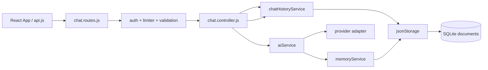
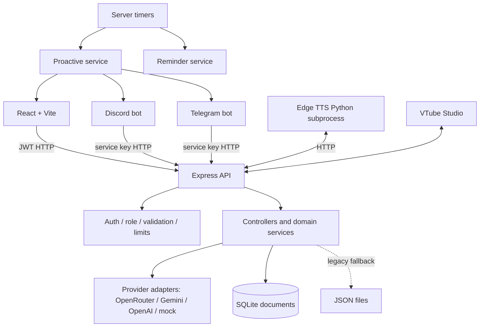

# Lucy Existing Architecture Audit

**Audit scope:** static inspection of current source, manifests, documentation, configuration examples, and tests. No source changes, tests, runtime, `.env`, database contents, or secret values inspected. Findings describe code paths, not measured runtime outcomes. “Not found” means absent from inspected code; it is not proof about external/manual processes.

## 1. Executive Summary

Lucy is a modular Node.js/Express application with React/Vite web client, SQLite-backed key/value document storage, JSON legacy fallback, LLM provider adapters, chat memory, platform bots, reminders, and a proactive-message scheduler. These are usable product foundations. Current proactive behavior is scheduled message generation, not an explicit autonomous cognitive/learning loop. No verified pipeline generates persistent learning goals, conducts evidence-based research, reflects on outcomes, or safely modifies its own code.

**Critical persistence risk:** `MemoryService.initialize()` checks legacy JSON file existence, then seeds through `saveJsonFile()`. The latter writes to SQLite. If expected JSON files are absent on a fresh deployment, this path can replace existing SQLite core/user/session documents with defaults on startup. This is a static control-flow finding; no live database was examined. Verify with a disposable test database before any production change.

Other verified concerns: scheduler state is process-local; core memory facts are not in chat system prompt; general rate limiter is defined but not mounted; TTS and several status endpoints are public; osu beatmap path lacks visible allowlist; docs/config contracts have mismatches. Tests were not run.

## 2. Verified Technology Stack

- **Backend:** Node.js, Express, ESM; dependencies and scripts in `backend/package.json` and root `package.json`.
- **Frontend:** React, Vite; `frontend/package.json`, `frontend/vite.config.js`.
- **Persistence:** `better-sqlite3` plus `sqlite` wrapper; `backend/src/storage/sqliteStorage.js`. JSON serialization/fallback lives in `backend/src/storage/jsonStorage.js`.
- **LLM providers:** OpenRouter, Gemini, OpenAI, mock implementations under `backend/src/services/ai/providers/`; selection/prompt orchestration in `aiService.js`.
- **Other integrations:** Discord.js, Telegraf, VTube Studio integration, Edge TTS Python subprocess, osu! beatmap parsing. Dependencies/config are in backend manifest and `backend/src/config/env.js`.
- **Tests:** Node test runner scripts and tests under `backend/test/`.
- **Runtime requirements mismatch:** README describes Node 16+, while frontend Vite dependency engine requires `^20.19.0 || >=22.12.0` (`frontend/package.json`).

## 3. Project Structure

- `backend/src/app.js`: Express middleware and route composition.
- `backend/src/server.js`: startup, service initialization, runtime schedulers/integrations.
- `backend/src/routes/`: API route declarations and middleware chains.
- `backend/src/controllers/`: HTTP orchestration.
- `backend/src/services/`: AI, auth, memory, reminders, voice, VTube, game services.
- `backend/src/middlewares/`: auth, role, validation, rate limiting, errors.
- `backend/src/storage/`: SQLite and JSON storage adapters.
- `backend/src/bots/`: Discord/Telegram adapters and access checks.
- `frontend/src/`: React app, components, API client and styles.
- `backend/test/`: unit/API/integration-style tests; `backend/data/`: persisted runtime data location.

**Pattern:** Express routes → controllers → service modules → JSON/SQLite storage. Frontend components call a centralized API helper. Bot adapters call backend APIs using service authentication. Startup composes long-lived schedulers and integrations. Services still import concrete storage/service modules directly; no general dependency-injection container was found.

## 4. Backend Architecture Map

### Startup and request flow

`backend/src/server.js` `startServer()` initializes memory, then starts reminder/proactive schedulers and VTube integration in runtime mode. Bots start only when `AUTO_START_BOTS=true` and credentials exist. `backend/src/app.js` mounts Helmet, Morgan, CORS, JSON body limit (1 MB), routes, 404 handling, and `errorHandler.middleware.js`.

Typical web chat path:

Route groups include auth, chat, memory, reminders, VTube, health, TTS, osu!, proactive, plus legacy `/chat` alias. Exact registrations are in `backend/src/app.js` and route files.

### Authentication and permissions

- Web session creation/authentication is implemented in `auth.controller.js` and `authService.js`; JWT middleware populates user/role context.
- Bot service-key auth and configured platform IDs appear in `auth.middleware.js` and `authService.js`; Discord/Telegram adapters also apply local access checks.
- Role restrictions use `role.middleware.js`; memory owner endpoints and proactive controls apply role checks in route declarations.
- Web authentication creates a generated user ID; it does not accept arbitrary `userId` from request body (`authenticateWebUser()` path).
- Public routes include health/status endpoints; TTS routes are mounted without visible auth middleware. Proactive status is public, while trigger/toggle routes apply owner restrictions.
- `generalRateLimiter` is defined but not mounted. Auth/session and chat have route-level limiters. Service-key identity alone does not bypass configured chat limiter unless resolved role is owner.

### Errors and logging

Express error handling is centralized in `backend/src/middlewares/errorHandler.middleware.js`; app-level logging uses Morgan and project logger in `backend/src/utils/logger.js`. Provider/service errors can propagate to controller middleware. No evidence found of a global durable background-job error queue or dead-letter mechanism.

## 5. Frontend Architecture Map

- `frontend/src/App.jsx`: application state, session/token handling, chat, notifications and integration toggles.
- `frontend/src/services/api.js`: backend requests and bearer-token handling.
- Components: `ChatWindow.jsx`, `Composer.jsx`, `Header.jsx`, `MemoryModal.jsx`, `RemindersModal.jsx`, `VTubeModal.jsx`, `OwnerLoginModal.jsx`, `NotificationToast.jsx`.
- Chat uses `/api/chat`; memory/reminders/VTube and notification UI depend on corresponding backend endpoints. Notification UI polls backend rather than receiving a verified push/WebSocket stream.
- Voice frontend fallback uses browser Web Speech APIs, but voice is disabled by default and Header toggle is commented out. Backend Edge TTS exists. No STT pipeline found.
- VTube UI emotion values do not fully match backend mapping: UI includes `marah`, `terkejut`, `berpikir`; backend mappings include different values such as `kesal`/`lucu`. Unknown values may be treated as raw expression filenames; `netral` maps to no expression request.

## 6. AI Processing Pipeline

1. `chat.routes.js` authenticates, applies chat rate limiter and validates input.
2. `chat.controller.js` loads prior conversation, marks user activity, supplies relevant proactive context where applicable, calls AI service, then stores user/assistant messages.
3. `aiService.js` selects configured available provider (OpenRouter, Gemini, OpenAI, or mock). External-provider chat commonly makes one LLM call to choose memory action, then another to generate response.
4. Prompt includes identity/personality/rules, selected user facts and temporary memory, chat history/current input, and role/context. `coreMemory.facts` are stored but not included in the system prompt.
5. Emotion detection is heuristic (`emotionDetector.js`) and can drive VTube behavior.
6. Provider errors: fallback responder is used for selected quota/credit failure paths; ordinary network/provider failures are not generally converted to mock responses. Retry/timeout behavior is provider-specific; no uniform cross-provider retry/timeout policy found.

**Cost/context:** extra memory-selection call increases normal chat request latency and API usage. History and memory limits exist, but no measured token accounting or global API budget was found. Actual token cost depends on provider/model/runtime settings and is unverified.

## 7. Memory Architecture

### Categories and lifecycle

`backend/src/services/memory/memoryService.js` holds core/persona memory, per-user long-term facts, session chat entries, temporary memory, and osu! skill data stored separately. These are not a four-type episodic/semantic/procedural/self architecture.

- **Create/update/delete:** model-selected memory actions can add/update/delete facts; user/owner endpoints expose memory operations. Services define duplicate/relevance handling; inspect exact operations in `memoryService.js` and `memory.controller.js`.
- **Temporary memory:** TTL is two hours; maximum 10 items, then pruning.
- **History:** maximum 10 message entries, i.e. up to roughly five user/assistant pairs, in `chatHistoryService.js`.
- **Retrieval:** keyword/relevance selection from available memory; no semantic vector retrieval or knowledge graph found.
- **Prompt integration:** selected user facts and temporary context are used. Core facts are not. Stored content therefore does not automatically equal reasoning context.
- **Provenance/revision:** no general source provenance, confidence scoring, immutable revision trail, or contradiction-resolution history found.

### Persistence warning

`backend/src/config/paths.js` defines canonical legacy JSON paths. During initialization, `MemoryService.initialize()` uses filesystem existence checks for selected JSON files to decide whether to seed. Seed writes call JSON storage API, which persists to SQLite. If those JSON files are absent while SQLite contains data, startup may overwrite stored documents with defaults. Confirm with isolated fixtures and add restart persistence tests before relying on existing data.

## 8. Proactive System Architecture

`backend/src/services/ai/proactiveThoughtService.js` uses an in-process interval (one minute), idle threshold (default 10 minutes), configured quiet hours (23:00–07:00 WIB), cooldown/escalation state and recent-message similarity filtering. It generates proactive question/thought/seeking/follow-up messages using configured modes/seeds and LLM/fallback logic, then dispatches over available bot channels or web notification queue.

This is scheduled proactive messaging, not verified multi-stage cognition: no explicit knowledge-gap analysis → persistent goal → plan/action → evidence evaluation → reflection loop found. Scheduler counters/last activity/toggle state are primarily process memory; restart resets them. Proactive text history is persisted separately in JSON. State/counters may be updated before delivery success, so failed delivery can affect subsequent escalation. No durable job queue/checkpoint/resume found.

Reminder scheduler is separate: `reminderService.js` polls every 15 seconds and `reminderDispatcher.js` delivers through bot channels or web notification queue. Reminder parsing uses local `Date`/`setHours`; timezone suffixes are not reliably enforced as WIB, and natural-language support is narrower than README examples.

## 9. Database and Persistence Analysis

`sqliteStorage.js` creates a single table `documents(key, value, updated_at)` with `CREATE TABLE IF NOT EXISTS`. Application objects are serialized into key/value records rather than normalized relational entities. `jsonStorage.js` reads SQLite first, uses JSON files as fallback for reads/migration, and writes through SQLite. No schema version table or ordered SQL migration framework was found. Legacy-file migration exists in memory initialization.

Persists: configured core/user/session memory documents, reminder data, notification/proactive history and other service documents routed through storage. Temporary memory is represented in memory data but expires/prunes by TTL. Scheduler runtime counters/timers and other in-process state are lost on restart. Relationships are mostly embedded in serialized JSON, not relational constraints. Backup/restore automation and crash-safe multi-document transactions were not verified. README claim of JSON/atomic writes does not match SQLite primary write path.

## 10. Security and Reliability Analysis

- Input validation and body limit: `validation.middleware.js`, `app.js`; chat validates message size/shape.
- Authentication/authorization: JWT and service key; role middleware for owner-only operations. Protect route omissions consistently.
- Rate limiting: auth/chat-specific limits; general limiter not mounted. Public TTS can launch a Python process for uncached text, creating resource-abuse risk.
- Secret handling: env-based configuration; secret values deliberately not inspected or included. Confirm `.env` exclusion and rotation procedures operationally.
- File access: `POST /api/game/osu/play` requires session auth, but supplied `beatmapPath` flows to parser file reading without a visible allowed-root check; path traversal/local-file exposure risk requires focused validation.
- Public status: health, VTube, osu and proactive status endpoints expose operational metadata; review necessity and sensitivity.
- Background work: timers run in main process; no durable queue, leader lock, overlap guard across replicas, or restart recovery found. Multiple server instances may duplicate scheduled actions.
- SQLite: synchronous `better-sqlite3` operations can block event loop; no load measurement. Startup-seeding concern above risks persistence loss.
- Documentation discrepancies: README describes JSON storage/atomic writes and offline fallback that do not match current primary storage/provider failure behavior. `SECURITY.md` claims broad public chat/general rate limiting inconsistently with actual chat auth and mounted limiters. `API_DOCS.md` omits or misstates several routes and access requirements.

## 11. Existing Test Coverage

Test files include `ai.test.js`, `api.test.js`, `auth.test.js`, `discordAccess.test.js`, `identity.test.js`, `memory.test.js`, `osu.test.js`, `proactive.test.js`, `rateLimiter.test.js`, `reminder.test.js`, `server.test.js`, `sqliteStorage.test.js`, `tts.test.js`, `vtube.test.js`, and `setup.js` under `backend/test/`.

Coverage targets provider/prompt/memory behavior, auth/routes, platform access, storage, reminder/proactive logic, TTS/VTube/osu, and server setup. Static inspection does not establish pass status. No tests were executed. Gaps to verify/add: SQLite restart without legacy JSON, failed delivery state accounting, concurrent/duplicate scheduler instances, public TTS abuse limits, osu path allowlisting, memory revision/provenance, and full chat pipeline provider failure/latency.

## 12. Dependency and Integration Map

Configuration is centralized in `backend/src/config/env.js`, constants in `constants.js`, paths in `paths.js`; root scripts delegate to backend/frontend. Exact package versions are in package manifests/lockfiles where present; audit did not install dependencies.

## 13. Technical Debt and Risks

1. Startup seed may reset SQLite memory documents when legacy JSON files are absent; highest data-integrity risk.
2. No versioned schema migrations; upgrades rely on table creation and ad hoc legacy migration.
3. Stored core facts not passed to reasoning prompt; UI core-memory display also incomplete.
4. Proactive process-local state loses continuity and delivery accounting can drift.
5. Public/resource-heavy routes lack consistent auth/rate limits; osu file path needs allowlisting.
6. Provider selection/fallback and memory selection have implicit cost/latency; no global budget/telemetry verified.
7. SQLite serialized document store couples storage layout to service keys and limits relational querying/integrity.
8. README, API docs, security docs and actual runtime differ; this raises operational/security risk.
9. UI/backend VTube emotion contract mismatch; voice toggle is unavailable in current UI.
10. Timezone-dependent reminder parsing can produce incorrect schedule times.

## 14. Verified Existing Capabilities

- Web chat with JWT session and validated request.
- Discord/Telegram adapters with configured access checks and backend service auth.
- Multiple selectable LLM provider adapters and mock provider.
- User facts and temporary memory with model-mediated memory operations.
- SQLite document persistence with JSON legacy-read/fallback path.
- Reminder scheduling and multi-channel/web notification delivery.
- Idle-triggered proactive message generation and delivery.
- Owner-protected memory/proactive controls, rate limits on selected routes.
- VTube Studio integration, emotion heuristics, Edge TTS backend, osu! utilities.
- Tests exist for listed domains; test results are not asserted here.

## 15. Unverified or Unclear Behaviors

- Production database contents, whether legacy JSON files exist in deployment, and whether startup reset has occurred.
- Real provider selection under each environment combination; live API latency, retry behavior, token usage, and costs.
- Actual delivery success and notification retention under failures/restarts.
- Multi-instance deployment behavior and duplicate timer execution.
- Effective secret protection, backups, restore drills, and filesystem permissions.
- Actual hardware performance on stated i5/12 GB system; no benchmark was run.
- Complete OS-level sandboxing or deployment network restrictions; none established by inspected application code.
- Any manual/external autonomous process not represented in this repository.

## Recommended Step 2 Focus

Before adding cognitive capabilities, isolate and verify the SQLite startup seeding/data-loss path with disposable test fixtures; add regression coverage for persistence across restart. Then review public route authorization/rate limits and osu path allowlisting. Preserve source behavior until these findings are confirmed and approved. This document does not perform gap-analysis implementation or target architecture design.

## 16. Evidence Verification

**Method:** static source and documentation inspection only. Line numbers refer to audited source snapshot and may shift with edits. No `.env`, active database contents, or secret values inspected. No app or tests run. “VERIFIED STATIC” confirms code structure/control flow, not that a risk occurred in deployment. “PARTIALLY VERIFIED” marks behavior or impact that depends on untested runtime/environment conditions.

| Finding | File and Function | Code Location | Evidence | Verification Status | Conditions / Limitations |
|---|---|---|---|---|---|
| SQLite startup seeding may overwrite existing memory documents | `MemoryService.initialize()`, `saveJsonFile()`, `writeDocument()` | `backend/src/services/memory/memoryService.js:23-58`; `backend/src/storage/jsonStorage.js:22`; `backend/src/storage/sqliteStorage.js:35`; paths in `backend/src/config/paths.js:15` | `initialize()` checks `fs.existsSync()` for core, user, and session JSON paths; for each missing file it calls `saveJsonFile(path, defaults)`. `saveJsonFile()` writes through storage `writeDocument()`; SQLite stores by document key, replacing that key's value. Legacy migration runs afterward. | VERIFIED STATIC | Actual overwrite requires expected JSON paths to be absent while corresponding SQLite keys already contain data. File/database state was not inspected; no actual loss is claimed. |
| Core memory facts omitted from chat system prompt | `AIService.buildSystemPrompt()`, `AIService.generateReply()` | `backend/src/services/ai/aiService.js:40-43,83-112,133-157` | Prompt builder reads `coreMemory.identity`, `.personality`, and `.rules`; it builds user-memory and temporary-memory sections, but does not read/interpolate `coreMemory.facts`. `generateReply()` fetches core memory before calling the builder. | VERIFIED STATIC | Confirms omission from this system prompt path; does not rule out a separate injection path elsewhere. |
| Scheduler runtime state is not persisted across restart | `ProactiveThoughtService` constructor/history persistence/start scheduler | `backend/src/services/ai/proactiveThoughtService.js:123-160,501` | Counters/timestamps/message/dispatch fields initialize as instance properties. Recent text history is explicitly loaded/saved to `proactiveHistory.json`; no equivalent persistence found for runtime counters or timer state. | PARTIALLY VERIFIED | A process restart recreates instance state; exact behavior depends on constructor defaults and initialization. No restart was executed. Persisted history does not imply persisted scheduler state. |
| Proactive state advances before platform delivery confirmation | `triggerSpontaneousThought()`, dispatch helpers | `backend/src/services/ai/proactiveThoughtService.js:389-413,441-493` | Ping time/count, history and in-app notification update before awaited platform dispatch. Platform failures are caught/logged and dispatch returns success status, but prior updates are not rolled back. | VERIFIED STATIC | State drift occurs when relevant platform delivery fails; in-app notification may still have been recorded. No live delivery was attempted. |
| General rate limiter is defined but not mounted globally | `generalRateLimiter`; Express app composition | `backend/src/middlewares/rateLimiter.middleware.js:66`; `backend/src/app.js:41-55` | Export exists; app mounts route groups without applying this limiter as global middleware. Auth/session and chat routes define specific limiters. | VERIFIED STATIC | Other infrastructure-level limits (proxy, gateway, hosting) were not inspected. |
| TTS routes show no authentication middleware | TTS route declarations and controller | `backend/src/routes/tts.routes.js:6`; `backend/src/controllers/tts.controller.js:4`; mount `backend/src/app.js:47` | GET/POST route directly invokes `handleTts`; controller validates text and streams output without auth middleware in this path. | VERIFIED STATIC | Confirms application route wiring, not network exposure in deployed infrastructure. |
| `beatmapPath` has no visible allowed-root validation | `/play` route, controller, parser | `backend/src/routes/osu.routes.js:9`; `backend/src/controllers/osu.controller.js:18`; `backend/src/services/game/osu/beatmapParser.js:90` | Route requires authentication; controller accepts supplied path; parser checks existence and reads it, with no visible canonical-path containment/allowlist check. | PARTIALLY VERIFIED | Practical impact depends on authenticated access, OS permissions, and response handling. No request was executed; no file read was attempted. |
| README storage/rate-limit/session claims mismatch current code | README and storage/constants/middleware | `README.md:27,44,55`; `backend/src/config/constants.js:18-19`; `backend/src/storage/jsonStorage.js:22`; `backend/src/app.js:41-55` | README describes session memory as two hours, all-endpoint rate limits, and JSON/atomic writes. Code assigns two-hour TTL to temporary memory, limits history by entries, writes through SQLite, and does not mount general limiter. | VERIFIED STATIC | README wording may describe intended behavior or another deployment revision; audit compares current checked-in source only. |
| SECURITY rate-limit/bot-bypass claims mismatch | SECURITY and limiter/auth code | `SECURITY.md:28-29`; `backend/src/middlewares/rateLimiter.middleware.js:27,66`; `backend/src/services/auth/authService.js:125` | SECURITY claims general per-endpoint limit and bot service-key bypass. General limiter is unmounted; limiter bypass is based on owner role, not `isBotService` alone. | VERIFIED STATIC | Reverse proxy or deployment controls could add limits; not inspected. |
| API docs omit routes/access annotations | `API_DOCS.md`, route mount/declarations | `backend/API_DOCS.md:86`; `backend/src/routes/memory.routes.js:17`; `backend/src/app.js:47` | Docs show core-memory GET without owner requirement; route requires auth and owner role. App mounts TTS, osu, proactive routes not represented in API endpoint list. | VERIFIED STATIC | Documentation may be incomplete by design; compared with current route files. |
| Memory retrieval happens before response prompt construction | `chat.controller.js`, `AIService.generateReply()`, `processChatMessageWithAI()` | `backend/src/controllers/chat.controller.js:13`; `backend/src/services/ai/aiService.js:117-157`; `backend/src/services/memory/memoryService.js:329-354` | Controller loads history before calling AI service. AI service selects provider, calls memory processing, reloads core/user memory, then builds prompt. Memory processing may itself invoke provider completion. | VERIFIED STATIC | Exact number of provider calls varies by provider and memory action; no live call or cost measurement performed. |
| History truncation counts messages, not conversational pairs | `chatHistoryService` and prompt construction | `backend/src/services/memory/chatHistoryService.js:35`; `backend/src/services/ai/aiService.js:157` | Stored history is capped at 10 role/content entries. Prompt separately adds up to the last six entries in recent-context text; provider messages also include the full supplied history and current user message. | VERIFIED STATIC | The extra context representation can duplicate recent history in prompt text; provider-specific tokenization was not measured. |
| Proactive interval lacks visible in-flight overlap guard | `startScheduler()` interval callback | `backend/src/services/ai/proactiveThoughtService.js:501,521` | Async interval callback invokes trigger; no visible lock/in-flight flag around that work. | PARTIALLY VERIFIED | Overlap requires one execution to exceed the tick interval and scheduler to remain active. No timing/runtime test performed. |
| Proactive restart recovery | scheduler initialization and history functions | `backend/src/services/ai/proactiveThoughtService.js:123-160,501` | Text history is persisted; timer/counters/dispatch state are in-memory fields. No durable jobs/checkpoint/resume path found in inspected implementation. | PARTIALLY VERIFIED | Confirms no visible recovery mechanism in this service; external process manager behavior was not inspected. |
| Provider choice vs request-time fallback | `getProvider()`, `generateReply()`, `isQuotaOrCreditError()` | `backend/src/services/ai/aiService.js:25-37,117-129,192-225` | Before request, configured/requested provider is used if available, else first available provider, else mock. During completion, quota/credit errors retry same provider at lower token cap then use contextual heuristic fallback; other errors are thrown, not switched to another provider. | VERIFIED STATIC | Provider `isAvailable()` behavior and provider-specific timeouts/retries are adapter-defined; no network behavior tested. |
| Background error handling differs by task | server startup, proactive/reminder/TTS/osu callbacks | `backend/src/server.js:39,103`; `backend/src/services/ai/proactiveThoughtService.js:521`; `backend/src/services/reminder/reminderService.js:68-72`; `backend/src/services/reminder/reminderDispatcher.js:25`; `backend/src/services/voice/edgeTtsService.js:95,113`; `backend/src/services/game/osu/osuGameService.js:97,137` | Server logs startup/uncaught failures and initiates shutdown; proactive tick catches errors; reminder removes due entries before dispatch and logs rejected dispatch without restoring; dispatcher catches platform send errors and may use in-app fallback; TTS observes child error/close; osu timeout callback has no local catch visible. | PARTIALLY VERIFIED | This audits selected background paths, not every asynchronous task or operational process. Runtime error outcomes and shutdown behavior were not exercised. |

### Three Critical Findings: Detailed Evidence

#### SQLite startup seeding

1. `MemoryService.initialize()` (`backend/src/services/memory/memoryService.js:23-58`) returns only if instance `initialized` is already true, ensures data directories, then checks each of `CORE_MEMORY_FILE`, `USER_MEMORY_FILE`, and `SESSION_MEMORY_FILE` with `fs.existsSync()`.
2. If `CORE_MEMORY_FILE` is absent, it calls `saveJsonFile(CORE_MEMORY_FILE, defaultCore)`; if user/session paths are absent, it calls `saveJsonFile()` with `{ users: {} }` defaults.
3. `saveJsonFile()` in `backend/src/storage/jsonStorage.js:22` routes the write through `writeDocument()`; this is not a direct write creating the checked JSON file.
4. `writeDocument()` in `backend/src/storage/sqliteStorage.js:35` writes the serialized document under its key in SQLite. The path-like key comes from `backend/src/config/paths.js`; an existing key can therefore receive the seed value.
5. A SQLite overwrite risk exists if a checked JSON file is absent while the corresponding SQLite document key already has non-default data. The missing JSON file continues to trigger the seed because SQLite presence is not what `existsSync()` tests. `migrateLegacyFiles()` follows seeding and may copy legacy root files if present.

**Status:** VERIFIED STATIC control-flow risk. Whether those files are absent or SQLite documents contain user data is UNVERIFIED. No active database was inspected, so this report does not claim data loss occurred.

#### Core memory prompt integration

`AIService.generateReply()` retrieves core memory (`aiService.js:133`) and passes it to `buildSystemPrompt()`. The builder reads identity, personality, and rules (`aiService.js:40-43`) and formats those plus user and temporary memory sections (`:46-112`). It does not read `coreMemory.facts`, despite that field existing in initialization data. Therefore those core facts are not injected by this system prompt builder. User facts and temporary memory are separately included. Finding is VERIFIED STATIC for this response path; no other prompt injection path was identified in the inspected function.

#### Scheduler persistence

`ProactiveThoughtService` initializes counters/timestamps/flags on the service instance (`proactiveThoughtService.js:123+`). The service explicitly persists recent text history (`:142-160`), but scheduler timing and dispatch counters are not stored by that mechanism. `startScheduler()` installs an in-process interval (`:501`); no checkpoint/recovery load is visible for those fields. A process restart recreates the service and timer, so runtime state relies on constructor defaults while persisted text history may remain. This verifies absence of persistence in the inspected service path, not the behavior of external supervisors or any uninspected persistence mechanism.
